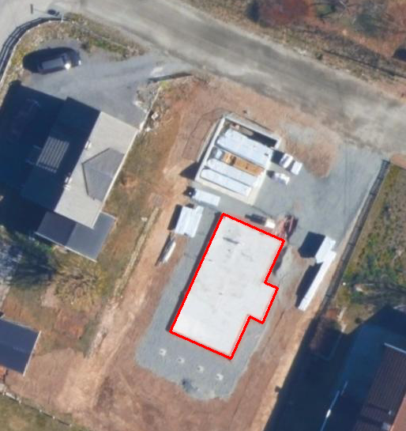
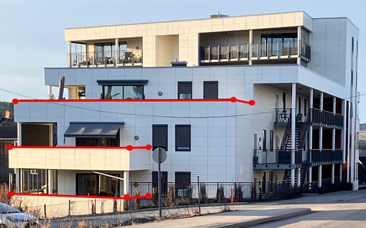

*Pakkens definisjon:* Datamodell for produktspesfikasjonen FKB-Bygning. FKB-Bygning inneholder detaljert bygningsinformasjon. Datamodellen omfatter beskrivelse av alle typer bygninger, takoverbygg, beskrivende bygningslinjer (for eksempel m&#248;nelinje) samt bygningsvedheng (for eksempel veranda).
 
===== Tagged Values
[cols="20,80"]
|===
|definition
|"FKB-Bygning contains detailed topographic building in 2.5D"@en
 
|description
|"Contains building surface, contour lines describing the builing and objects connected to the building" @en
 
|designation
|"Product specification FKB-Bygning 5.0"@en
 
|language
|no
 
|SOSI_kortnavn
|FKBBygning
 
|SOSI_langnavn
|FKB-Bygning
 
|SOSI_modellstatus
|gyldig
 
|SOSI_spesifikasjonstype
|produktspesifikasjon
 
|SOSI_versjon
|5.0
 
|targetNamespace
|http://skjema.geonorge.no/SOSI/registreringsinstruks/FKB-Bygning/5.0/Fotogrammetrisk_2022-01-01
 
|version
|5.0
 
|xmlns
|app
 
|xsdDocument
|FKBBygning.xsd
 
|xsdEncodingRule
|sosi
 
|===
[caption="Figur  ",title=Pakkerealisering]
image::Pakkerealisering.png[Pakkerealisering, Alt="Diagramm: Pakkerealisering"]
[caption="Figur  ",title=Oversiktsdiagram FKB-Bygning]
image::Oversiktsdiagram FKB-Bygning.png[Oversiktsdiagram FKB-Bygning, Alt="Diagramm: Oversiktsdiagram FKB-Bygning"]
*Pakkens definisjon:* Inneholder elementer fra FKB Generell del 5.0
[caption="Figur  ",title=Oversiktsdiagram Fellesegenskaper]
image::Oversiktsdiagram Fellesegenskaper.png[Oversiktsdiagram Fellesegenskaper, Alt="Diagramm: Oversiktsdiagram Fellesegenskaper"]
[caption="Figur  ",title=Realisering fra SOSI generell del]
image::Realisering fra SOSI generell del.png[Realisering fra SOSI generell del, Alt="Diagramm: Realisering fra SOSI generell del"]
[caption="Figur  ",title=Hoveddiagram Posisjonskvalitet]
image::Hoveddiagram Posisjonskvalitet.png[Hoveddiagram Posisjonskvalitet, Alt="Diagramm: Hoveddiagram Posisjonskvalitet"]
 
<<<
'''
 
[[fellesegenskaper]]
=== Objekttype: Fellesegenskaper
 
[discrete]
==== Tilleggsinformasjon for fotogrammetrisk registrering
abstrakt objekttype som b&#230;rer sentrale egenskaper som er anbefalt for bruk i produktspesifikasjoner.
 
 
[discrete]
==== Føringer
[cols="h,2"]
|===
|===
 
 
<<<
 
[discrete]
==== Egenskapstabell for objekttype: Fellesegenskaper
[cols="20,20,20,10", options="header"]
|===
|*Navn:* 
|*Type:* 
|*SOSI_navn:* 
|*Mult.:* 
 
|identifikasjon
|«dataType» Identifikasjon
|..IDENT
|[0..1]
 
|identifikasjon.lokalId
|CharacterString
|...LOKALID
|[1..1]
 
|identifikasjon.navnerom
|CharacterString
|...NAVNEROM
|[1..1]
 
|identifikasjon.versjonId
|CharacterString
|...VERSJONID
|[0..1]
 
|oppdateringsdato
|DateTime
|..OPPDATERINGSDATO
|[0..1]
 
|sluttdato
|DateTime
|..SLUTTDATO
|[0..1]
 
|datafangstdato
|Date
|..DATAFANGSTDATO
|[1..1]
 
|verifiseringsdato
|Date
|..VERIFISERINGSDATO
|[0..1]
 
|registreringsversjon
| «CodeList»  https://register.geonorge.no/sosi-kodelister/fkb/generell/5.0/registreringsversjon[Registreringsversjon, window = _blank]
|..REGISTRERINGSVERSJON
|[0..1]
 
|informasjon
|CharacterString
|..INFORMASJON
|[0..1]
 
|===
===== Roller
[cols="20,80"]
|===
|Generalisering av:
|«featureType» Bygning +
«featureType» Takoverbygg +
«featureType» AnnenBygning +
«featureType» Bygningsdelelinje +
«FeatureType» KvalitetOpsjonell +
«FeatureType» KvalitetPåkrevd
|===
 
<<<
'''
 
[[kvalitetpåkrevd]]
=== Objekttype: KvalitetPåkrevd
*Definisjon fra FKB produktspesifikasjon*: abstrakt objekttype som b&#230;rer sentrale egenskaper som er anbefalt for bruk i produktspesifikasjoner.
 
 
[discrete]
==== Tilleggsinformasjon for fotogrammetrisk registrering
abstrakt objekttype med p&#229;krevet kvalitetsangivelse
 
 
[discrete]
==== Føringer
[cols="h,2"]
|===
|===
 
 
<<<
 
[discrete]
==== Egenskapstabell for objekttype: KvalitetPåkrevd
[cols="20,20,20,10", options="header"]
|===
|*Navn:* 
|*Type:* 
|*SOSI_navn:* 
|*Mult.:* 
 
|identifikasjon
|«dataType» Identifikasjon
|..IDENT
|[0..1]
 
|identifikasjon.lokalId
|CharacterString
|...LOKALID
|[1..1]
 
|identifikasjon.navnerom
|CharacterString
|...NAVNEROM
|[1..1]
 
|identifikasjon.versjonId
|CharacterString
|...VERSJONID
|[0..1]
 
|oppdateringsdato
|DateTime
|..OPPDATERINGSDATO
|[0..1]
 
|sluttdato
|DateTime
|..SLUTTDATO
|[0..1]
 
|datafangstdato
|Date
|..DATAFANGSTDATO
|[1..1]
 
|verifiseringsdato
|Date
|..VERIFISERINGSDATO
|[0..1]
 
|registreringsversjon
| «CodeList»  https://register.geonorge.no/sosi-kodelister/fkb/generell/5.0/registreringsversjon[Registreringsversjon, window = _blank]
|..REGISTRERINGSVERSJON
|[0..1]
 
|informasjon
|CharacterString
|..INFORMASJON
|[0..1]
 
|kvalitet
|«dataType» Posisjonskvalitet
|..KVALITET
|[1..1]
 
|kvalitet.datafangstmetode
| «CodeList»  https://register.geonorge.no/sosi-kodelister/fkb/generell/5.0/datafangstmetode[Datafangstmetode, window = _blank]
|...DATAFANGSTMETODE
|[1..1]
 
|kvalitet.nøyaktighet
|Integer
|...NØYAKTIGHET
|[0..1]
 
|kvalitet.synbarhet
| «CodeList»  https://register.geonorge.no/sosi-kodelister/fkb/generell/5.0/synbarhet[Synbarhet, window = _blank]
|...SYNBARHET
|[0..1]
 
|kvalitet.datafangstmetodeHøyde
| «CodeList»  https://register.geonorge.no/sosi-kodelister/fkb/generell/5.0/datafangstmetode[Datafangstmetode, window = _blank]
|...DATAFANGSTMETODEHØYDE
|[0..1]
 
|kvalitet.nøyaktighetHøyde
|Integer
|...H-NØYAKTIGHET
|[0..1]
 
|===
===== Roller
[cols="20,80"]
|===
|Generalisering av:
|«featureType» Bygningsvedheng +
«featureType» TakoverbyggKant +
«featureType» BeskrivendeBygningsdetalj +
«featureType» Bygningsavgrensning
|===
 
<<<
'''
 
[[kvalitetopsjonell]]
=== Objekttype: KvalitetOpsjonell
*Definisjon fra FKB produktspesifikasjon*: abstrakt objekttype som b&#230;rer sentrale egenskaper som er anbefalt for bruk i produktspesifikasjoner.
 
 
[discrete]
==== Tilleggsinformasjon for fotogrammetrisk registrering
abstrakt objekttype med valgfri kvalitetsangivelse
 
 
[discrete]
==== Føringer
[cols="h,2"]
|===
|===
 
 
<<<
 
[discrete]
==== Egenskapstabell for objekttype: KvalitetOpsjonell
[cols="20,20,20,10", options="header"]
|===
|*Navn:* 
|*Type:* 
|*SOSI_navn:* 
|*Mult.:* 
 
|identifikasjon
|«dataType» Identifikasjon
|..IDENT
|[0..1]
 
|identifikasjon.lokalId
|CharacterString
|...LOKALID
|[1..1]
 
|identifikasjon.navnerom
|CharacterString
|...NAVNEROM
|[1..1]
 
|identifikasjon.versjonId
|CharacterString
|...VERSJONID
|[0..1]
 
|oppdateringsdato
|DateTime
|..OPPDATERINGSDATO
|[0..1]
 
|sluttdato
|DateTime
|..SLUTTDATO
|[0..1]
 
|datafangstdato
|Date
|..DATAFANGSTDATO
|[1..1]
 
|verifiseringsdato
|Date
|..VERIFISERINGSDATO
|[0..1]
 
|registreringsversjon
| «CodeList»  https://register.geonorge.no/sosi-kodelister/fkb/generell/5.0/registreringsversjon[Registreringsversjon, window = _blank]
|..REGISTRERINGSVERSJON
|[0..1]
 
|informasjon
|CharacterString
|..INFORMASJON
|[0..1]
 
|kvalitet
|«dataType» Posisjonskvalitet
|..KVALITET
|[0..1]
 
|kvalitet.datafangstmetode
| «CodeList»  https://register.geonorge.no/sosi-kodelister/fkb/generell/5.0/datafangstmetode[Datafangstmetode, window = _blank]
|...DATAFANGSTMETODE
|[1..1]
 
|kvalitet.nøyaktighet
|Integer
|...NØYAKTIGHET
|[0..1]
 
|kvalitet.synbarhet
| «CodeList»  https://register.geonorge.no/sosi-kodelister/fkb/generell/5.0/synbarhet[Synbarhet, window = _blank]
|...SYNBARHET
|[0..1]
 
|kvalitet.datafangstmetodeHøyde
| «CodeList»  https://register.geonorge.no/sosi-kodelister/fkb/generell/5.0/datafangstmetode[Datafangstmetode, window = _blank]
|...DATAFANGSTMETODEHØYDE
|[0..1]
 
|kvalitet.nøyaktighetHøyde
|Integer
|...H-NØYAKTIGHET
|[0..1]
 
|===
===== Roller
[cols="20,80"]
|===
|Generalisering av:
|«featureType» FiktivBygningsavgrensning +
«featureType» BygningsavgrensningTiltak
|===
 
<<<
'''
 
[[identifikasjon]]
=== Objekttype: Identifikasjon
 
[discrete]
==== Tilleggsinformasjon for fotogrammetrisk registrering
Unik identifikasjon av et objekt i et datasett, forvaltet av den ansvarlige produsent/forvalter, og kan benyttes av eksterne applikasjoner som stabil referanse til objektet. 

Merknad 1: Denne objektidentifikasjonen må ikke forveksles med en tematisk objektidentifikasjon, slik som f.eks bygningsnummer. 

Merknad 2: Denne unike identifikatoren vil ikke endres i løpet av objektets levetid, og ikke gjenbrukes i andre objekt. 
 
 
[discrete]
==== Føringer
[cols="h,2"]
|===
|===
 
 
<<<
 
[discrete]
==== Egenskapstabell for objekttype: Identifikasjon
[cols="20,20,20,10", options="header"]
|===
|*Navn:* 
|*Type:* 
|*SOSI_navn:* 
|*Mult.:* 
 
|lokalId
|CharacterString
|..LOKALID
|[1..1]
 
|navnerom
|CharacterString
|..NAVNEROM
|[1..1]
 
|versjonId
|CharacterString
|..VERSJONID
|[0..1]
 
|===
 
<<<
'''
 
[[posisjonskvalitet]]
=== Objekttype: Posisjonskvalitet
 
[discrete]
==== Tilleggsinformasjon for fotogrammetrisk registrering
beskrivelse av kvaliteten p&#229; stedfestingen.

Merknad:
Posisjonskvalitet er ikke konform med  kvalitetsmodellen i ISO slik den er defineret i ISO19157:2013, men er en videref&#248;ring av tildligere brukte kvalitetsegenskaper i SOSI. FKB 5.0 innf&#248;rer en egen variant av datatypen Posisjonskvalitet der kodeliste m&#229;lemetode er byttet ut med den mer generelle kodelista Datafangstmetode. 
 
 
[discrete]
==== Føringer
[cols="h,2"]
|===
|===
 
 
<<<
 
[discrete]
==== Egenskapstabell for objekttype: Posisjonskvalitet
[cols="20,20,20,10", options="header"]
|===
|*Navn:* 
|*Type:* 
|*SOSI_navn:* 
|*Mult.:* 
 
|datafangstmetode
| «CodeList»  https://register.geonorge.no/sosi-kodelister/fkb/generell/5.0/datafangstmetode[Datafangstmetode, window = _blank]
|..DATAFANGSTMETODE
|[1..1]
 
|nøyaktighet
|Integer
|..NØYAKTIGHET
|[0..1]
 
|synbarhet
| «CodeList»  https://register.geonorge.no/sosi-kodelister/fkb/generell/5.0/synbarhet[Synbarhet, window = _blank]
|..SYNBARHET
|[0..1]
 
|datafangstmetodeHøyde
| «CodeList»  https://register.geonorge.no/sosi-kodelister/fkb/generell/5.0/datafangstmetode[Datafangstmetode, window = _blank]
|..DATAFANGSTMETODEHØYDE
|[0..1]
 
|nøyaktighetHøyde
|Integer
|..H-NØYAKTIGHET
|[0..1]
 
|===
===== Roller
[discrete]
==== Restriksjoner
[cols="20,80", options="header"]
 
|===
|*Navn:* 
|*Beskrivelse:* 
 
|ugyldige datafangstmetoder for høyde
|inv: self.datafangstmetodeH&#248;yde &lt;&gt; 'dig'
--Datafangstmetode Digitalisert skal ikke brukes p&#229; egenskapen datafangstmetodeH&#248;yde
 
|===
*Pakkens definisjon:* Inneholder elementer fra SOSI Bygg 4.5, Bygningspunkt
[caption="Figur  ",title=Oversiktsdiagram Bygning]
image::Oversiktsdiagram Bygning.png[Oversiktsdiagram Bygning, Alt="Diagramm: Oversiktsdiagram Bygning"]
[caption="Figur  ",title=Realisering fra Bygg 4.5 - Bygningspunkt]
image::Realisering fra Bygg 4.5 - Bygningspunkt.png[Realisering fra Bygg 4.5 - Bygningspunkt, Alt="Diagramm: Realisering fra Bygg 4.5 - Bygningspunkt"]
[caption="Figur  ",title=Hoveddiagram Bygning - objekttyper og kodelister]
image::Hoveddiagram Bygning - objekttyper og kodelister.png[Hoveddiagram Bygning - objekttyper og kodelister, Alt="Diagramm: Hoveddiagram Bygning - objekttyper og kodelister"]
[caption="Figur  ",title=Hoveddiagram Bygning - flateavgrensning]
image::Hoveddiagram Bygning - flateavgrensning.png[Hoveddiagram Bygning - flateavgrensning, Alt="Diagramm: Hoveddiagram Bygning - flateavgrensning"]
 
<<<
'''
 
[[bygning]]
=== Objekttype: Bygning
*Definisjon fra FKB produktspesifikasjon*: abstrakt objekttype som b&#230;rer sentrale egenskaper som er anbefalt for bruk i produktspesifikasjoner.
 
 
.Illustrasjon av objekttype Bygning
image::http://skjema.geonorge.no/SOSI/produktspesifikasjon/FKB-Bygning/5.0/figurer/objtype_bygning.png[link=http://skjema.geonorge.no/SOSI/produktspesifikasjon/FKB-Bygning/5.0/figurer/objtype_bygning.png, Alt="Illustrasjon av objekttype: Bygning"]
 
 
[discrete]
==== Tilleggsinformasjon for fotogrammetrisk registrering
bygning som er registrert i matrikkelen
 
 
[discrete]
==== Føringer
[cols="h,2"]
|===
|===
 
 
<<<
 
[discrete]
==== Egenskapstabell for objekttype: Bygning
[cols="20,20,20,10", options="header"]
|===
|*Navn:* 
|*Type:* 
|*SOSI_navn:* 
|*Mult.:* 
 
|identifikasjon
|«dataType» Identifikasjon
|..IDENT
|[0..1]
 
|identifikasjon.lokalId
|CharacterString
|...LOKALID
|[1..1]
 
|identifikasjon.navnerom
|CharacterString
|...NAVNEROM
|[1..1]
 
|identifikasjon.versjonId
|CharacterString
|...VERSJONID
|[0..1]
 
|oppdateringsdato
|DateTime
|..OPPDATERINGSDATO
|[0..1]
 
|sluttdato
|DateTime
|..SLUTTDATO
|[0..1]
 
|datafangstdato
|Date
|..DATAFANGSTDATO
|[1..1]
 
|verifiseringsdato
|Date
|..VERIFISERINGSDATO
|[0..1]
 
|registreringsversjon
| «CodeList»  https://register.geonorge.no/sosi-kodelister/fkb/generell/5.0/registreringsversjon[Registreringsversjon, window = _blank]
|..REGISTRERINGSVERSJON
|[0..1]
 
|informasjon
|CharacterString
|..INFORMASJON
|[0..1]
 
|område
|GM_Surface
|.FLATE
|[0..1]
 
|posisjon
|GM_Point
|.PUNKT
|[1..1]
 
|bygningsnummer
|«dataType» Integer
|..BYGGNR
|[1..1]
 
|bygningstype
| «CodeList»  https://register.geonorge.no/sosi-kodelister/fkb/bygning/5.0/bygningstype[Bygningstype, window = _blank]
|..BYGGTYP_NBR
|[1..1]
 
|bygningsstatus
| «CodeList»  https://register.geonorge.no/sosi-kodelister/fkb/bygning/5.0/bygningsstatus[Bygningsstatus, window = _blank]
|..BYGGSTAT
|[1..1]
 
|kommunenummer
| «CodeList»  https://register.geonorge.no/sosi-kodelister/kommunenummer-alle[Kommunenummer, window = _blank]
|..KOMM
|[1..1]
 
|medium
| «CodeList»  https://register.geonorge.no/sosi-kodelister/fkb/generell/5.0/medium[Medium, window = _blank]
|..MEDIUM
|[1..1]
 
|vedhengTilBygning
|«featureType» Bygningsvedheng
|..VEDHENGTILBYGNING
|[0..*]
|beskriverBygning
|«featureType» BeskrivendeBygningsdetalj
|..BESKRIVERBYGNING
|[0..*]
|===
===== Roller
[cols="20,80"]
|===
|*Rollenavn:* 
|*vedhengTilBygning*
 
|Definisjon:
|Bygning kjenner sine vedheng
 
|Multiplisitet: 
|[0..*]
 
|Til klasse
|«featureType» Bygningsvedheng
|===
[cols="20,80"]
|===
|*Rollenavn:* 
|*beskriverBygning*
 
|Definisjon:
|bygningen kjenner hvilke beskrivede bygningsdetaljer som tilhører bygningen
 
|Multiplisitet: 
|[0..*]
 
|Til klasse
|«featureType» BeskrivendeBygningsdetalj
|===
[cols="20,80"]
|===
|*Rollenavn:* 
|*avgrensesAvBygningsavgrensningTiltak*
 
|Definisjon:
|Krav til delt flategeometri. Avgrensning av bygning ved hjelp av geometriobjekter fra tiltaksbasen.
 
|Multiplisitet: 
|[0..*]
 
|Til klasse
|«featureType» BygningsavgrensningTiltak
|===
[cols="20,80"]
|===
|*Rollenavn:* 
|*avgrensesAvBygningsdelelinje*
 
|Definisjon:
|Krav til delt flategeometri. Avgrensning av bygning ved hjelp av bygningsdelelinje
 
|Multiplisitet: 
|[0..*]
 
|Til klasse
|«featureType» Bygningsdelelinje
|===
[cols="20,80"]
|===
|*Rollenavn:* 
|*avgrensesAvFiktivBygningsavgrensning*
 
|Definisjon:
|Krav til delt flategeometri. Avgrensning av bygning med en fiktiv avgrensningslinje
 
|Multiplisitet: 
|[0..*]
 
|Til klasse
|«featureType» FiktivBygningsavgrensning
|===
[cols="20,80"]
|===
|*Rollenavn:* 
|*avgrensesAvBygningsavgrensning*
 
|Definisjon:
|Krav til delt flategeometri. Avgrensning av bygning med en innmålt avgrensningslinje
 
|Multiplisitet: 
|[0..*]
 
|Til klasse
|«featureType» Bygningsavgrensning
|===
[cols="20,80"]
|===
|Generalisering av:
|«FeatureType» Bygning
|===
[discrete]
==== Restriksjoner
[cols="20,80", options="header"]
 
|===
|*Navn:* 
|*Beskrivelse:* 
 
|avgrensningsobjekter i samsvar med områdegeometri
|--ingen OCL, restriksjonen implementeres manuelt
--Omr&#229;de-geometrien skal v&#230;re lik summen av geometriene til de assosierte avgrensningsobjektene
 
|posisjon innenfor område
|--ingen OCL, restriksjonen implementeres manuelt
--Dersom det finnes omr&#229;de-geometri skal posisjon-geometrien ligge innenfor omr&#229;de-geometrien
 
|===
 
<<<
'''
 
[[annenbygning]]
=== Objekttype: AnnenBygning
*Definisjon fra FKB produktspesifikasjon*: abstrakt objekttype som b&#230;rer sentrale egenskaper som er anbefalt for bruk i produktspesifikasjoner.
 
 
.Illustrasjon av objekttype AnnenBygning
image::http://skjema.geonorge.no/SOSI/produktspesifikasjon/FKB-Bygning/5.0/figurer/objtype_annenbygning.png[link=http://skjema.geonorge.no/SOSI/produktspesifikasjon/FKB-Bygning/5.0/figurer/objtype_annenbygning.png, Alt="Illustrasjon av objekttype: AnnenBygning"]
 
 
[discrete]
==== Tilleggsinformasjon for fotogrammetrisk registrering
bygning som ikke er registrert  i matrikkelen
 
 
[discrete]
==== Føringer
[cols="h,2"]
|===
|===
 
 
<<<
 
[discrete]
==== Egenskapstabell for objekttype: AnnenBygning
[cols="20,20,20,10", options="header"]
|===
|*Navn:* 
|*Type:* 
|*SOSI_navn:* 
|*Mult.:* 
 
|identifikasjon
|«dataType» Identifikasjon
|..IDENT
|[0..1]
 
|identifikasjon.lokalId
|CharacterString
|...LOKALID
|[1..1]
 
|identifikasjon.navnerom
|CharacterString
|...NAVNEROM
|[1..1]
 
|identifikasjon.versjonId
|CharacterString
|...VERSJONID
|[0..1]
 
|oppdateringsdato
|DateTime
|..OPPDATERINGSDATO
|[0..1]
 
|sluttdato
|DateTime
|..SLUTTDATO
|[0..1]
 
|datafangstdato
|Date
|..DATAFANGSTDATO
|[1..1]
 
|verifiseringsdato
|Date
|..VERIFISERINGSDATO
|[0..1]
 
|registreringsversjon
| «CodeList»  https://register.geonorge.no/sosi-kodelister/fkb/generell/5.0/registreringsversjon[Registreringsversjon, window = _blank]
|..REGISTRERINGSVERSJON
|[0..1]
 
|informasjon
|CharacterString
|..INFORMASJON
|[0..1]
 
|område
|GM_Surface
|.FLATE
|[1..1]
 
|posisjon
|GM_Point
|.PUNKT
|[0..1]
 
|medium
| «CodeList»  https://register.geonorge.no/sosi-kodelister/fkb/generell/5.0/medium[Medium, window = _blank]
|..MEDIUM
|[1..1]
 
|vedhengTilAnnenBygning
|«featureType» Bygningsvedheng
|..VEDHENGTILANNENBYGNING
|[0..*]
|beskriverAnnenBygning
|«featureType» BeskrivendeBygningsdetalj
|..BESKRIVERANNENBYGNING
|[0..*]
|===
===== Roller
[cols="20,80"]
|===
|*Rollenavn:* 
|*avgrensesAvBygningsavgrensningTiltak*
 
|Definisjon:
|Krav til delt flategeometri. Avgrensning av bygning (som ikke ligger i matrikkel)  ved hjelp av geometriobjekter fra tiltaksbasen.
 
|Multiplisitet: 
|[0..*]
 
|Til klasse
|«featureType» BygningsavgrensningTiltak
|===
[cols="20,80"]
|===
|*Rollenavn:* 
|*vedhengTilAnnenBygning*
 
|Definisjon:
|AnnenBygning kjenner sine bygningsvedheng
 
|Multiplisitet: 
|[0..*]
 
|Til klasse
|«featureType» Bygningsvedheng
|===
[cols="20,80"]
|===
|*Rollenavn:* 
|*avgrensesAvFiktivBygningsavgrensning*
 
|Definisjon:
|Krav til delt flategeometri. Avgrensning av bygning (som ikke ligger i matrikkel) med en fiktiv avgrensningslinje
 
|Multiplisitet: 
|[0..*]
 
|Til klasse
|«featureType» FiktivBygningsavgrensning
|===
[cols="20,80"]
|===
|*Rollenavn:* 
|*avgrensesAvBygningsavgrensning*
 
|Definisjon:
|Krav til delt flategeometri. Avgrensning av bygning (som ikke ligger i matrikkel) med en innmålt avgrensningslinje.
 
|Multiplisitet: 
|[0..*]
 
|Til klasse
|«featureType» Bygningsavgrensning
|===
[cols="20,80"]
|===
|*Rollenavn:* 
|*beskriverAnnenBygning*
 
|Definisjon:
|AnnenBygning kjenner hvilke beskrivede bygningsdetaljer som tilhører bygningen
 
|Multiplisitet: 
|[0..*]
 
|Til klasse
|«featureType» BeskrivendeBygningsdetalj
|===
[cols="20,80"]
|===
|Generalisering av:
|«FeatureType» AnnenBygning
|===
[discrete]
==== Restriksjoner
[cols="20,80", options="header"]
 
|===
|*Navn:* 
|*Beskrivelse:* 
 
|avgrensningsobjekter i samsvar med områdegeometri
|--ingen OCL, restriksjonen implementeres manuelt
--Omr&#229;de-geometrien skal v&#230;re lik summen av geometriene til de assosierte avgrensningsobjektene
 
|posisjon innenfor område
|--ingen OCL, restriksjonen implementeres manuelt
--Dersom det finns omr&#229;de-geometri skal posisjon-geometrien ligge innenfor omr&#229;de-geometrien
 
|===
*Pakkens definisjon:* Inneholder elementer fra SOSI Bygg 4.5, Bygningsavgrensning
[caption="Figur  ",title=Oversiktsdiagram Bygningsavgrensning]
image::Oversiktsdiagram Bygningsavgrensning.png[Oversiktsdiagram Bygningsavgrensning, Alt="Diagramm: Oversiktsdiagram Bygningsavgrensning"]
[caption="Figur  ",title=Realisering fra Bygg 4.5 - Bygningsavgrensning]
image::Realisering fra Bygg 4.5 - Bygningsavgrensning.png[Realisering fra Bygg 4.5 - Bygningsavgrensning, Alt="Diagramm: Realisering fra Bygg 4.5 - Bygningsavgrensning"]
[caption="Figur  ",title=Hoveddiagram Bygningsavgrensning - Objekttyper med egenskaper]
image::Hoveddiagram Bygningsavgrensning - Objekttyper med egenskaper.png[Hoveddiagram Bygningsavgrensning - Objekttyper med egenskaper, Alt="Diagramm: Hoveddiagram Bygningsavgrensning - Objekttyper med egenskaper"]
 
<<<
'''
 
[[bygningsavgrensning]]
=== Objekttype: Bygningsavgrensning
*Definisjon fra FKB produktspesifikasjon*: abstrakt objekttype med p&#229;krevet kvalitetsangivelse
 
 
[discrete]
==== Tilleggsinformasjon for fotogrammetrisk registrering
abstrakt supertype som bærer geometrien til avgrensningslinjene. Vil aldri realiseres som en objekttype
 
 
[discrete]
==== Føringer
[cols="h,2"]
|===
|===
 
 
<<<
 
[discrete]
==== Egenskapstabell for objekttype: Bygningsavgrensning
[cols="20,20,20,10", options="header"]
|===
|*Navn:* 
|*Type:* 
|*SOSI_navn:* 
|*Mult.:* 
 
|identifikasjon
|«dataType» Identifikasjon
|..IDENT
|[0..1]
 
|identifikasjon.lokalId
|CharacterString
|...LOKALID
|[1..1]
 
|identifikasjon.navnerom
|CharacterString
|...NAVNEROM
|[1..1]
 
|identifikasjon.versjonId
|CharacterString
|...VERSJONID
|[0..1]
 
|oppdateringsdato
|DateTime
|..OPPDATERINGSDATO
|[0..1]
 
|sluttdato
|DateTime
|..SLUTTDATO
|[0..1]
 
|datafangstdato
|Date
|..DATAFANGSTDATO
|[1..1]
 
|verifiseringsdato
|Date
|..VERIFISERINGSDATO
|[0..1]
 
|registreringsversjon
| «CodeList»  https://register.geonorge.no/sosi-kodelister/fkb/generell/5.0/registreringsversjon[Registreringsversjon, window = _blank]
|..REGISTRERINGSVERSJON
|[0..1]
 
|informasjon
|CharacterString
|..INFORMASJON
|[0..1]
 
|kvalitet
|«dataType» Posisjonskvalitet
|..KVALITET
|[1..1]
 
|kvalitet.datafangstmetode
| «CodeList»  https://register.geonorge.no/sosi-kodelister/fkb/generell/5.0/datafangstmetode[Datafangstmetode, window = _blank]
|...DATAFANGSTMETODE
|[1..1]
 
|kvalitet.nøyaktighet
|Integer
|...NØYAKTIGHET
|[0..1]
 
|kvalitet.synbarhet
| «CodeList»  https://register.geonorge.no/sosi-kodelister/fkb/generell/5.0/synbarhet[Synbarhet, window = _blank]
|...SYNBARHET
|[0..1]
 
|kvalitet.datafangstmetodeHøyde
| «CodeList»  https://register.geonorge.no/sosi-kodelister/fkb/generell/5.0/datafangstmetode[Datafangstmetode, window = _blank]
|...DATAFANGSTMETODEHØYDE
|[0..1]
 
|kvalitet.nøyaktighetHøyde
|Integer
|...H-NØYAKTIGHET
|[0..1]
 
|grense
|GM_Curve
|.KURVE
|[1..1]
 
|===
===== Roller
[cols="20,80"]
|===
|===
[cols="20,80"]
|===
|===
[cols="20,80"]
|===
|Generalisering av:
|«featureType» Takkant +
«featureType» Grunnmur +
«featureType» Fasadeliv
|===
 
<<<
'''
 
[[bygningsavgrensningtiltak]]
=== Objekttype: BygningsavgrensningTiltak
*Definisjon fra FKB produktspesifikasjon*: abstrakt objekttype med valgfri kvalitetsangivelse
 
 
.Illustrasjon av objekttype BygningsavgrensningTiltak
image::http://skjema.geonorge.no/SOSI/produktspesifikasjon/FKB-Bygning/5.0/figurer/objtype_bygningsavgrensningtiltak.png[link=http://skjema.geonorge.no/SOSI/produktspesifikasjon/FKB-Bygning/5.0/figurer/objtype_bygningsavgrensningtiltak.png, Alt="Illustrasjon av objekttype: BygningsavgrensningTiltak"]
 
 
[discrete]
==== Tilleggsinformasjon for fotogrammetrisk registrering
Bygningsavgrensning hentet fra FKB-Tiltak. Dataene er tatt fra plan og er ikke innmålt i terrenget.
 
 
[discrete]
==== Føringer
[cols="h,2"]
|===
|===
 
 
<<<
 
[discrete]
==== Egenskapstabell for objekttype: BygningsavgrensningTiltak
[cols="20,20,20,10", options="header"]
|===
|*Navn:* 
|*Type:* 
|*SOSI_navn:* 
|*Mult.:* 
 
|identifikasjon
|«dataType» Identifikasjon
|..IDENT
|[0..1]
 
|identifikasjon.lokalId
|CharacterString
|...LOKALID
|[1..1]
 
|identifikasjon.navnerom
|CharacterString
|...NAVNEROM
|[1..1]
 
|identifikasjon.versjonId
|CharacterString
|...VERSJONID
|[0..1]
 
|oppdateringsdato
|DateTime
|..OPPDATERINGSDATO
|[0..1]
 
|sluttdato
|DateTime
|..SLUTTDATO
|[0..1]
 
|datafangstdato
|Date
|..DATAFANGSTDATO
|[1..1]
 
|verifiseringsdato
|Date
|..VERIFISERINGSDATO
|[0..1]
 
|registreringsversjon
| «CodeList»  https://register.geonorge.no/sosi-kodelister/fkb/generell/5.0/registreringsversjon[Registreringsversjon, window = _blank]
|..REGISTRERINGSVERSJON
|[0..1]
 
|informasjon
|CharacterString
|..INFORMASJON
|[0..1]
 
|kvalitet
|«dataType» Posisjonskvalitet
|..KVALITET
|[0..1]
 
|kvalitet.datafangstmetode
| «CodeList»  https://register.geonorge.no/sosi-kodelister/fkb/generell/5.0/datafangstmetode[Datafangstmetode, window = _blank]
|...DATAFANGSTMETODE
|[1..1]
 
|kvalitet.nøyaktighet
|Integer
|...NØYAKTIGHET
|[0..1]
 
|kvalitet.synbarhet
| «CodeList»  https://register.geonorge.no/sosi-kodelister/fkb/generell/5.0/synbarhet[Synbarhet, window = _blank]
|...SYNBARHET
|[0..1]
 
|kvalitet.datafangstmetodeHøyde
| «CodeList»  https://register.geonorge.no/sosi-kodelister/fkb/generell/5.0/datafangstmetode[Datafangstmetode, window = _blank]
|...DATAFANGSTMETODEHØYDE
|[0..1]
 
|kvalitet.nøyaktighetHøyde
|Integer
|...H-NØYAKTIGHET
|[0..1]
 
|grense
|GM_Curve
|.KURVE
|[1..1]
 
|medium
| «CodeList»  https://register.geonorge.no/sosi-kodelister/fkb/generell/5.0/medium[Medium, window = _blank]
|..MEDIUM
|[1..1]
 
|høydereferanse
| «CodeList»  https://register.geonorge.no/sosi-kodelister/fkb/generell/5.0/hoydereferanse[Høydereferanse, window = _blank]
|..HREF
|[1..1]
 
|lavestegulv
|Real
|..LAVESTEGULV
|[0..1]
 
|===
===== Roller
[cols="20,80"]
|===
|===
[cols="20,80"]
|===
|===
 
<<<
'''
 
[[bygningsdelelinje]]
=== Objekttype: Bygningsdelelinje
*Definisjon fra FKB produktspesifikasjon*: abstrakt objekttype som b&#230;rer sentrale egenskaper som er anbefalt for bruk i produktspesifikasjoner.
 
 
.Illustrasjon av objekttype Bygningsdelelinje
image::http://skjema.geonorge.no/SOSI/produktspesifikasjon/FKB-Bygning/5.0/figurer/objtype_bygningsdelelinje.png[link=http://skjema.geonorge.no/SOSI/produktspesifikasjon/FKB-Bygning/5.0/figurer/objtype_bygningsdelelinje.png, Alt="Illustrasjon av objekttype: Bygningsdelelinje"]
 
 
[discrete]
==== Tilleggsinformasjon for fotogrammetrisk registrering
linje mellom to bygninger (bygninger registrert i Matrikkelen) som st&#229;r inntil hverandre. 

Merknad: Det kan ofte v&#230;re vanskelig &#229; registrere bygningsdelelinjer n&#248;yaktig. Bygningsdelelinje kodes ikke med posisjonskvalitet.
 
 
[discrete]
==== Føringer
[cols="h,2"]
|===
|===
 
 
<<<
 
[discrete]
==== Egenskapstabell for objekttype: Bygningsdelelinje
[cols="20,20,20,10", options="header"]
|===
|*Navn:* 
|*Type:* 
|*SOSI_navn:* 
|*Mult.:* 
 
|identifikasjon
|«dataType» Identifikasjon
|..IDENT
|[0..1]
 
|identifikasjon.lokalId
|CharacterString
|...LOKALID
|[1..1]
 
|identifikasjon.navnerom
|CharacterString
|...NAVNEROM
|[1..1]
 
|identifikasjon.versjonId
|CharacterString
|...VERSJONID
|[0..1]
 
|oppdateringsdato
|DateTime
|..OPPDATERINGSDATO
|[0..1]
 
|sluttdato
|DateTime
|..SLUTTDATO
|[0..1]
 
|datafangstdato
|Date
|..DATAFANGSTDATO
|[1..1]
 
|verifiseringsdato
|Date
|..VERIFISERINGSDATO
|[0..1]
 
|registreringsversjon
| «CodeList»  https://register.geonorge.no/sosi-kodelister/fkb/generell/5.0/registreringsversjon[Registreringsversjon, window = _blank]
|..REGISTRERINGSVERSJON
|[0..1]
 
|informasjon
|CharacterString
|..INFORMASJON
|[0..1]
 
|grense
|GM_Curve
|.KURVE
|[1..1]
 
|treDNivå
| «CodeList»  https://register.geonorge.no/sosi-kodelister/fkb/bygning/5.0/tredniv%c3%a5[TreDNivå, window = _blank]
|..TRE_D_NIVÅ
|[1..1]
 
|===
===== Roller
[cols="20,80"]
|===
|===
[cols="20,80"]
|===
|Generalisering av:
|«FeatureType» Bygningsdelelinje
|===
 
<<<
'''
 
[[fasadeliv]]
=== Objekttype: Fasadeliv
*Definisjon fra FKB produktspesifikasjon*: abstrakt supertype som bærer geometrien til avgrensningslinjene. Vil aldri realiseres som en objekttype
 
 
.Illustrasjon av objekttype Fasadeliv
image::http://skjema.geonorge.no/SOSI/produktspesifikasjon/FKB-Bygning/5.0/figurer/objtype_fasadeliv.png[link=http://skjema.geonorge.no/SOSI/produktspesifikasjon/FKB-Bygning/5.0/figurer/objtype_fasadeliv.png, Alt="Illustrasjon av objekttype: Fasadeliv"]
 
 
[discrete]
==== Tilleggsinformasjon for fotogrammetrisk registrering
bygningens ytre avgrensing i fasaderiss
 
 
[discrete]
==== Føringer
[cols="h,2"]
|===
|===
 
 
<<<
 
[discrete]
==== Egenskapstabell for objekttype: Fasadeliv
[cols="20,20,20,10", options="header"]
|===
|*Navn:* 
|*Type:* 
|*SOSI_navn:* 
|*Mult.:* 
 
|identifikasjon
|«dataType» Identifikasjon
|..IDENT
|[0..1]
 
|identifikasjon.lokalId
|CharacterString
|...LOKALID
|[1..1]
 
|identifikasjon.navnerom
|CharacterString
|...NAVNEROM
|[1..1]
 
|identifikasjon.versjonId
|CharacterString
|...VERSJONID
|[0..1]
 
|oppdateringsdato
|DateTime
|..OPPDATERINGSDATO
|[0..1]
 
|sluttdato
|DateTime
|..SLUTTDATO
|[0..1]
 
|datafangstdato
|Date
|..DATAFANGSTDATO
|[1..1]
 
|verifiseringsdato
|Date
|..VERIFISERINGSDATO
|[0..1]
 
|registreringsversjon
| «CodeList»  https://register.geonorge.no/sosi-kodelister/fkb/generell/5.0/registreringsversjon[Registreringsversjon, window = _blank]
|..REGISTRERINGSVERSJON
|[0..1]
 
|informasjon
|CharacterString
|..INFORMASJON
|[0..1]
 
|kvalitet
|«dataType» Posisjonskvalitet
|..KVALITET
|[1..1]
 
|kvalitet.datafangstmetode
| «CodeList»  https://register.geonorge.no/sosi-kodelister/fkb/generell/5.0/datafangstmetode[Datafangstmetode, window = _blank]
|...DATAFANGSTMETODE
|[1..1]
 
|kvalitet.nøyaktighet
|Integer
|...NØYAKTIGHET
|[0..1]
 
|kvalitet.synbarhet
| «CodeList»  https://register.geonorge.no/sosi-kodelister/fkb/generell/5.0/synbarhet[Synbarhet, window = _blank]
|...SYNBARHET
|[0..1]
 
|kvalitet.datafangstmetodeHøyde
| «CodeList»  https://register.geonorge.no/sosi-kodelister/fkb/generell/5.0/datafangstmetode[Datafangstmetode, window = _blank]
|...DATAFANGSTMETODEHØYDE
|[0..1]
 
|kvalitet.nøyaktighetHøyde
|Integer
|...H-NØYAKTIGHET
|[0..1]
 
|grense
|GM_Curve
|.KURVE
|[1..1]
 
|medium
| «CodeList»  https://register.geonorge.no/sosi-kodelister/fkb/generell/5.0/medium[Medium, window = _blank]
|..MEDIUM
|[1..1]
 
|høydereferanse
| «CodeList»  https://register.geonorge.no/sosi-kodelister/fkb/generell/5.0/hoydereferanse[Høydereferanse, window = _blank]
|..HREF
|[1..1]
 
|skalAvgrenseBygning
|Boolean
|..SKAL_AVGR_BYGN
|[1..1]
 
|===
===== Roller
[cols="20,80"]
|===
|Generalisering av:
|«FeatureType» Fasadeliv
|===
 
<<<
'''
 
[[fiktivbygningsavgrensning]]
=== Objekttype: FiktivBygningsavgrensning
*Definisjon fra FKB produktspesifikasjon*: abstrakt objekttype med valgfri kvalitetsangivelse
 
 
.Illustrasjon av objekttype FiktivBygningsavgrensning
image::http://skjema.geonorge.no/SOSI/produktspesifikasjon/FKB-Bygning/5.0/figurer/objtype_fiktivbygningsavgrensning.png[link=http://skjema.geonorge.no/SOSI/produktspesifikasjon/FKB-Bygning/5.0/figurer/objtype_fiktivbygningsavgrensning.png, Alt="Illustrasjon av objekttype: FiktivBygningsavgrensning"]
 
 
[discrete]
==== Tilleggsinformasjon for fotogrammetrisk registrering
fiktiv avgrensing av bygning
Merknad: Brukes når deler av takkant, fasadeliv, grunnmur eller bygningsdelelinje er ukjent for at det skal bli mulig å danne en flate.  Fiktiv bygningsavgrensing benyttes også for å lage flater for underjordiske bygninger og som fiktiv linje på takoverbygg der takoverbyggkant mangler.
 
 
[discrete]
==== Føringer
[cols="h,2"]
|===
|===
 
 
<<<
 
[discrete]
==== Egenskapstabell for objekttype: FiktivBygningsavgrensning
[cols="20,20,20,10", options="header"]
|===
|*Navn:* 
|*Type:* 
|*SOSI_navn:* 
|*Mult.:* 
 
|identifikasjon
|«dataType» Identifikasjon
|..IDENT
|[0..1]
 
|identifikasjon.lokalId
|CharacterString
|...LOKALID
|[1..1]
 
|identifikasjon.navnerom
|CharacterString
|...NAVNEROM
|[1..1]
 
|identifikasjon.versjonId
|CharacterString
|...VERSJONID
|[0..1]
 
|oppdateringsdato
|DateTime
|..OPPDATERINGSDATO
|[0..1]
 
|sluttdato
|DateTime
|..SLUTTDATO
|[0..1]
 
|datafangstdato
|Date
|..DATAFANGSTDATO
|[1..1]
 
|verifiseringsdato
|Date
|..VERIFISERINGSDATO
|[0..1]
 
|registreringsversjon
| «CodeList»  https://register.geonorge.no/sosi-kodelister/fkb/generell/5.0/registreringsversjon[Registreringsversjon, window = _blank]
|..REGISTRERINGSVERSJON
|[0..1]
 
|informasjon
|CharacterString
|..INFORMASJON
|[0..1]
 
|kvalitet
|«dataType» Posisjonskvalitet
|..KVALITET
|[0..1]
 
|kvalitet.datafangstmetode
| «CodeList»  https://register.geonorge.no/sosi-kodelister/fkb/generell/5.0/datafangstmetode[Datafangstmetode, window = _blank]
|...DATAFANGSTMETODE
|[1..1]
 
|kvalitet.nøyaktighet
|Integer
|...NØYAKTIGHET
|[0..1]
 
|kvalitet.synbarhet
| «CodeList»  https://register.geonorge.no/sosi-kodelister/fkb/generell/5.0/synbarhet[Synbarhet, window = _blank]
|...SYNBARHET
|[0..1]
 
|kvalitet.datafangstmetodeHøyde
| «CodeList»  https://register.geonorge.no/sosi-kodelister/fkb/generell/5.0/datafangstmetode[Datafangstmetode, window = _blank]
|...DATAFANGSTMETODEHØYDE
|[0..1]
 
|kvalitet.nøyaktighetHøyde
|Integer
|...H-NØYAKTIGHET
|[0..1]
 
|grense
|GM_Curve
|.KURVE
|[1..1]
 
|medium
| «CodeList»  https://register.geonorge.no/sosi-kodelister/fkb/generell/5.0/medium[Medium, window = _blank]
|..MEDIUM
|[1..1]
 
|===
===== Roller
[cols="20,80"]
|===
|===
[cols="20,80"]
|===
|===
[cols="20,80"]
|===
|===
[cols="20,80"]
|===
|Generalisering av:
|«FeatureType» FiktivBygningsavgrensning
|===
 
<<<
'''
 
[[grunnmur]]
=== Objekttype: Grunnmur
*Definisjon fra FKB produktspesifikasjon*: abstrakt supertype som bærer geometrien til avgrensningslinjene. Vil aldri realiseres som en objekttype
 
 
.Illustrasjon av objekttype Grunnmur
image::http://skjema.geonorge.no/SOSI/produktspesifikasjon/FKB-Bygning/5.0/figurer/objtype_grunnmur.png[link=http://skjema.geonorge.no/SOSI/produktspesifikasjon/FKB-Bygning/5.0/figurer/objtype_grunnmur.png, Alt="Illustrasjon av objekttype: Grunnmur"]
 
 
[discrete]
==== Tilleggsinformasjon for fotogrammetrisk registrering
bygningens ytteravgrensning langs grunnmur
Merknad: H&#248;ydereferanse  angis med h&#248;ydereferanse. Grunnrissreferanse er ytterkant av grunnmur.
Merknad: Benyttes hovedsaklig for bygning under oppf&#248;ring. For bygninger som revet/nedbrent benyttes objekttyper ruin og mur i FKB-BygnAnlegg
 
 
[discrete]
==== Føringer
[cols="h,2"]
|===
|===
 
 
<<<
 
[discrete]
==== Egenskapstabell for objekttype: Grunnmur
[cols="20,20,20,10", options="header"]
|===
|*Navn:* 
|*Type:* 
|*SOSI_navn:* 
|*Mult.:* 
 
|identifikasjon
|«dataType» Identifikasjon
|..IDENT
|[0..1]
 
|identifikasjon.lokalId
|CharacterString
|...LOKALID
|[1..1]
 
|identifikasjon.navnerom
|CharacterString
|...NAVNEROM
|[1..1]
 
|identifikasjon.versjonId
|CharacterString
|...VERSJONID
|[0..1]
 
|oppdateringsdato
|DateTime
|..OPPDATERINGSDATO
|[0..1]
 
|sluttdato
|DateTime
|..SLUTTDATO
|[0..1]
 
|datafangstdato
|Date
|..DATAFANGSTDATO
|[1..1]
 
|verifiseringsdato
|Date
|..VERIFISERINGSDATO
|[0..1]
 
|registreringsversjon
| «CodeList»  https://register.geonorge.no/sosi-kodelister/fkb/generell/5.0/registreringsversjon[Registreringsversjon, window = _blank]
|..REGISTRERINGSVERSJON
|[0..1]
 
|informasjon
|CharacterString
|..INFORMASJON
|[0..1]
 
|kvalitet
|«dataType» Posisjonskvalitet
|..KVALITET
|[1..1]
 
|kvalitet.datafangstmetode
| «CodeList»  https://register.geonorge.no/sosi-kodelister/fkb/generell/5.0/datafangstmetode[Datafangstmetode, window = _blank]
|...DATAFANGSTMETODE
|[1..1]
 
|kvalitet.nøyaktighet
|Integer
|...NØYAKTIGHET
|[0..1]
 
|kvalitet.synbarhet
| «CodeList»  https://register.geonorge.no/sosi-kodelister/fkb/generell/5.0/synbarhet[Synbarhet, window = _blank]
|...SYNBARHET
|[0..1]
 
|kvalitet.datafangstmetodeHøyde
| «CodeList»  https://register.geonorge.no/sosi-kodelister/fkb/generell/5.0/datafangstmetode[Datafangstmetode, window = _blank]
|...DATAFANGSTMETODEHØYDE
|[0..1]
 
|kvalitet.nøyaktighetHøyde
|Integer
|...H-NØYAKTIGHET
|[0..1]
 
|grense
|GM_Curve
|.KURVE
|[1..1]
 
|medium
| «CodeList»  https://register.geonorge.no/sosi-kodelister/fkb/generell/5.0/medium[Medium, window = _blank]
|..MEDIUM
|[1..1]
 
|høydereferanse
| «CodeList»  https://register.geonorge.no/sosi-kodelister/fkb/generell/5.0/hoydereferanse[Høydereferanse, window = _blank]
|..HREF
|[1..1]
 
|===
===== Roller
[cols="20,80"]
|===
|Generalisering av:
|«FeatureType» Grunnmur
|===
 
<<<
'''
 
[[takkant]]
=== Objekttype: Takkant
*Definisjon fra FKB produktspesifikasjon*: abstrakt supertype som bærer geometrien til avgrensningslinjene. Vil aldri realiseres som en objekttype
 
 
.Illustrasjon av objekttype Takkant
image::http://skjema.geonorge.no/SOSI/produktspesifikasjon/FKB-Bygning/5.0/figurer/objtype_takkant.png[link=http://skjema.geonorge.no/SOSI/produktspesifikasjon/FKB-Bygning/5.0/figurer/objtype_takkant.png, Alt="Illustrasjon av objekttype: Takkant"]
 
 
[discrete]
==== Tilleggsinformasjon for fotogrammetrisk registrering
bygningens ytre takflateavgrensing
Merknad: Høydereferansen er de målte punktene på taket. 
Merknad: Dersom deler av takkanten ikke er synlig kodes den synlige delen som takkant- og den ikke synlige som fiktiv bygningsavgrensning.
 
 
[discrete]
==== Føringer
[cols="h,2"]
|===
|===
 
 
<<<
 
[discrete]
==== Egenskapstabell for objekttype: Takkant
[cols="20,20,20,10", options="header"]
|===
|*Navn:* 
|*Type:* 
|*SOSI_navn:* 
|*Mult.:* 
 
|identifikasjon
|«dataType» Identifikasjon
|..IDENT
|[0..1]
 
|identifikasjon.lokalId
|CharacterString
|...LOKALID
|[1..1]
 
|identifikasjon.navnerom
|CharacterString
|...NAVNEROM
|[1..1]
 
|identifikasjon.versjonId
|CharacterString
|...VERSJONID
|[0..1]
 
|oppdateringsdato
|DateTime
|..OPPDATERINGSDATO
|[0..1]
 
|sluttdato
|DateTime
|..SLUTTDATO
|[0..1]
 
|datafangstdato
|Date
|..DATAFANGSTDATO
|[1..1]
 
|verifiseringsdato
|Date
|..VERIFISERINGSDATO
|[0..1]
 
|registreringsversjon
| «CodeList»  https://register.geonorge.no/sosi-kodelister/fkb/generell/5.0/registreringsversjon[Registreringsversjon, window = _blank]
|..REGISTRERINGSVERSJON
|[0..1]
 
|informasjon
|CharacterString
|..INFORMASJON
|[0..1]
 
|kvalitet
|«dataType» Posisjonskvalitet
|..KVALITET
|[1..1]
 
|kvalitet.datafangstmetode
| «CodeList»  https://register.geonorge.no/sosi-kodelister/fkb/generell/5.0/datafangstmetode[Datafangstmetode, window = _blank]
|...DATAFANGSTMETODE
|[1..1]
 
|kvalitet.nøyaktighet
|Integer
|...NØYAKTIGHET
|[0..1]
 
|kvalitet.synbarhet
| «CodeList»  https://register.geonorge.no/sosi-kodelister/fkb/generell/5.0/synbarhet[Synbarhet, window = _blank]
|...SYNBARHET
|[0..1]
 
|kvalitet.datafangstmetodeHøyde
| «CodeList»  https://register.geonorge.no/sosi-kodelister/fkb/generell/5.0/datafangstmetode[Datafangstmetode, window = _blank]
|...DATAFANGSTMETODEHØYDE
|[0..1]
 
|kvalitet.nøyaktighetHøyde
|Integer
|...H-NØYAKTIGHET
|[0..1]
 
|grense
|GM_Curve
|.KURVE
|[1..1]
 
|medium
| «CodeList»  https://register.geonorge.no/sosi-kodelister/fkb/generell/5.0/medium[Medium, window = _blank]
|..MEDIUM
|[1..1]
 
|treDNivå
| «CodeList»  https://register.geonorge.no/sosi-kodelister/fkb/bygning/5.0/tredniv%c3%a5[TreDNivå, window = _blank]
|..TRE_D_NIVÅ
|[1..1]
 
|takskjegg
|«dataType» Integer
|..TAKSKJEGG
|[0..1]
 
|===
===== Roller
[cols="20,80"]
|===
|Generalisering av:
|«FeatureType» Takkant
|===
*Pakkens definisjon:* Inneholder elementer fra SOSI Bygg 4.5, BeskrivendeBygningslinjer
[caption="Figur  ",title=Oversiktsdiagram BeskrivendeBygningslinjer]
image::Oversiktsdiagram BeskrivendeBygningslinjer.png[Oversiktsdiagram BeskrivendeBygningslinjer, Alt="Diagramm: Oversiktsdiagram BeskrivendeBygningslinjer"]
[caption="Figur  ",title=Realisering fra Bygg 4.5 - BeskrivendeBygningslinjer]
image::Realisering fra Bygg 4.5 - BeskrivendeBygningslinjer.png[Realisering fra Bygg 4.5 - BeskrivendeBygningslinjer, Alt="Diagramm: Realisering fra Bygg 4.5 - BeskrivendeBygningslinjer"]
[caption="Figur  ",title=Hoveddiagram BeskrivendeBygningslinjer - objekttyper og kodelister]
image::Hoveddiagram BeskrivendeBygningslinjer - objekttyper og kodelister.png[Hoveddiagram BeskrivendeBygningslinjer - objekttyper og kodelister, Alt="Diagramm: Hoveddiagram BeskrivendeBygningslinjer - objekttyper og kodelister"]
[caption="Figur  ",title=Hoveddiagram BeskrivendeBygningslinjer - Assosiasjoner]
image::Hoveddiagram BeskrivendeBygningslinjer - Assosiasjoner.png[Hoveddiagram BeskrivendeBygningslinjer - Assosiasjoner, Alt="Diagramm: Hoveddiagram BeskrivendeBygningslinjer - Assosiasjoner"]
 
<<<
'''
 
[[beskrivendebygningsdetalj]]
=== Objekttype: BeskrivendeBygningsdetalj
*Definisjon fra FKB produktspesifikasjon*: abstrakt objekttype med p&#229;krevet kvalitetsangivelse
 
 
[discrete]
==== Tilleggsinformasjon for fotogrammetrisk registrering
bygningsdetalj som ligger innenfor bygningsavgrensning, og som ikke er knyttet til bygningens avgrensning
 
 
[discrete]
==== Føringer
[cols="h,2"]
|===
|===
 
 
<<<
 
[discrete]
==== Egenskapstabell for objekttype: BeskrivendeBygningsdetalj
[cols="20,20,20,10", options="header"]
|===
|*Navn:* 
|*Type:* 
|*SOSI_navn:* 
|*Mult.:* 
 
|identifikasjon
|«dataType» Identifikasjon
|..IDENT
|[0..1]
 
|identifikasjon.lokalId
|CharacterString
|...LOKALID
|[1..1]
 
|identifikasjon.navnerom
|CharacterString
|...NAVNEROM
|[1..1]
 
|identifikasjon.versjonId
|CharacterString
|...VERSJONID
|[0..1]
 
|oppdateringsdato
|DateTime
|..OPPDATERINGSDATO
|[0..1]
 
|sluttdato
|DateTime
|..SLUTTDATO
|[0..1]
 
|datafangstdato
|Date
|..DATAFANGSTDATO
|[1..1]
 
|verifiseringsdato
|Date
|..VERIFISERINGSDATO
|[0..1]
 
|registreringsversjon
| «CodeList»  https://register.geonorge.no/sosi-kodelister/fkb/generell/5.0/registreringsversjon[Registreringsversjon, window = _blank]
|..REGISTRERINGSVERSJON
|[0..1]
 
|informasjon
|CharacterString
|..INFORMASJON
|[0..1]
 
|kvalitet
|«dataType» Posisjonskvalitet
|..KVALITET
|[1..1]
 
|kvalitet.datafangstmetode
| «CodeList»  https://register.geonorge.no/sosi-kodelister/fkb/generell/5.0/datafangstmetode[Datafangstmetode, window = _blank]
|...DATAFANGSTMETODE
|[1..1]
 
|kvalitet.nøyaktighet
|Integer
|...NØYAKTIGHET
|[0..1]
 
|kvalitet.synbarhet
| «CodeList»  https://register.geonorge.no/sosi-kodelister/fkb/generell/5.0/synbarhet[Synbarhet, window = _blank]
|...SYNBARHET
|[0..1]
 
|kvalitet.datafangstmetodeHøyde
| «CodeList»  https://register.geonorge.no/sosi-kodelister/fkb/generell/5.0/datafangstmetode[Datafangstmetode, window = _blank]
|...DATAFANGSTMETODEHØYDE
|[0..1]
 
|kvalitet.nøyaktighetHøyde
|Integer
|...H-NØYAKTIGHET
|[0..1]
 
|treDNivå
| «CodeList»  https://register.geonorge.no/sosi-kodelister/fkb/bygning/5.0/tredniv%c3%a5[TreDNivå, window = _blank]
|..TRE_D_NIVÅ
|[1..1]
 
|===
===== Roller
[cols="20,80"]
|===
|===
[cols="20,80"]
|===
|===
[cols="20,80"]
|===
|Generalisering av:
|«featureType» Arkade +
«featureType» Taksprang +
«featureType» Mønelinje +
«featureType» TakMur +
«featureType» Portrom +
«featureType» Hjelpepunkt3D +
«featureType» Takplatå +
«featureType» TakplatåTopp +
«featureType» Hjelpelinje3D +
«featureType» TaksprangBunn +
«featureType» Bygningslinje
|===
 
<<<
'''
 
[[arkade]]
=== Objekttype: Arkade
*Definisjon fra FKB produktspesifikasjon*: bygningsdetalj som ligger innenfor bygningsavgrensning, og som ikke er knyttet til bygningens avgrensning
 
 
.Illustrasjon av objekttype Arkade
image::http://skjema.geonorge.no/SOSI/produktspesifikasjon/FKB-Bygning/5.0/figurer/objtype_arkade.png[link=http://skjema.geonorge.no/SOSI/produktspesifikasjon/FKB-Bygning/5.0/figurer/objtype_arkade.png, Alt="Illustrasjon av objekttype: Arkade"]
 
 
[discrete]
==== Tilleggsinformasjon for fotogrammetrisk registrering
avgrensing av en tunnel gjennom en bygning
 
 
[discrete]
==== Føringer
[cols="h,2"]
|===
|===
 
 
<<<
 
[discrete]
==== Egenskapstabell for objekttype: Arkade
[cols="20,20,20,10", options="header"]
|===
|*Navn:* 
|*Type:* 
|*SOSI_navn:* 
|*Mult.:* 
 
|identifikasjon
|«dataType» Identifikasjon
|..IDENT
|[0..1]
 
|identifikasjon.lokalId
|CharacterString
|...LOKALID
|[1..1]
 
|identifikasjon.navnerom
|CharacterString
|...NAVNEROM
|[1..1]
 
|identifikasjon.versjonId
|CharacterString
|...VERSJONID
|[0..1]
 
|oppdateringsdato
|DateTime
|..OPPDATERINGSDATO
|[0..1]
 
|sluttdato
|DateTime
|..SLUTTDATO
|[0..1]
 
|datafangstdato
|Date
|..DATAFANGSTDATO
|[1..1]
 
|verifiseringsdato
|Date
|..VERIFISERINGSDATO
|[0..1]
 
|registreringsversjon
| «CodeList»  https://register.geonorge.no/sosi-kodelister/fkb/generell/5.0/registreringsversjon[Registreringsversjon, window = _blank]
|..REGISTRERINGSVERSJON
|[0..1]
 
|informasjon
|CharacterString
|..INFORMASJON
|[0..1]
 
|kvalitet
|«dataType» Posisjonskvalitet
|..KVALITET
|[1..1]
 
|kvalitet.datafangstmetode
| «CodeList»  https://register.geonorge.no/sosi-kodelister/fkb/generell/5.0/datafangstmetode[Datafangstmetode, window = _blank]
|...DATAFANGSTMETODE
|[1..1]
 
|kvalitet.nøyaktighet
|Integer
|...NØYAKTIGHET
|[0..1]
 
|kvalitet.synbarhet
| «CodeList»  https://register.geonorge.no/sosi-kodelister/fkb/generell/5.0/synbarhet[Synbarhet, window = _blank]
|...SYNBARHET
|[0..1]
 
|kvalitet.datafangstmetodeHøyde
| «CodeList»  https://register.geonorge.no/sosi-kodelister/fkb/generell/5.0/datafangstmetode[Datafangstmetode, window = _blank]
|...DATAFANGSTMETODEHØYDE
|[0..1]
 
|kvalitet.nøyaktighetHøyde
|Integer
|...H-NØYAKTIGHET
|[0..1]
 
|treDNivå
| «CodeList»  https://register.geonorge.no/sosi-kodelister/fkb/bygning/5.0/tredniv%c3%a5[TreDNivå, window = _blank]
|..TRE_D_NIVÅ
|[1..1]
 
|grense
|GM_Curve
|.KURVE
|[1..1]
 
|høydereferanse
| «CodeList»  https://register.geonorge.no/sosi-kodelister/fkb/generell/5.0/hoydereferanse[Høydereferanse, window = _blank]
|..HREF
|[1..1]
 
|===
===== Roller
[cols="20,80"]
|===
|Generalisering av:
|«FeatureType» Arkade
|===
 
<<<
'''
 
[[bygningslinje]]
=== Objekttype: Bygningslinje
*Definisjon fra FKB produktspesifikasjon*: bygningsdetalj som ligger innenfor bygningsavgrensning, og som ikke er knyttet til bygningens avgrensning
 
 
.Illustrasjon av objekttype Bygningslinje
image::http://skjema.geonorge.no/SOSI/produktspesifikasjon/FKB-Bygning/5.0/figurer/objtype_bygningslinje.png[link=http://skjema.geonorge.no/SOSI/produktspesifikasjon/FKB-Bygning/5.0/figurer/objtype_bygningslinje.png, Alt="Illustrasjon av objekttype: Bygningslinje"]
 
 
[discrete]
==== Tilleggsinformasjon for fotogrammetrisk registrering
linje som beskriver bygningsdetalj innenfor en takflate  og som ikke kan beskrives av andre objekttyper
Eksempel: Valming på tak
 
 
[discrete]
==== Føringer
[cols="h,2"]
|===
|===
 
 
<<<
 
[discrete]
==== Egenskapstabell for objekttype: Bygningslinje
[cols="20,20,20,10", options="header"]
|===
|*Navn:* 
|*Type:* 
|*SOSI_navn:* 
|*Mult.:* 
 
|identifikasjon
|«dataType» Identifikasjon
|..IDENT
|[0..1]
 
|identifikasjon.lokalId
|CharacterString
|...LOKALID
|[1..1]
 
|identifikasjon.navnerom
|CharacterString
|...NAVNEROM
|[1..1]
 
|identifikasjon.versjonId
|CharacterString
|...VERSJONID
|[0..1]
 
|oppdateringsdato
|DateTime
|..OPPDATERINGSDATO
|[0..1]
 
|sluttdato
|DateTime
|..SLUTTDATO
|[0..1]
 
|datafangstdato
|Date
|..DATAFANGSTDATO
|[1..1]
 
|verifiseringsdato
|Date
|..VERIFISERINGSDATO
|[0..1]
 
|registreringsversjon
| «CodeList»  https://register.geonorge.no/sosi-kodelister/fkb/generell/5.0/registreringsversjon[Registreringsversjon, window = _blank]
|..REGISTRERINGSVERSJON
|[0..1]
 
|informasjon
|CharacterString
|..INFORMASJON
|[0..1]
 
|kvalitet
|«dataType» Posisjonskvalitet
|..KVALITET
|[1..1]
 
|kvalitet.datafangstmetode
| «CodeList»  https://register.geonorge.no/sosi-kodelister/fkb/generell/5.0/datafangstmetode[Datafangstmetode, window = _blank]
|...DATAFANGSTMETODE
|[1..1]
 
|kvalitet.nøyaktighet
|Integer
|...NØYAKTIGHET
|[0..1]
 
|kvalitet.synbarhet
| «CodeList»  https://register.geonorge.no/sosi-kodelister/fkb/generell/5.0/synbarhet[Synbarhet, window = _blank]
|...SYNBARHET
|[0..1]
 
|kvalitet.datafangstmetodeHøyde
| «CodeList»  https://register.geonorge.no/sosi-kodelister/fkb/generell/5.0/datafangstmetode[Datafangstmetode, window = _blank]
|...DATAFANGSTMETODEHØYDE
|[0..1]
 
|kvalitet.nøyaktighetHøyde
|Integer
|...H-NØYAKTIGHET
|[0..1]
 
|treDNivå
| «CodeList»  https://register.geonorge.no/sosi-kodelister/fkb/bygning/5.0/tredniv%c3%a5[TreDNivå, window = _blank]
|..TRE_D_NIVÅ
|[1..1]
 
|grense
|GM_Curve
|.KURVE
|[1..1]
 
|===
===== Roller
[cols="20,80"]
|===
|Generalisering av:
|«FeatureType» Bygningslinje
|===
 
<<<
'''
 
[[hjelpelinje3d]]
=== Objekttype: Hjelpelinje3D
*Definisjon fra FKB produktspesifikasjon*: bygningsdetalj som ligger innenfor bygningsavgrensning, og som ikke er knyttet til bygningens avgrensning
 
 
.Illustrasjon av objekttype Hjelpelinje3D
image::http://skjema.geonorge.no/SOSI/produktspesifikasjon/FKB-Bygning/5.0/figurer/objtype_hjelpelinje3d.png[link=http://skjema.geonorge.no/SOSI/produktspesifikasjon/FKB-Bygning/5.0/figurer/objtype_hjelpelinje3d.png, Alt="Illustrasjon av objekttype: Hjelpelinje3D"]
 
 
[discrete]
==== Tilleggsinformasjon for fotogrammetrisk registrering
linje for å kunne danne gode 3D modeller av bygninger
 
 
[discrete]
==== Føringer
[cols="h,2"]
|===
|===
 
 
<<<
 
[discrete]
==== Egenskapstabell for objekttype: Hjelpelinje3D
[cols="20,20,20,10", options="header"]
|===
|*Navn:* 
|*Type:* 
|*SOSI_navn:* 
|*Mult.:* 
 
|identifikasjon
|«dataType» Identifikasjon
|..IDENT
|[0..1]
 
|identifikasjon.lokalId
|CharacterString
|...LOKALID
|[1..1]
 
|identifikasjon.navnerom
|CharacterString
|...NAVNEROM
|[1..1]
 
|identifikasjon.versjonId
|CharacterString
|...VERSJONID
|[0..1]
 
|oppdateringsdato
|DateTime
|..OPPDATERINGSDATO
|[0..1]
 
|sluttdato
|DateTime
|..SLUTTDATO
|[0..1]
 
|datafangstdato
|Date
|..DATAFANGSTDATO
|[1..1]
 
|verifiseringsdato
|Date
|..VERIFISERINGSDATO
|[0..1]
 
|registreringsversjon
| «CodeList»  https://register.geonorge.no/sosi-kodelister/fkb/generell/5.0/registreringsversjon[Registreringsversjon, window = _blank]
|..REGISTRERINGSVERSJON
|[0..1]
 
|informasjon
|CharacterString
|..INFORMASJON
|[0..1]
 
|kvalitet
|«dataType» Posisjonskvalitet
|..KVALITET
|[1..1]
 
|kvalitet.datafangstmetode
| «CodeList»  https://register.geonorge.no/sosi-kodelister/fkb/generell/5.0/datafangstmetode[Datafangstmetode, window = _blank]
|...DATAFANGSTMETODE
|[1..1]
 
|kvalitet.nøyaktighet
|Integer
|...NØYAKTIGHET
|[0..1]
 
|kvalitet.synbarhet
| «CodeList»  https://register.geonorge.no/sosi-kodelister/fkb/generell/5.0/synbarhet[Synbarhet, window = _blank]
|...SYNBARHET
|[0..1]
 
|kvalitet.datafangstmetodeHøyde
| «CodeList»  https://register.geonorge.no/sosi-kodelister/fkb/generell/5.0/datafangstmetode[Datafangstmetode, window = _blank]
|...DATAFANGSTMETODEHØYDE
|[0..1]
 
|kvalitet.nøyaktighetHøyde
|Integer
|...H-NØYAKTIGHET
|[0..1]
 
|treDNivå
| «CodeList»  https://register.geonorge.no/sosi-kodelister/fkb/bygning/5.0/tredniv%c3%a5[TreDNivå, window = _blank]
|..TRE_D_NIVÅ
|[1..1]
 
|senterlinje
|GM_Curve
|.KURVE
|[1..1]
 
|===
===== Roller
[cols="20,80"]
|===
|Generalisering av:
|«FeatureType» Hjelpelinje3D
|===
 
<<<
'''
 
[[hjelpepunkt3d]]
=== Objekttype: Hjelpepunkt3D
*Definisjon fra FKB produktspesifikasjon*: bygningsdetalj som ligger innenfor bygningsavgrensning, og som ikke er knyttet til bygningens avgrensning
 
 
.Illustrasjon av objekttype Hjelpepunkt3D
image::http://skjema.geonorge.no/SOSI/produktspesifikasjon/FKB-Bygning/5.0/figurer/objtype_hjelpepunkt3d.png[link=http://skjema.geonorge.no/SOSI/produktspesifikasjon/FKB-Bygning/5.0/figurer/objtype_hjelpepunkt3d.png, Alt="Illustrasjon av objekttype: Hjelpepunkt3D"]
 
 
[discrete]
==== Tilleggsinformasjon for fotogrammetrisk registrering
punkt for å kunne danne gode 3-D modeller av oppstikkende detaljer som for eksempel spir
 
 
[discrete]
==== Føringer
[cols="h,2"]
|===
|===
 
 
<<<
 
[discrete]
==== Egenskapstabell for objekttype: Hjelpepunkt3D
[cols="20,20,20,10", options="header"]
|===
|*Navn:* 
|*Type:* 
|*SOSI_navn:* 
|*Mult.:* 
 
|identifikasjon
|«dataType» Identifikasjon
|..IDENT
|[0..1]
 
|identifikasjon.lokalId
|CharacterString
|...LOKALID
|[1..1]
 
|identifikasjon.navnerom
|CharacterString
|...NAVNEROM
|[1..1]
 
|identifikasjon.versjonId
|CharacterString
|...VERSJONID
|[0..1]
 
|oppdateringsdato
|DateTime
|..OPPDATERINGSDATO
|[0..1]
 
|sluttdato
|DateTime
|..SLUTTDATO
|[0..1]
 
|datafangstdato
|Date
|..DATAFANGSTDATO
|[1..1]
 
|verifiseringsdato
|Date
|..VERIFISERINGSDATO
|[0..1]
 
|registreringsversjon
| «CodeList»  https://register.geonorge.no/sosi-kodelister/fkb/generell/5.0/registreringsversjon[Registreringsversjon, window = _blank]
|..REGISTRERINGSVERSJON
|[0..1]
 
|informasjon
|CharacterString
|..INFORMASJON
|[0..1]
 
|kvalitet
|«dataType» Posisjonskvalitet
|..KVALITET
|[1..1]
 
|kvalitet.datafangstmetode
| «CodeList»  https://register.geonorge.no/sosi-kodelister/fkb/generell/5.0/datafangstmetode[Datafangstmetode, window = _blank]
|...DATAFANGSTMETODE
|[1..1]
 
|kvalitet.nøyaktighet
|Integer
|...NØYAKTIGHET
|[0..1]
 
|kvalitet.synbarhet
| «CodeList»  https://register.geonorge.no/sosi-kodelister/fkb/generell/5.0/synbarhet[Synbarhet, window = _blank]
|...SYNBARHET
|[0..1]
 
|kvalitet.datafangstmetodeHøyde
| «CodeList»  https://register.geonorge.no/sosi-kodelister/fkb/generell/5.0/datafangstmetode[Datafangstmetode, window = _blank]
|...DATAFANGSTMETODEHØYDE
|[0..1]
 
|kvalitet.nøyaktighetHøyde
|Integer
|...H-NØYAKTIGHET
|[0..1]
 
|treDNivå
| «CodeList»  https://register.geonorge.no/sosi-kodelister/fkb/bygning/5.0/tredniv%c3%a5[TreDNivå, window = _blank]
|..TRE_D_NIVÅ
|[1..1]
 
|posisjon
|GM_Point
|.PUNKT
|[1..1]
 
|===
 
<<<
'''
 
[[mønelinje]]
=== Objekttype: Mønelinje
*Definisjon fra FKB produktspesifikasjon*: bygningsdetalj som ligger innenfor bygningsavgrensning, og som ikke er knyttet til bygningens avgrensning
 
 
.Illustrasjon av objekttype Mønelinje
image::http://skjema.geonorge.no/SOSI/produktspesifikasjon/FKB-Bygning/5.0/figurer/objtype_monelinje.png[link=http://skjema.geonorge.no/SOSI/produktspesifikasjon/FKB-Bygning/5.0/figurer/objtype_monelinje.png, Alt="Illustrasjon av objekttype: Mønelinje"]
 
 
[discrete]
==== Tilleggsinformasjon for fotogrammetrisk registrering
linje som beskriver den horisontale knekklinje på toppen av taket (høyeste topp)
 
 
[discrete]
==== Føringer
[cols="h,2"]
|===
|===
 
 
<<<
 
[discrete]
==== Egenskapstabell for objekttype: Mønelinje
[cols="20,20,20,10", options="header"]
|===
|*Navn:* 
|*Type:* 
|*SOSI_navn:* 
|*Mult.:* 
 
|identifikasjon
|«dataType» Identifikasjon
|..IDENT
|[0..1]
 
|identifikasjon.lokalId
|CharacterString
|...LOKALID
|[1..1]
 
|identifikasjon.navnerom
|CharacterString
|...NAVNEROM
|[1..1]
 
|identifikasjon.versjonId
|CharacterString
|...VERSJONID
|[0..1]
 
|oppdateringsdato
|DateTime
|..OPPDATERINGSDATO
|[0..1]
 
|sluttdato
|DateTime
|..SLUTTDATO
|[0..1]
 
|datafangstdato
|Date
|..DATAFANGSTDATO
|[1..1]
 
|verifiseringsdato
|Date
|..VERIFISERINGSDATO
|[0..1]
 
|registreringsversjon
| «CodeList»  https://register.geonorge.no/sosi-kodelister/fkb/generell/5.0/registreringsversjon[Registreringsversjon, window = _blank]
|..REGISTRERINGSVERSJON
|[0..1]
 
|informasjon
|CharacterString
|..INFORMASJON
|[0..1]
 
|kvalitet
|«dataType» Posisjonskvalitet
|..KVALITET
|[1..1]
 
|kvalitet.datafangstmetode
| «CodeList»  https://register.geonorge.no/sosi-kodelister/fkb/generell/5.0/datafangstmetode[Datafangstmetode, window = _blank]
|...DATAFANGSTMETODE
|[1..1]
 
|kvalitet.nøyaktighet
|Integer
|...NØYAKTIGHET
|[0..1]
 
|kvalitet.synbarhet
| «CodeList»  https://register.geonorge.no/sosi-kodelister/fkb/generell/5.0/synbarhet[Synbarhet, window = _blank]
|...SYNBARHET
|[0..1]
 
|kvalitet.datafangstmetodeHøyde
| «CodeList»  https://register.geonorge.no/sosi-kodelister/fkb/generell/5.0/datafangstmetode[Datafangstmetode, window = _blank]
|...DATAFANGSTMETODEHØYDE
|[0..1]
 
|kvalitet.nøyaktighetHøyde
|Integer
|...H-NØYAKTIGHET
|[0..1]
 
|treDNivå
| «CodeList»  https://register.geonorge.no/sosi-kodelister/fkb/bygning/5.0/tredniv%c3%a5[TreDNivå, window = _blank]
|..TRE_D_NIVÅ
|[1..1]
 
|grense
|GM_Curve
|.KURVE
|[1..1]
 
|===
===== Roller
[cols="20,80"]
|===
|Generalisering av:
|«FeatureType» Mønelinje
|===
 
<<<
'''
 
[[portrom]]
=== Objekttype: Portrom
*Definisjon fra FKB produktspesifikasjon*: bygningsdetalj som ligger innenfor bygningsavgrensning, og som ikke er knyttet til bygningens avgrensning
 
 
.Illustrasjon av objekttype Portrom
image::http://skjema.geonorge.no/SOSI/produktspesifikasjon/FKB-Bygning/5.0/figurer/objtype_portrom.png[link=http://skjema.geonorge.no/SOSI/produktspesifikasjon/FKB-Bygning/5.0/figurer/objtype_portrom.png, Alt="Illustrasjon av objekttype: Portrom"]
 
 
[discrete]
==== Tilleggsinformasjon for fotogrammetrisk registrering
avgrensing av en tunnel gjennom en bygning
 
 
[discrete]
==== Føringer
[cols="h,2"]
|===
|===
 
 
<<<
 
[discrete]
==== Egenskapstabell for objekttype: Portrom
[cols="20,20,20,10", options="header"]
|===
|*Navn:* 
|*Type:* 
|*SOSI_navn:* 
|*Mult.:* 
 
|identifikasjon
|«dataType» Identifikasjon
|..IDENT
|[0..1]
 
|identifikasjon.lokalId
|CharacterString
|...LOKALID
|[1..1]
 
|identifikasjon.navnerom
|CharacterString
|...NAVNEROM
|[1..1]
 
|identifikasjon.versjonId
|CharacterString
|...VERSJONID
|[0..1]
 
|oppdateringsdato
|DateTime
|..OPPDATERINGSDATO
|[0..1]
 
|sluttdato
|DateTime
|..SLUTTDATO
|[0..1]
 
|datafangstdato
|Date
|..DATAFANGSTDATO
|[1..1]
 
|verifiseringsdato
|Date
|..VERIFISERINGSDATO
|[0..1]
 
|registreringsversjon
| «CodeList»  https://register.geonorge.no/sosi-kodelister/fkb/generell/5.0/registreringsversjon[Registreringsversjon, window = _blank]
|..REGISTRERINGSVERSJON
|[0..1]
 
|informasjon
|CharacterString
|..INFORMASJON
|[0..1]
 
|kvalitet
|«dataType» Posisjonskvalitet
|..KVALITET
|[1..1]
 
|kvalitet.datafangstmetode
| «CodeList»  https://register.geonorge.no/sosi-kodelister/fkb/generell/5.0/datafangstmetode[Datafangstmetode, window = _blank]
|...DATAFANGSTMETODE
|[1..1]
 
|kvalitet.nøyaktighet
|Integer
|...NØYAKTIGHET
|[0..1]
 
|kvalitet.synbarhet
| «CodeList»  https://register.geonorge.no/sosi-kodelister/fkb/generell/5.0/synbarhet[Synbarhet, window = _blank]
|...SYNBARHET
|[0..1]
 
|kvalitet.datafangstmetodeHøyde
| «CodeList»  https://register.geonorge.no/sosi-kodelister/fkb/generell/5.0/datafangstmetode[Datafangstmetode, window = _blank]
|...DATAFANGSTMETODEHØYDE
|[0..1]
 
|kvalitet.nøyaktighetHøyde
|Integer
|...H-NØYAKTIGHET
|[0..1]
 
|treDNivå
| «CodeList»  https://register.geonorge.no/sosi-kodelister/fkb/bygning/5.0/tredniv%c3%a5[TreDNivå, window = _blank]
|..TRE_D_NIVÅ
|[1..1]
 
|grense
|GM_Curve
|.KURVE
|[1..1]
 
|høydereferanse
| «CodeList»  https://register.geonorge.no/sosi-kodelister/fkb/generell/5.0/hoydereferanse[Høydereferanse, window = _blank]
|..HREF
|[1..1]
 
|===
===== Roller
[cols="20,80"]
|===
|Generalisering av:
|«FeatureType» Portrom
|===
 
<<<
'''
 
[[takmur]]
=== Objekttype: TakMur
*Definisjon fra FKB produktspesifikasjon*: bygningsdetalj som ligger innenfor bygningsavgrensning, og som ikke er knyttet til bygningens avgrensning
 
 
.Illustrasjon av objekttype TakMur
image::http://skjema.geonorge.no/SOSI/produktspesifikasjon/FKB-Bygning/5.0/figurer/objtype_takmur.png[link=http://skjema.geonorge.no/SOSI/produktspesifikasjon/FKB-Bygning/5.0/figurer/objtype_takmur.png, Alt="Illustrasjon av objekttype: TakMur"]
 
 
[discrete]
==== Tilleggsinformasjon for fotogrammetrisk registrering
opphøyde kanter ved takkant
Merknad: Eksempel på kanter der TakMur skal benyttes er gavlvegger og brannvegger som stikker opp over takflaten
 
 
[discrete]
==== Føringer
[cols="h,2"]
|===
|===
 
 
<<<
 
[discrete]
==== Egenskapstabell for objekttype: TakMur
[cols="20,20,20,10", options="header"]
|===
|*Navn:* 
|*Type:* 
|*SOSI_navn:* 
|*Mult.:* 
 
|identifikasjon
|«dataType» Identifikasjon
|..IDENT
|[0..1]
 
|identifikasjon.lokalId
|CharacterString
|...LOKALID
|[1..1]
 
|identifikasjon.navnerom
|CharacterString
|...NAVNEROM
|[1..1]
 
|identifikasjon.versjonId
|CharacterString
|...VERSJONID
|[0..1]
 
|oppdateringsdato
|DateTime
|..OPPDATERINGSDATO
|[0..1]
 
|sluttdato
|DateTime
|..SLUTTDATO
|[0..1]
 
|datafangstdato
|Date
|..DATAFANGSTDATO
|[1..1]
 
|verifiseringsdato
|Date
|..VERIFISERINGSDATO
|[0..1]
 
|registreringsversjon
| «CodeList»  https://register.geonorge.no/sosi-kodelister/fkb/generell/5.0/registreringsversjon[Registreringsversjon, window = _blank]
|..REGISTRERINGSVERSJON
|[0..1]
 
|informasjon
|CharacterString
|..INFORMASJON
|[0..1]
 
|kvalitet
|«dataType» Posisjonskvalitet
|..KVALITET
|[1..1]
 
|kvalitet.datafangstmetode
| «CodeList»  https://register.geonorge.no/sosi-kodelister/fkb/generell/5.0/datafangstmetode[Datafangstmetode, window = _blank]
|...DATAFANGSTMETODE
|[1..1]
 
|kvalitet.nøyaktighet
|Integer
|...NØYAKTIGHET
|[0..1]
 
|kvalitet.synbarhet
| «CodeList»  https://register.geonorge.no/sosi-kodelister/fkb/generell/5.0/synbarhet[Synbarhet, window = _blank]
|...SYNBARHET
|[0..1]
 
|kvalitet.datafangstmetodeHøyde
| «CodeList»  https://register.geonorge.no/sosi-kodelister/fkb/generell/5.0/datafangstmetode[Datafangstmetode, window = _blank]
|...DATAFANGSTMETODEHØYDE
|[0..1]
 
|kvalitet.nøyaktighetHøyde
|Integer
|...H-NØYAKTIGHET
|[0..1]
 
|treDNivå
| «CodeList»  https://register.geonorge.no/sosi-kodelister/fkb/bygning/5.0/tredniv%c3%a5[TreDNivå, window = _blank]
|..TRE_D_NIVÅ
|[1..1]
 
|grense
|GM_Curve
|.KURVE
|[1..1]
 
|===
===== Roller
[cols="20,80"]
|===
|Generalisering av:
|«FeatureType» Takmur
|===
 
<<<
'''
 
[[takplatå]]
=== Objekttype: Takplatå
*Definisjon fra FKB produktspesifikasjon*: bygningsdetalj som ligger innenfor bygningsavgrensning, og som ikke er knyttet til bygningens avgrensning
 
 
.Illustrasjon av objekttype Takplatå
image::http://skjema.geonorge.no/SOSI/produktspesifikasjon/FKB-Bygning/5.0/figurer/objtype_takplata.png[link=http://skjema.geonorge.no/SOSI/produktspesifikasjon/FKB-Bygning/5.0/figurer/objtype_takplata.png, Alt="Illustrasjon av objekttype: Takplatå"]
 
 
[discrete]
==== Tilleggsinformasjon for fotogrammetrisk registrering
innsøkk i form av laveste vannrette flate på hovedvolum på bygningskropp
Eksempel: Arker som går inn i hovedtaket og "terrasse" inne i en bygård.
 
 
[discrete]
==== Føringer
[cols="h,2"]
|===
|===
 
 
<<<
 
[discrete]
==== Egenskapstabell for objekttype: Takplatå
[cols="20,20,20,10", options="header"]
|===
|*Navn:* 
|*Type:* 
|*SOSI_navn:* 
|*Mult.:* 
 
|identifikasjon
|«dataType» Identifikasjon
|..IDENT
|[0..1]
 
|identifikasjon.lokalId
|CharacterString
|...LOKALID
|[1..1]
 
|identifikasjon.navnerom
|CharacterString
|...NAVNEROM
|[1..1]
 
|identifikasjon.versjonId
|CharacterString
|...VERSJONID
|[0..1]
 
|oppdateringsdato
|DateTime
|..OPPDATERINGSDATO
|[0..1]
 
|sluttdato
|DateTime
|..SLUTTDATO
|[0..1]
 
|datafangstdato
|Date
|..DATAFANGSTDATO
|[1..1]
 
|verifiseringsdato
|Date
|..VERIFISERINGSDATO
|[0..1]
 
|registreringsversjon
| «CodeList»  https://register.geonorge.no/sosi-kodelister/fkb/generell/5.0/registreringsversjon[Registreringsversjon, window = _blank]
|..REGISTRERINGSVERSJON
|[0..1]
 
|informasjon
|CharacterString
|..INFORMASJON
|[0..1]
 
|kvalitet
|«dataType» Posisjonskvalitet
|..KVALITET
|[1..1]
 
|kvalitet.datafangstmetode
| «CodeList»  https://register.geonorge.no/sosi-kodelister/fkb/generell/5.0/datafangstmetode[Datafangstmetode, window = _blank]
|...DATAFANGSTMETODE
|[1..1]
 
|kvalitet.nøyaktighet
|Integer
|...NØYAKTIGHET
|[0..1]
 
|kvalitet.synbarhet
| «CodeList»  https://register.geonorge.no/sosi-kodelister/fkb/generell/5.0/synbarhet[Synbarhet, window = _blank]
|...SYNBARHET
|[0..1]
 
|kvalitet.datafangstmetodeHøyde
| «CodeList»  https://register.geonorge.no/sosi-kodelister/fkb/generell/5.0/datafangstmetode[Datafangstmetode, window = _blank]
|...DATAFANGSTMETODEHØYDE
|[0..1]
 
|kvalitet.nøyaktighetHøyde
|Integer
|...H-NØYAKTIGHET
|[0..1]
 
|treDNivå
| «CodeList»  https://register.geonorge.no/sosi-kodelister/fkb/bygning/5.0/tredniv%c3%a5[TreDNivå, window = _blank]
|..TRE_D_NIVÅ
|[1..1]
 
|grense
|GM_Curve
|.KURVE
|[1..1]
 
|===
===== Roller
[cols="20,80"]
|===
|Generalisering av:
|«FeatureType» Takplatå
|===
 
<<<
'''
 
[[takplatåtopp]]
=== Objekttype: TakplatåTopp
*Definisjon fra FKB produktspesifikasjon*: bygningsdetalj som ligger innenfor bygningsavgrensning, og som ikke er knyttet til bygningens avgrensning
 
 
.Illustrasjon av objekttype TakplatåTopp
image::http://skjema.geonorge.no/SOSI/produktspesifikasjon/FKB-Bygning/5.0/figurer/objtype_takplatatopp.png[link=http://skjema.geonorge.no/SOSI/produktspesifikasjon/FKB-Bygning/5.0/figurer/objtype_takplatatopp.png, Alt="Illustrasjon av objekttype: TakplatåTopp"]
 
 
[discrete]
==== Tilleggsinformasjon for fotogrammetrisk registrering
takkant i indre rom i byg&#229;rder der det indre rommet ikke g&#229;r ned til terrengoverflaten
MERKNAD: Objekttypen skal benyttes som en utfyllende linje for &#229; beskrive bygningsvolumet. Benyttes kun der Takplat&#229; er benyttet for &#229; beskrive tak inne i en bygning (for eksempel en byg&#229;rd).
 
 
[discrete]
==== Føringer
[cols="h,2"]
|===
|===
 
 
<<<
 
[discrete]
==== Egenskapstabell for objekttype: TakplatåTopp
[cols="20,20,20,10", options="header"]
|===
|*Navn:* 
|*Type:* 
|*SOSI_navn:* 
|*Mult.:* 
 
|identifikasjon
|«dataType» Identifikasjon
|..IDENT
|[0..1]
 
|identifikasjon.lokalId
|CharacterString
|...LOKALID
|[1..1]
 
|identifikasjon.navnerom
|CharacterString
|...NAVNEROM
|[1..1]
 
|identifikasjon.versjonId
|CharacterString
|...VERSJONID
|[0..1]
 
|oppdateringsdato
|DateTime
|..OPPDATERINGSDATO
|[0..1]
 
|sluttdato
|DateTime
|..SLUTTDATO
|[0..1]
 
|datafangstdato
|Date
|..DATAFANGSTDATO
|[1..1]
 
|verifiseringsdato
|Date
|..VERIFISERINGSDATO
|[0..1]
 
|registreringsversjon
| «CodeList»  https://register.geonorge.no/sosi-kodelister/fkb/generell/5.0/registreringsversjon[Registreringsversjon, window = _blank]
|..REGISTRERINGSVERSJON
|[0..1]
 
|informasjon
|CharacterString
|..INFORMASJON
|[0..1]
 
|kvalitet
|«dataType» Posisjonskvalitet
|..KVALITET
|[1..1]
 
|kvalitet.datafangstmetode
| «CodeList»  https://register.geonorge.no/sosi-kodelister/fkb/generell/5.0/datafangstmetode[Datafangstmetode, window = _blank]
|...DATAFANGSTMETODE
|[1..1]
 
|kvalitet.nøyaktighet
|Integer
|...NØYAKTIGHET
|[0..1]
 
|kvalitet.synbarhet
| «CodeList»  https://register.geonorge.no/sosi-kodelister/fkb/generell/5.0/synbarhet[Synbarhet, window = _blank]
|...SYNBARHET
|[0..1]
 
|kvalitet.datafangstmetodeHøyde
| «CodeList»  https://register.geonorge.no/sosi-kodelister/fkb/generell/5.0/datafangstmetode[Datafangstmetode, window = _blank]
|...DATAFANGSTMETODEHØYDE
|[0..1]
 
|kvalitet.nøyaktighetHøyde
|Integer
|...H-NØYAKTIGHET
|[0..1]
 
|treDNivå
| «CodeList»  https://register.geonorge.no/sosi-kodelister/fkb/bygning/5.0/tredniv%c3%a5[TreDNivå, window = _blank]
|..TRE_D_NIVÅ
|[1..1]
 
|grense
|GM_Curve
|.KURVE
|[1..1]
 
|===
===== Roller
[cols="20,80"]
|===
|Generalisering av:
|«FeatureType» TakplatåTopp
|===
 
<<<
'''
 
[[taksprang]]
=== Objekttype: Taksprang
*Definisjon fra FKB produktspesifikasjon*: bygningsdetalj som ligger innenfor bygningsavgrensning, og som ikke er knyttet til bygningens avgrensning
 
 
.Illustrasjon av objekttype Taksprang
image::http://skjema.geonorge.no/SOSI/produktspesifikasjon/FKB-Bygning/5.0/figurer/objtype_taksprang.png[link=http://skjema.geonorge.no/SOSI/produktspesifikasjon/FKB-Bygning/5.0/figurer/objtype_taksprang.png, Alt="Illustrasjon av objekttype: Taksprang"]
 
 
[discrete]
==== Tilleggsinformasjon for fotogrammetrisk registrering
topp av takkant inne på en bygningskropp
Merknad: ikke ytterkant som registreres som takkant
 
 
[discrete]
==== Føringer
[cols="h,2"]
|===
|===
 
 
<<<
 
[discrete]
==== Egenskapstabell for objekttype: Taksprang
[cols="20,20,20,10", options="header"]
|===
|*Navn:* 
|*Type:* 
|*SOSI_navn:* 
|*Mult.:* 
 
|identifikasjon
|«dataType» Identifikasjon
|..IDENT
|[0..1]
 
|identifikasjon.lokalId
|CharacterString
|...LOKALID
|[1..1]
 
|identifikasjon.navnerom
|CharacterString
|...NAVNEROM
|[1..1]
 
|identifikasjon.versjonId
|CharacterString
|...VERSJONID
|[0..1]
 
|oppdateringsdato
|DateTime
|..OPPDATERINGSDATO
|[0..1]
 
|sluttdato
|DateTime
|..SLUTTDATO
|[0..1]
 
|datafangstdato
|Date
|..DATAFANGSTDATO
|[1..1]
 
|verifiseringsdato
|Date
|..VERIFISERINGSDATO
|[0..1]
 
|registreringsversjon
| «CodeList»  https://register.geonorge.no/sosi-kodelister/fkb/generell/5.0/registreringsversjon[Registreringsversjon, window = _blank]
|..REGISTRERINGSVERSJON
|[0..1]
 
|informasjon
|CharacterString
|..INFORMASJON
|[0..1]
 
|kvalitet
|«dataType» Posisjonskvalitet
|..KVALITET
|[1..1]
 
|kvalitet.datafangstmetode
| «CodeList»  https://register.geonorge.no/sosi-kodelister/fkb/generell/5.0/datafangstmetode[Datafangstmetode, window = _blank]
|...DATAFANGSTMETODE
|[1..1]
 
|kvalitet.nøyaktighet
|Integer
|...NØYAKTIGHET
|[0..1]
 
|kvalitet.synbarhet
| «CodeList»  https://register.geonorge.no/sosi-kodelister/fkb/generell/5.0/synbarhet[Synbarhet, window = _blank]
|...SYNBARHET
|[0..1]
 
|kvalitet.datafangstmetodeHøyde
| «CodeList»  https://register.geonorge.no/sosi-kodelister/fkb/generell/5.0/datafangstmetode[Datafangstmetode, window = _blank]
|...DATAFANGSTMETODEHØYDE
|[0..1]
 
|kvalitet.nøyaktighetHøyde
|Integer
|...H-NØYAKTIGHET
|[0..1]
 
|treDNivå
| «CodeList»  https://register.geonorge.no/sosi-kodelister/fkb/bygning/5.0/tredniv%c3%a5[TreDNivå, window = _blank]
|..TRE_D_NIVÅ
|[1..1]
 
|grense
|GM_Curve
|.KURVE
|[1..1]
 
|===
===== Roller
[cols="20,80"]
|===
|Generalisering av:
|«FeatureType» Taksprang
|===
 
<<<
'''
 
[[taksprangbunn]]
=== Objekttype: TaksprangBunn
*Definisjon fra FKB produktspesifikasjon*: bygningsdetalj som ligger innenfor bygningsavgrensning, og som ikke er knyttet til bygningens avgrensning
 
 
.Illustrasjon av objekttype TaksprangBunn
image::http://skjema.geonorge.no/SOSI/produktspesifikasjon/FKB-Bygning/5.0/figurer/objtype_taksprangbunn.png[link=http://skjema.geonorge.no/SOSI/produktspesifikasjon/FKB-Bygning/5.0/figurer/objtype_taksprangbunn.png, Alt="Illustrasjon av objekttype: TaksprangBunn"]
 
 
[discrete]
==== Tilleggsinformasjon for fotogrammetrisk registrering
bunn av takkant inne på en bygningskropp 
Merknad: Ikke ytterkant som er takkant
 
 
[discrete]
==== Føringer
[cols="h,2"]
|===
|===
 
 
<<<
 
[discrete]
==== Egenskapstabell for objekttype: TaksprangBunn
[cols="20,20,20,10", options="header"]
|===
|*Navn:* 
|*Type:* 
|*SOSI_navn:* 
|*Mult.:* 
 
|identifikasjon
|«dataType» Identifikasjon
|..IDENT
|[0..1]
 
|identifikasjon.lokalId
|CharacterString
|...LOKALID
|[1..1]
 
|identifikasjon.navnerom
|CharacterString
|...NAVNEROM
|[1..1]
 
|identifikasjon.versjonId
|CharacterString
|...VERSJONID
|[0..1]
 
|oppdateringsdato
|DateTime
|..OPPDATERINGSDATO
|[0..1]
 
|sluttdato
|DateTime
|..SLUTTDATO
|[0..1]
 
|datafangstdato
|Date
|..DATAFANGSTDATO
|[1..1]
 
|verifiseringsdato
|Date
|..VERIFISERINGSDATO
|[0..1]
 
|registreringsversjon
| «CodeList»  https://register.geonorge.no/sosi-kodelister/fkb/generell/5.0/registreringsversjon[Registreringsversjon, window = _blank]
|..REGISTRERINGSVERSJON
|[0..1]
 
|informasjon
|CharacterString
|..INFORMASJON
|[0..1]
 
|kvalitet
|«dataType» Posisjonskvalitet
|..KVALITET
|[1..1]
 
|kvalitet.datafangstmetode
| «CodeList»  https://register.geonorge.no/sosi-kodelister/fkb/generell/5.0/datafangstmetode[Datafangstmetode, window = _blank]
|...DATAFANGSTMETODE
|[1..1]
 
|kvalitet.nøyaktighet
|Integer
|...NØYAKTIGHET
|[0..1]
 
|kvalitet.synbarhet
| «CodeList»  https://register.geonorge.no/sosi-kodelister/fkb/generell/5.0/synbarhet[Synbarhet, window = _blank]
|...SYNBARHET
|[0..1]
 
|kvalitet.datafangstmetodeHøyde
| «CodeList»  https://register.geonorge.no/sosi-kodelister/fkb/generell/5.0/datafangstmetode[Datafangstmetode, window = _blank]
|...DATAFANGSTMETODEHØYDE
|[0..1]
 
|kvalitet.nøyaktighetHøyde
|Integer
|...H-NØYAKTIGHET
|[0..1]
 
|treDNivå
| «CodeList»  https://register.geonorge.no/sosi-kodelister/fkb/bygning/5.0/tredniv%c3%a5[TreDNivå, window = _blank]
|..TRE_D_NIVÅ
|[1..1]
 
|grense
|GM_Curve
|.KURVE
|[1..1]
 
|===
===== Roller
[cols="20,80"]
|===
|Generalisering av:
|«FeatureType» TaksprangBunn
|===
*Pakkens definisjon:* Inneholder elementer fra SOSI Bygg 4.5, Bygningsvedheng
[caption="Figur  ",title=Oversiktsdiagram Bygningsvedheng]
image::Oversiktsdiagram Bygningsvedheng.png[Oversiktsdiagram Bygningsvedheng, Alt="Diagramm: Oversiktsdiagram Bygningsvedheng"]
[caption="Figur  ",title=Realisering fra Bygg 4.5 - Bygningsvedheng]
image::Realisering fra Bygg 4.5 - Bygningsvedheng.png[Realisering fra Bygg 4.5 - Bygningsvedheng, Alt="Diagramm: Realisering fra Bygg 4.5 - Bygningsvedheng"]
[caption="Figur  ",title=Hoveddiagram Bygningsvedheng - objekttyper]
image::Hoveddiagram Bygningsvedheng - objekttyper.png[Hoveddiagram Bygningsvedheng - objekttyper, Alt="Diagramm: Hoveddiagram Bygningsvedheng - objekttyper"]
[caption="Figur  ",title=Hoveddiagram Bygningsvedheng - assosiasjoner]
image::Hoveddiagram Bygningsvedheng - assosiasjoner.png[Hoveddiagram Bygningsvedheng - assosiasjoner, Alt="Diagramm: Hoveddiagram Bygningsvedheng - assosiasjoner"]
 
<<<
'''
 
[[bygningsvedheng]]
=== Objekttype: Bygningsvedheng
*Definisjon fra FKB produktspesifikasjon*: abstrakt objekttype med p&#229;krevet kvalitetsangivelse
 
 
[discrete]
==== Tilleggsinformasjon for fotogrammetrisk registrering
bygningsdetaljer som ligger i tilknytning til  bygningen, og som ikke er knyttet til bygningens avgrensning
 
 
[discrete]
==== Føringer
[cols="h,2"]
|===
|===
 
 
<<<
 
[discrete]
==== Egenskapstabell for objekttype: Bygningsvedheng
[cols="20,20,20,10", options="header"]
|===
|*Navn:* 
|*Type:* 
|*SOSI_navn:* 
|*Mult.:* 
 
|identifikasjon
|«dataType» Identifikasjon
|..IDENT
|[0..1]
 
|identifikasjon.lokalId
|CharacterString
|...LOKALID
|[1..1]
 
|identifikasjon.navnerom
|CharacterString
|...NAVNEROM
|[1..1]
 
|identifikasjon.versjonId
|CharacterString
|...VERSJONID
|[0..1]
 
|oppdateringsdato
|DateTime
|..OPPDATERINGSDATO
|[0..1]
 
|sluttdato
|DateTime
|..SLUTTDATO
|[0..1]
 
|datafangstdato
|Date
|..DATAFANGSTDATO
|[1..1]
 
|verifiseringsdato
|Date
|..VERIFISERINGSDATO
|[0..1]
 
|registreringsversjon
| «CodeList»  https://register.geonorge.no/sosi-kodelister/fkb/generell/5.0/registreringsversjon[Registreringsversjon, window = _blank]
|..REGISTRERINGSVERSJON
|[0..1]
 
|informasjon
|CharacterString
|..INFORMASJON
|[0..1]
 
|kvalitet
|«dataType» Posisjonskvalitet
|..KVALITET
|[1..1]
 
|kvalitet.datafangstmetode
| «CodeList»  https://register.geonorge.no/sosi-kodelister/fkb/generell/5.0/datafangstmetode[Datafangstmetode, window = _blank]
|...DATAFANGSTMETODE
|[1..1]
 
|kvalitet.nøyaktighet
|Integer
|...NØYAKTIGHET
|[0..1]
 
|kvalitet.synbarhet
| «CodeList»  https://register.geonorge.no/sosi-kodelister/fkb/generell/5.0/synbarhet[Synbarhet, window = _blank]
|...SYNBARHET
|[0..1]
 
|kvalitet.datafangstmetodeHøyde
| «CodeList»  https://register.geonorge.no/sosi-kodelister/fkb/generell/5.0/datafangstmetode[Datafangstmetode, window = _blank]
|...DATAFANGSTMETODEHØYDE
|[0..1]
 
|kvalitet.nøyaktighetHøyde
|Integer
|...H-NØYAKTIGHET
|[0..1]
 
|grense
|GM_Curve
|.KURVE
|[1..1]
 
|===
===== Roller
[cols="20,80"]
|===
|===
[cols="20,80"]
|===
|===
[cols="20,80"]
|===
|Generalisering av:
|«featureType» VeggFrittstående +
«featureType» Låvebru +
«featureType» Veranda +
«featureType» BygningBru +
«featureType» TrappBygg
|===
 
<<<
'''
 
[[bygningbru]]
=== Objekttype: BygningBru
*Definisjon fra FKB produktspesifikasjon*: bygningsdetaljer som ligger i tilknytning til  bygningen, og som ikke er knyttet til bygningens avgrensning
 
 
.Illustrasjon av objekttype BygningBru
image::http://skjema.geonorge.no/SOSI/produktspesifikasjon/FKB-Bygning/5.0/figurer/objtype_bygningbru.png[link=http://skjema.geonorge.no/SOSI/produktspesifikasjon/FKB-Bygning/5.0/figurer/objtype_bygningbru.png, Alt="Illustrasjon av objekttype: BygningBru"]
 
 
[discrete]
==== Tilleggsinformasjon for fotogrammetrisk registrering
bru tilknyttet bygning som brukes som adkomst til bygninger, og bruer mellom bygninger
Merknad:  Brukes på bygninger som ikke er driftsbygninger i landbruket. I det siste tilfellet brukes låvebru
 
 
[discrete]
==== Føringer
[cols="h,2"]
|===
|===
 
 
<<<
 
[discrete]
==== Egenskapstabell for objekttype: BygningBru
[cols="20,20,20,10", options="header"]
|===
|*Navn:* 
|*Type:* 
|*SOSI_navn:* 
|*Mult.:* 
 
|identifikasjon
|«dataType» Identifikasjon
|..IDENT
|[0..1]
 
|identifikasjon.lokalId
|CharacterString
|...LOKALID
|[1..1]
 
|identifikasjon.navnerom
|CharacterString
|...NAVNEROM
|[1..1]
 
|identifikasjon.versjonId
|CharacterString
|...VERSJONID
|[0..1]
 
|oppdateringsdato
|DateTime
|..OPPDATERINGSDATO
|[0..1]
 
|sluttdato
|DateTime
|..SLUTTDATO
|[0..1]
 
|datafangstdato
|Date
|..DATAFANGSTDATO
|[1..1]
 
|verifiseringsdato
|Date
|..VERIFISERINGSDATO
|[0..1]
 
|registreringsversjon
| «CodeList»  https://register.geonorge.no/sosi-kodelister/fkb/generell/5.0/registreringsversjon[Registreringsversjon, window = _blank]
|..REGISTRERINGSVERSJON
|[0..1]
 
|informasjon
|CharacterString
|..INFORMASJON
|[0..1]
 
|kvalitet
|«dataType» Posisjonskvalitet
|..KVALITET
|[1..1]
 
|kvalitet.datafangstmetode
| «CodeList»  https://register.geonorge.no/sosi-kodelister/fkb/generell/5.0/datafangstmetode[Datafangstmetode, window = _blank]
|...DATAFANGSTMETODE
|[1..1]
 
|kvalitet.nøyaktighet
|Integer
|...NØYAKTIGHET
|[0..1]
 
|kvalitet.synbarhet
| «CodeList»  https://register.geonorge.no/sosi-kodelister/fkb/generell/5.0/synbarhet[Synbarhet, window = _blank]
|...SYNBARHET
|[0..1]
 
|kvalitet.datafangstmetodeHøyde
| «CodeList»  https://register.geonorge.no/sosi-kodelister/fkb/generell/5.0/datafangstmetode[Datafangstmetode, window = _blank]
|...DATAFANGSTMETODEHØYDE
|[0..1]
 
|kvalitet.nøyaktighetHøyde
|Integer
|...H-NØYAKTIGHET
|[0..1]
 
|grense
|GM_Curve
|.KURVE
|[1..1]
 
|===
===== Roller
[cols="20,80"]
|===
|Generalisering av:
|«FeatureType» BygningBru
|===
 
<<<
'''
 
[[låvebru]]
=== Objekttype: Låvebru
*Definisjon fra FKB produktspesifikasjon*: bygningsdetaljer som ligger i tilknytning til  bygningen, og som ikke er knyttet til bygningens avgrensning
 
 
.Illustrasjon av objekttype Låvebru
image::http://skjema.geonorge.no/SOSI/produktspesifikasjon/FKB-Bygning/5.0/figurer/objtype_lavebru.png[link=http://skjema.geonorge.no/SOSI/produktspesifikasjon/FKB-Bygning/5.0/figurer/objtype_lavebru.png, Alt="Illustrasjon av objekttype: Låvebru"]
 
 
[discrete]
==== Tilleggsinformasjon for fotogrammetrisk registrering
kjørerampe til et landbruksbygg
Merknad: Kjørerampe i tilknytning til et industri og lagerbygg beskrives som Annet vegareal/avkjørsel og Brukonstruksjon
 
 
[discrete]
==== Føringer
[cols="h,2"]
|===
|===
 
 
<<<
 
[discrete]
==== Egenskapstabell for objekttype: Låvebru
[cols="20,20,20,10", options="header"]
|===
|*Navn:* 
|*Type:* 
|*SOSI_navn:* 
|*Mult.:* 
 
|identifikasjon
|«dataType» Identifikasjon
|..IDENT
|[0..1]
 
|identifikasjon.lokalId
|CharacterString
|...LOKALID
|[1..1]
 
|identifikasjon.navnerom
|CharacterString
|...NAVNEROM
|[1..1]
 
|identifikasjon.versjonId
|CharacterString
|...VERSJONID
|[0..1]
 
|oppdateringsdato
|DateTime
|..OPPDATERINGSDATO
|[0..1]
 
|sluttdato
|DateTime
|..SLUTTDATO
|[0..1]
 
|datafangstdato
|Date
|..DATAFANGSTDATO
|[1..1]
 
|verifiseringsdato
|Date
|..VERIFISERINGSDATO
|[0..1]
 
|registreringsversjon
| «CodeList»  https://register.geonorge.no/sosi-kodelister/fkb/generell/5.0/registreringsversjon[Registreringsversjon, window = _blank]
|..REGISTRERINGSVERSJON
|[0..1]
 
|informasjon
|CharacterString
|..INFORMASJON
|[0..1]
 
|kvalitet
|«dataType» Posisjonskvalitet
|..KVALITET
|[1..1]
 
|kvalitet.datafangstmetode
| «CodeList»  https://register.geonorge.no/sosi-kodelister/fkb/generell/5.0/datafangstmetode[Datafangstmetode, window = _blank]
|...DATAFANGSTMETODE
|[1..1]
 
|kvalitet.nøyaktighet
|Integer
|...NØYAKTIGHET
|[0..1]
 
|kvalitet.synbarhet
| «CodeList»  https://register.geonorge.no/sosi-kodelister/fkb/generell/5.0/synbarhet[Synbarhet, window = _blank]
|...SYNBARHET
|[0..1]
 
|kvalitet.datafangstmetodeHøyde
| «CodeList»  https://register.geonorge.no/sosi-kodelister/fkb/generell/5.0/datafangstmetode[Datafangstmetode, window = _blank]
|...DATAFANGSTMETODEHØYDE
|[0..1]
 
|kvalitet.nøyaktighetHøyde
|Integer
|...H-NØYAKTIGHET
|[0..1]
 
|grense
|GM_Curve
|.KURVE
|[1..1]
 
|===
===== Roller
[cols="20,80"]
|===
|Generalisering av:
|«FeatureType» Låvebru
|===
 
<<<
'''
 
[[trappbygg]]
=== Objekttype: TrappBygg
*Definisjon fra FKB produktspesifikasjon*: bygningsdetaljer som ligger i tilknytning til  bygningen, og som ikke er knyttet til bygningens avgrensning
 
 
.Illustrasjon av objekttype TrappBygg
image::http://skjema.geonorge.no/SOSI/produktspesifikasjon/FKB-Bygning/5.0/figurer/objtype_trappbygg.png[link=http://skjema.geonorge.no/SOSI/produktspesifikasjon/FKB-Bygning/5.0/figurer/objtype_trappbygg.png, Alt="Illustrasjon av objekttype: TrappBygg"]
 
 
[discrete]
==== Tilleggsinformasjon for fotogrammetrisk registrering
omfatter trapper som danner adkomsten til hus og trapp inntil hus
 
 
[discrete]
==== Føringer
[cols="h,2"]
|===
|===
 
 
<<<
 
[discrete]
==== Egenskapstabell for objekttype: TrappBygg
[cols="20,20,20,10", options="header"]
|===
|*Navn:* 
|*Type:* 
|*SOSI_navn:* 
|*Mult.:* 
 
|identifikasjon
|«dataType» Identifikasjon
|..IDENT
|[0..1]
 
|identifikasjon.lokalId
|CharacterString
|...LOKALID
|[1..1]
 
|identifikasjon.navnerom
|CharacterString
|...NAVNEROM
|[1..1]
 
|identifikasjon.versjonId
|CharacterString
|...VERSJONID
|[0..1]
 
|oppdateringsdato
|DateTime
|..OPPDATERINGSDATO
|[0..1]
 
|sluttdato
|DateTime
|..SLUTTDATO
|[0..1]
 
|datafangstdato
|Date
|..DATAFANGSTDATO
|[1..1]
 
|verifiseringsdato
|Date
|..VERIFISERINGSDATO
|[0..1]
 
|registreringsversjon
| «CodeList»  https://register.geonorge.no/sosi-kodelister/fkb/generell/5.0/registreringsversjon[Registreringsversjon, window = _blank]
|..REGISTRERINGSVERSJON
|[0..1]
 
|informasjon
|CharacterString
|..INFORMASJON
|[0..1]
 
|kvalitet
|«dataType» Posisjonskvalitet
|..KVALITET
|[1..1]
 
|kvalitet.datafangstmetode
| «CodeList»  https://register.geonorge.no/sosi-kodelister/fkb/generell/5.0/datafangstmetode[Datafangstmetode, window = _blank]
|...DATAFANGSTMETODE
|[1..1]
 
|kvalitet.nøyaktighet
|Integer
|...NØYAKTIGHET
|[0..1]
 
|kvalitet.synbarhet
| «CodeList»  https://register.geonorge.no/sosi-kodelister/fkb/generell/5.0/synbarhet[Synbarhet, window = _blank]
|...SYNBARHET
|[0..1]
 
|kvalitet.datafangstmetodeHøyde
| «CodeList»  https://register.geonorge.no/sosi-kodelister/fkb/generell/5.0/datafangstmetode[Datafangstmetode, window = _blank]
|...DATAFANGSTMETODEHØYDE
|[0..1]
 
|kvalitet.nøyaktighetHøyde
|Integer
|...H-NØYAKTIGHET
|[0..1]
 
|grense
|GM_Curve
|.KURVE
|[1..1]
 
|===
===== Roller
[cols="20,80"]
|===
|Generalisering av:
|«FeatureType» TrappBygg
|===
 
<<<
'''
 
[[veranda]]
=== Objekttype: Veranda
*Definisjon fra FKB produktspesifikasjon*: bygningsdetaljer som ligger i tilknytning til  bygningen, og som ikke er knyttet til bygningens avgrensning
 
 
.Illustrasjon av objekttype Veranda
image::http://skjema.geonorge.no/SOSI/produktspesifikasjon/FKB-Bygning/5.0/figurer/objtype_veranda.png[link=http://skjema.geonorge.no/SOSI/produktspesifikasjon/FKB-Bygning/5.0/figurer/objtype_veranda.png, Alt="Illustrasjon av objekttype: Veranda"]
 
 
[discrete]
==== Tilleggsinformasjon for fotogrammetrisk registrering
bygningsvedheng som omfatter veranda,  terrasse, altan, balkong og lasterampe
Merknad: Garasje med veranda på taket er enten en del av bygningsenheten den ligger til eller - hvis den er tildelt eget bygningsnummer - en bygning.
 
 
[discrete]
==== Føringer
[cols="h,2"]
|===
|===
 
 
<<<
 
[discrete]
==== Egenskapstabell for objekttype: Veranda
[cols="20,20,20,10", options="header"]
|===
|*Navn:* 
|*Type:* 
|*SOSI_navn:* 
|*Mult.:* 
 
|identifikasjon
|«dataType» Identifikasjon
|..IDENT
|[0..1]
 
|identifikasjon.lokalId
|CharacterString
|...LOKALID
|[1..1]
 
|identifikasjon.navnerom
|CharacterString
|...NAVNEROM
|[1..1]
 
|identifikasjon.versjonId
|CharacterString
|...VERSJONID
|[0..1]
 
|oppdateringsdato
|DateTime
|..OPPDATERINGSDATO
|[0..1]
 
|sluttdato
|DateTime
|..SLUTTDATO
|[0..1]
 
|datafangstdato
|Date
|..DATAFANGSTDATO
|[1..1]
 
|verifiseringsdato
|Date
|..VERIFISERINGSDATO
|[0..1]
 
|registreringsversjon
| «CodeList»  https://register.geonorge.no/sosi-kodelister/fkb/generell/5.0/registreringsversjon[Registreringsversjon, window = _blank]
|..REGISTRERINGSVERSJON
|[0..1]
 
|informasjon
|CharacterString
|..INFORMASJON
|[0..1]
 
|kvalitet
|«dataType» Posisjonskvalitet
|..KVALITET
|[1..1]
 
|kvalitet.datafangstmetode
| «CodeList»  https://register.geonorge.no/sosi-kodelister/fkb/generell/5.0/datafangstmetode[Datafangstmetode, window = _blank]
|...DATAFANGSTMETODE
|[1..1]
 
|kvalitet.nøyaktighet
|Integer
|...NØYAKTIGHET
|[0..1]
 
|kvalitet.synbarhet
| «CodeList»  https://register.geonorge.no/sosi-kodelister/fkb/generell/5.0/synbarhet[Synbarhet, window = _blank]
|...SYNBARHET
|[0..1]
 
|kvalitet.datafangstmetodeHøyde
| «CodeList»  https://register.geonorge.no/sosi-kodelister/fkb/generell/5.0/datafangstmetode[Datafangstmetode, window = _blank]
|...DATAFANGSTMETODEHØYDE
|[0..1]
 
|kvalitet.nøyaktighetHøyde
|Integer
|...H-NØYAKTIGHET
|[0..1]
 
|grense
|GM_Curve
|.KURVE
|[1..1]
 
|høydereferanse
| «CodeList»  https://register.geonorge.no/sosi-kodelister/fkb/generell/5.0/hoydereferanse[Høydereferanse, window = _blank]
|..HREF
|[1..1]
 
|medium
| «CodeList»  https://register.geonorge.no/sosi-kodelister/fkb/generell/5.0/medium[Medium, window = _blank]
|..MEDIUM
|[1..1]
 
|===
===== Roller
[cols="20,80"]
|===
|Generalisering av:
|«FeatureType» Veranda
|===
 
<<<
'''
 
[[veggfrittstående]]
=== Objekttype: VeggFrittstående
*Definisjon fra FKB produktspesifikasjon*: bygningsdetaljer som ligger i tilknytning til  bygningen, og som ikke er knyttet til bygningens avgrensning
 
 
.Illustrasjon av objekttype VeggFrittstående
image::http://skjema.geonorge.no/SOSI/produktspesifikasjon/FKB-Bygning/5.0/figurer/objtype_veggfrittstaende.png[link=http://skjema.geonorge.no/SOSI/produktspesifikasjon/FKB-Bygning/5.0/figurer/objtype_veggfrittstaende.png, Alt="Illustrasjon av objekttype: VeggFrittstående"]
 
 
[discrete]
==== Tilleggsinformasjon for fotogrammetrisk registrering
vegg oppsatt for skjerming
 
 
[discrete]
==== Føringer
[cols="h,2"]
|===
|===
 
 
<<<
 
[discrete]
==== Egenskapstabell for objekttype: VeggFrittstående
[cols="20,20,20,10", options="header"]
|===
|*Navn:* 
|*Type:* 
|*SOSI_navn:* 
|*Mult.:* 
 
|identifikasjon
|«dataType» Identifikasjon
|..IDENT
|[0..1]
 
|identifikasjon.lokalId
|CharacterString
|...LOKALID
|[1..1]
 
|identifikasjon.navnerom
|CharacterString
|...NAVNEROM
|[1..1]
 
|identifikasjon.versjonId
|CharacterString
|...VERSJONID
|[0..1]
 
|oppdateringsdato
|DateTime
|..OPPDATERINGSDATO
|[0..1]
 
|sluttdato
|DateTime
|..SLUTTDATO
|[0..1]
 
|datafangstdato
|Date
|..DATAFANGSTDATO
|[1..1]
 
|verifiseringsdato
|Date
|..VERIFISERINGSDATO
|[0..1]
 
|registreringsversjon
| «CodeList»  https://register.geonorge.no/sosi-kodelister/fkb/generell/5.0/registreringsversjon[Registreringsversjon, window = _blank]
|..REGISTRERINGSVERSJON
|[0..1]
 
|informasjon
|CharacterString
|..INFORMASJON
|[0..1]
 
|kvalitet
|«dataType» Posisjonskvalitet
|..KVALITET
|[1..1]
 
|kvalitet.datafangstmetode
| «CodeList»  https://register.geonorge.no/sosi-kodelister/fkb/generell/5.0/datafangstmetode[Datafangstmetode, window = _blank]
|...DATAFANGSTMETODE
|[1..1]
 
|kvalitet.nøyaktighet
|Integer
|...NØYAKTIGHET
|[0..1]
 
|kvalitet.synbarhet
| «CodeList»  https://register.geonorge.no/sosi-kodelister/fkb/generell/5.0/synbarhet[Synbarhet, window = _blank]
|...SYNBARHET
|[0..1]
 
|kvalitet.datafangstmetodeHøyde
| «CodeList»  https://register.geonorge.no/sosi-kodelister/fkb/generell/5.0/datafangstmetode[Datafangstmetode, window = _blank]
|...DATAFANGSTMETODEHØYDE
|[0..1]
 
|kvalitet.nøyaktighetHøyde
|Integer
|...H-NØYAKTIGHET
|[0..1]
 
|grense
|GM_Curve
|.KURVE
|[1..1]
 
|høydereferanse
| «CodeList»  https://register.geonorge.no/sosi-kodelister/fkb/generell/5.0/hoydereferanse[Høydereferanse, window = _blank]
|..HREF
|[1..1]
 
|medium
| «CodeList»  https://register.geonorge.no/sosi-kodelister/fkb/generell/5.0/medium[Medium, window = _blank]
|..MEDIUM
|[1..1]
 
|===
===== Roller
[cols="20,80"]
|===
|Generalisering av:
|«FeatureType» VeggFrittstående
|===
*Pakkens definisjon:* Inneholder elementer fra SOSI Bygg 4.5, Takoverbygg
[caption="Figur  ",title=Oversiktsdiagram Takoverbygg]
image::Oversiktsdiagram Takoverbygg.png[Oversiktsdiagram Takoverbygg, Alt="Diagramm: Oversiktsdiagram Takoverbygg"]
[caption="Figur  ",title=Realisering fra Bygg 4.5 - Takoverbygg]
image::Realisering fra Bygg 4.5 - Takoverbygg.png[Realisering fra Bygg 4.5 - Takoverbygg, Alt="Diagramm: Realisering fra Bygg 4.5 - Takoverbygg"]
[caption="Figur  ",title=Hoveddiagram Takoverbygg - objekttyper]
image::Hoveddiagram Takoverbygg - objekttyper.png[Hoveddiagram Takoverbygg - objekttyper, Alt="Diagramm: Hoveddiagram Takoverbygg - objekttyper"]
[caption="Figur  ",title=Hoveddiagram Takoverbygg - flateavgrensning]
image::Hoveddiagram Takoverbygg - flateavgrensning.png[Hoveddiagram Takoverbygg - flateavgrensning, Alt="Diagramm: Hoveddiagram Takoverbygg - flateavgrensning"]
 
<<<
'''
 
[[takoverbygg]]
=== Objekttype: Takoverbygg
*Definisjon fra FKB produktspesifikasjon*: abstrakt objekttype som b&#230;rer sentrale egenskaper som er anbefalt for bruk i produktspesifikasjoner.
 
 
.Illustrasjon av objekttype Takoverbygg
image::http://skjema.geonorge.no/SOSI/produktspesifikasjon/FKB-Bygning/5.0/figurer/objtype_takoverbygg.png[link=http://skjema.geonorge.no/SOSI/produktspesifikasjon/FKB-Bygning/5.0/figurer/objtype_takoverbygg.png, Alt="Illustrasjon av objekttype: Takoverbygg"]
 
 
[discrete]
==== Tilleggsinformasjon for fotogrammetrisk registrering
byggverk med ingen eller få vegger, og som ikke er registrert som bygning i matrikkelen
Eksempel:  'carport' eller tak over bensinpumper
 
 
[discrete]
==== Føringer
[cols="h,2"]
|===
|===
 
 
<<<
 
[discrete]
==== Egenskapstabell for objekttype: Takoverbygg
[cols="20,20,20,10", options="header"]
|===
|*Navn:* 
|*Type:* 
|*SOSI_navn:* 
|*Mult.:* 
 
|identifikasjon
|«dataType» Identifikasjon
|..IDENT
|[0..1]
 
|identifikasjon.lokalId
|CharacterString
|...LOKALID
|[1..1]
 
|identifikasjon.navnerom
|CharacterString
|...NAVNEROM
|[1..1]
 
|identifikasjon.versjonId
|CharacterString
|...VERSJONID
|[0..1]
 
|oppdateringsdato
|DateTime
|..OPPDATERINGSDATO
|[0..1]
 
|sluttdato
|DateTime
|..SLUTTDATO
|[0..1]
 
|datafangstdato
|Date
|..DATAFANGSTDATO
|[1..1]
 
|verifiseringsdato
|Date
|..VERIFISERINGSDATO
|[0..1]
 
|registreringsversjon
| «CodeList»  https://register.geonorge.no/sosi-kodelister/fkb/generell/5.0/registreringsversjon[Registreringsversjon, window = _blank]
|..REGISTRERINGSVERSJON
|[0..1]
 
|informasjon
|CharacterString
|..INFORMASJON
|[0..1]
 
|område
|GM_Surface
|.FLATE
|[1..1]
 
|posisjon
|GM_Point
|.PUNKT
|[0..1]
 
|===
===== Roller
[cols="20,80"]
|===
|*Rollenavn:* 
|*avgrensesAvTakoverbyggKant*
 
|Definisjon:
|Krav til delt flategeometri. Avgrensning av takoverbygg med takoverbyggkant
 
|Multiplisitet: 
|[0..*]
 
|Til klasse
|«featureType» TakoverbyggKant
|===
[cols="20,80"]
|===
|*Rollenavn:* 
|*avgrensesAvFiktivBygningsavgrensning*
 
|Definisjon:
|Krav til delt flategeometri. Avgrensning av takoverbygg med en fiktiv avgrensningslinje
 
|Multiplisitet: 
|[0..*]
 
|Til klasse
|«featureType» FiktivBygningsavgrensning
|===
[cols="20,80"]
|===
|Generalisering av:
|«FeatureType» Takoverbygg
|===
[discrete]
==== Restriksjoner
[cols="20,80", options="header"]
 
|===
|*Navn:* 
|*Beskrivelse:* 
 
|avgrensningsobjekter i samsvar med områdegeometri
|--ingen OCL, restriksjonen implementeres manuelt
--Omr&#229;de-geometrien skal v&#230;re lik summen av geometriene til de assosierte avgrensningsobjektene
 
|posisjon innenfor område
|--ingen OCL, restriksjonen implementeres manuelt
--Dersom det finnes omr&#229;de-geometri skal posisjon-geometrien ligge innenfor omr&#229;de-geometrien
 
|===
 
<<<
'''
 
[[takoverbyggkant]]
=== Objekttype: TakoverbyggKant
*Definisjon fra FKB produktspesifikasjon*: abstrakt objekttype med p&#229;krevet kvalitetsangivelse
 
 
.Illustrasjon av objekttype TakoverbyggKant
image::http://skjema.geonorge.no/SOSI/produktspesifikasjon/FKB-Bygning/5.0/figurer/objtype_takoverbyggkant.png[link=http://skjema.geonorge.no/SOSI/produktspesifikasjon/FKB-Bygning/5.0/figurer/objtype_takoverbyggkant.png, Alt="Illustrasjon av objekttype: TakoverbyggKant"]
 
 
[discrete]
==== Tilleggsinformasjon for fotogrammetrisk registrering
avgrensing av takoverbygg
 
 
[discrete]
==== Føringer
[cols="h,2"]
|===
|===
 
 
<<<
 
[discrete]
==== Egenskapstabell for objekttype: TakoverbyggKant
[cols="20,20,20,10", options="header"]
|===
|*Navn:* 
|*Type:* 
|*SOSI_navn:* 
|*Mult.:* 
 
|identifikasjon
|«dataType» Identifikasjon
|..IDENT
|[0..1]
 
|identifikasjon.lokalId
|CharacterString
|...LOKALID
|[1..1]
 
|identifikasjon.navnerom
|CharacterString
|...NAVNEROM
|[1..1]
 
|identifikasjon.versjonId
|CharacterString
|...VERSJONID
|[0..1]
 
|oppdateringsdato
|DateTime
|..OPPDATERINGSDATO
|[0..1]
 
|sluttdato
|DateTime
|..SLUTTDATO
|[0..1]
 
|datafangstdato
|Date
|..DATAFANGSTDATO
|[1..1]
 
|verifiseringsdato
|Date
|..VERIFISERINGSDATO
|[0..1]
 
|registreringsversjon
| «CodeList»  https://register.geonorge.no/sosi-kodelister/fkb/generell/5.0/registreringsversjon[Registreringsversjon, window = _blank]
|..REGISTRERINGSVERSJON
|[0..1]
 
|informasjon
|CharacterString
|..INFORMASJON
|[0..1]
 
|kvalitet
|«dataType» Posisjonskvalitet
|..KVALITET
|[1..1]
 
|kvalitet.datafangstmetode
| «CodeList»  https://register.geonorge.no/sosi-kodelister/fkb/generell/5.0/datafangstmetode[Datafangstmetode, window = _blank]
|...DATAFANGSTMETODE
|[1..1]
 
|kvalitet.nøyaktighet
|Integer
|...NØYAKTIGHET
|[0..1]
 
|kvalitet.synbarhet
| «CodeList»  https://register.geonorge.no/sosi-kodelister/fkb/generell/5.0/synbarhet[Synbarhet, window = _blank]
|...SYNBARHET
|[0..1]
 
|kvalitet.datafangstmetodeHøyde
| «CodeList»  https://register.geonorge.no/sosi-kodelister/fkb/generell/5.0/datafangstmetode[Datafangstmetode, window = _blank]
|...DATAFANGSTMETODEHØYDE
|[0..1]
 
|kvalitet.nøyaktighetHøyde
|Integer
|...H-NØYAKTIGHET
|[0..1]
 
|grense
|GM_Curve
|.KURVE
|[1..1]
 
|===
===== Roller
[cols="20,80"]
|===
|===
[cols="20,80"]
|===
|Generalisering av:
|«FeatureType» TakoverbyggKant
|===
*Pakkens definisjon:* Pakke som inneholder Bygning og AnnenBygning (flate-objektene)
 
<<<
'''
 
[[annenbygning]]
=== Objekttype: AnnenBygning
*Definisjon fra FKB produktspesifikasjon*: bygning som ikke er registrert  i matrikkelen
 
 
.Illustrasjon fra produktspesifikasjon av AnnenBygning
image::http://skjema.geonorge.no/SOSI/produktspesifikasjon/FKB-Bygning/5.0/figurer/objtype_annenbygning.png[link=http://skjema.geonorge.no/SOSI/produktspesifikasjon/FKB-Bygning/5.0/figurer/objtype_annenbygning.png, Alt="Illustrasjon fra produktspesifikasjon: AnnenBygning"]
 
 
[discrete]
==== Tilleggsinformasjon for fotogrammetrisk registrering
Alle bygninger over minstem&#229;l som ikke har et bygningspunkt fra matrikkelen innenfor bygningsomriss (takkant) registreres som AnnenBygning (flategeometri). 
Busskur skal registreres som AnnenBygning dersom de er st&#248;rre minstem&#229;let.
Campingvogner skal ikke registreres. Spikertelt (permanent fortelt til campingvogn som typisk er laget av treverk) i tilknytning til campingvogn skal registreres dersom de er st&#248;rre en minstem&#229;let.
AnnenBygning skal ogs&#229; benyttes for plasthaller og brakker, selv om de er midlertidige.
AnnenBygning registreres med delt flategeometri.
 
 
'''
.Figurene viser minstehøyde for AnnenBygning over 3m².  Bygningen til venstre skal registreres ettersom minstehøyde ved høyeste taknivå er over 2m (grønn pil).  Bygningen (hundehuset) til høyre skal ikke registreres ettersom minstehøyde ved høyeste taknivå er under 2m (rød pil).  
image::figurer/annenbygning_minstehoyde.png[link=figurer/annenbygning_minstehoyde.png, Alt="Figurene viser minstehøyde for AnnenBygning over 3m².  Bygningen til venstre skal registreres ettersom minstehøyde ved høyeste taknivå er over 2m (grønn pil).  Bygningen (hundehuset) til høyre skal ikke registreres ettersom minstehøyde ved høyeste taknivå er under 2m (rød pil).  "]
 
 
 
[discrete]
==== Føringer
[cols="h,2"]
|===
|FKB-A
|Påkrevd registrering
 
|FKB-B
|Påkrevd registrering
 
|FKB-C
|Påkrevd registrering
 
|FKB-D
|Påkrevd registrering
 
|FKB grunnrissreferanse
|Se avgrensningsobjekttyper
 
|FKB høydereferanse
|Se avgrengsningsobjekttyper
 
|FKB-A minstestørrelse
|Areal > 3m2 og høyde > 2m
 
|FKB-B minstestørrelse
|Areal > 3m2 og høyde > 2m
 
|FKB-C minstestørrelse
|Areal > 3m2 og høyde > 2m
 
|FKB-D minstestørrelse
|Areal > 3m2 og høyde > 2m
 
|===
 
 
<<<
 
[discrete]
==== Egenskapstabell for objekttype: AnnenBygning
[cols="20,20,20,10", options="header"]
|===
|*Navn:* 
|*Type:* 
|*SOSI_navn:* 
|*Mult.:* 
 
|identifikasjon
|«dataType» Identifikasjon
|..IDENT
|[0..1]
 
|identifikasjon.lokalId
|CharacterString
|...LOKALID
|[1..1]
 
|identifikasjon.navnerom
|CharacterString
|...NAVNEROM
|[1..1]
 
|identifikasjon.versjonId
|CharacterString
|...VERSJONID
|[0..1]
 
|oppdateringsdato
|DateTime
|..OPPDATERINGSDATO
|[0..1]
 
|sluttdato
|DateTime
|..SLUTTDATO
|[0..1]
 
|datafangstdato
|Date
|..DATAFANGSTDATO
|[1..1]
 
|verifiseringsdato
|Date
|..VERIFISERINGSDATO
|[0..1]
 
|registreringsversjon
| «CodeList»  https://register.geonorge.no/sosi-kodelister/fkb/generell/5.0/registreringsversjon[Registreringsversjon, window = _blank]
|..REGISTRERINGSVERSJON
|[0..1]
 
|informasjon
|CharacterString
|..INFORMASJON
|[0..1]
 
|område
|GM_Surface
|.FLATE
|[1..1]
 
|posisjon
|GM_Point
|.PUNKT
|[0..1]
 
|medium
| «CodeList»  https://register.geonorge.no/sosi-kodelister/fkb/generell/5.0/medium[Medium, window = _blank]
|..MEDIUM
|[1..1]
 
|vedhengTilAnnenBygning
|«featureType» Bygningsvedheng
|..VEDHENGTILANNENBYGNING
|[0..*]
|beskriverAnnenBygning
|«featureType» BeskrivendeBygningsdetalj
|..BESKRIVERANNENBYGNING
|[0..*]
|===
 
<<<
'''
 
[[bygning]]
=== Objekttype: Bygning
*Definisjon fra FKB produktspesifikasjon*: bygning som er registrert i matrikkelen
 
 
.Illustrasjon fra produktspesifikasjon av Bygning
image::http://skjema.geonorge.no/SOSI/produktspesifikasjon/FKB-Bygning/5.0/figurer/objtype_bygning.png[link=http://skjema.geonorge.no/SOSI/produktspesifikasjon/FKB-Bygning/5.0/figurer/objtype_bygning.png, Alt="Illustrasjon fra produktspesifikasjon: Bygning"]
 
 
[discrete]
==== Tilleggsinformasjon for fotogrammetrisk registrering
Alle bygninger som har et bygningspunkt fra matrikkelen innenfor bygningsomriss (takkant) registreres som Bygning (flategeometri) i forbindelse med fotogrammetrisk registrering. Bygningspunktet fra matrikkelen beholdes som en punktgeometri (representasjonspunkt) p&#229; det samme objektet.

Bygning registreres med delt flategeometri. 
 
 
[discrete]
==== Føringer
[cols="h,2"]
|===
|FKB-A
|Påkrevd registrering
 
|FKB-B
|Påkrevd registrering
 
|FKB-C
|Påkrevd registrering
 
|FKB-D
|Påkrevd registrering
 
|FKB grunnrissreferanse
|Se avgrensningsobjekttyper
 
|FKB høydereferanse
|Se avgrensningsobjekttyper
 
|===
 
 
<<<
 
[discrete]
==== Egenskapstabell for objekttype: Bygning
[cols="20,20,20,10", options="header"]
|===
|*Navn:* 
|*Type:* 
|*SOSI_navn:* 
|*Mult.:* 
 
|identifikasjon
|«dataType» Identifikasjon
|..IDENT
|[0..1]
 
|identifikasjon.lokalId
|CharacterString
|...LOKALID
|[1..1]
 
|identifikasjon.navnerom
|CharacterString
|...NAVNEROM
|[1..1]
 
|identifikasjon.versjonId
|CharacterString
|...VERSJONID
|[0..1]
 
|oppdateringsdato
|DateTime
|..OPPDATERINGSDATO
|[0..1]
 
|sluttdato
|DateTime
|..SLUTTDATO
|[0..1]
 
|datafangstdato
|Date
|..DATAFANGSTDATO
|[1..1]
 
|verifiseringsdato
|Date
|..VERIFISERINGSDATO
|[0..1]
 
|registreringsversjon
| «CodeList»  https://register.geonorge.no/sosi-kodelister/fkb/generell/5.0/registreringsversjon[Registreringsversjon, window = _blank]
|..REGISTRERINGSVERSJON
|[0..1]
 
|informasjon
|CharacterString
|..INFORMASJON
|[0..1]
 
|område
|GM_Surface
|.FLATE
|[0..1]
 
|posisjon
|GM_Point
|.PUNKT
|[1..1]
 
|bygningsnummer
|«dataType» Integer
|..BYGGNR
|[1..1]
 
|bygningstype
| «CodeList»  https://register.geonorge.no/sosi-kodelister/fkb/bygning/5.0/bygningstype[Bygningstype, window = _blank]
|..BYGGTYP_NBR
|[1..1]
 
|bygningsstatus
| «CodeList»  https://register.geonorge.no/sosi-kodelister/fkb/bygning/5.0/bygningsstatus[Bygningsstatus, window = _blank]
|..BYGGSTAT
|[1..1]
 
|kommunenummer
| «CodeList»  https://register.geonorge.no/sosi-kodelister/kommunenummer-alle[Kommunenummer, window = _blank]
|..KOMM
|[1..1]
 
|medium
| «CodeList»  https://register.geonorge.no/sosi-kodelister/fkb/generell/5.0/medium[Medium, window = _blank]
|..MEDIUM
|[1..1]
 
|vedhengTilBygning
|«featureType» Bygningsvedheng
|..VEDHENGTILBYGNING
|[0..*]
|beskriverBygning
|«featureType» BeskrivendeBygningsdetalj
|..BESKRIVERBYGNING
|[0..*]
|===
*Pakkens definisjon:* Pakke som inneholder alle bygningsavgrensende objekter
 
<<<
'''
 
[[takkant]]
=== Objekttype: Takkant
*Definisjon fra FKB produktspesifikasjon*: bygningens ytre takflateavgrensing
Merknad: Høydereferansen er de målte punktene på taket. 
Merknad: Dersom deler av takkanten ikke er synlig kodes den synlige delen som takkant- og den ikke synlige som fiktiv bygningsavgrensning.
 
 
.Illustrasjon fra produktspesifikasjon av Takkant
image::http://skjema.geonorge.no/SOSI/produktspesifikasjon/FKB-Bygning/5.0/figurer/objtype_takkant.png[link=http://skjema.geonorge.no/SOSI/produktspesifikasjon/FKB-Bygning/5.0/figurer/objtype_takkant.png, Alt="Illustrasjon fra produktspesifikasjon: Takkant"]
 
 
[discrete]
==== Tilleggsinformasjon for fotogrammetrisk registrering
Der det er sprang i taket som er mindre enn toleransen for stedfestingsn&#248;yaktigheten, registreres skr&#229;linjen fra h&#248;yeste punkt i takkanten til den laveste uten &#229; registrere et punkt i takkanten. 

Hvis et Taksprang eller Bygningslinje ender i et Taksprang som ligger under minstem&#229;l, skal punkt i taksprang likevel registreres. Det skal da lages nodepunkt mellom tilst&#248;tende linjer (vanlige noderegler).

Dersom deler av en bygning, registrert i matrikkelen, har ingen eller f&#229; vegger (Takoverbygg) benyttes Takkant uansett for hele bygningsavgrensningen.

Dersom deler av takkanten ikke er synlig kodes den synlige delen som takkant- og den ikke synlige som fiktiv bygningsavgrensning  (gjelder for bygninger som delvis ligger under terreng) .

Takkant skal sammen med Bygningsdelelinje og FiktivBygningsavgrensning danne avgrensning til Bygning.

Takkanten skal registreres sammenhengende i 3D. Unntaket er de tilfellene der det er et Taksprang. Da skal Takkanten kun henge sammen i 2D. 

Der Takkant henger sammen med beskrivende bygningslinjer skal det lages 3D-nodepunkt.

I de tilfeller der Takkant skal danne grunnriss som bygningsavgrensning for Bygning skal det dannes nodepunkt med Bygningsdelelinje. Nodepunktene skal v&#230;re i 3D der dette er naturlig.

Takkanter kan overlappe hverandre og takkanter kan overlappe Takoverbygg.

Takkant kan v&#230;re sammenfallende med TakoverbyggKant, Veranda, TrappBygg, L&#229;vebru eller Bygningsbru. Da registreres to frittst&#229;ende objekter. 
 
 
'''
.Illustrasjon på registrering av konstruksjon med oval bygningsform. Rød strek er objekttype Takkant, og blå er objekttype Hjelpelinje3d
image::figurer/Oval_Bygning1.png[link=figurer/Oval_Bygning1.png, Alt="Illustrasjon på registrering av konstruksjon med oval bygningsform. Rød strek er objekttype Takkant, og blå er objekttype Hjelpelinje3d"]
 
 
'''
.Eksempel på registrering av takkant (takkant i rødt og taksprang i blått).  
image::figurer/takkant_nodepunkt.png[link=figurer/takkant_nodepunkt.png, Alt="Eksempel på registrering av takkant (takkant i rødt og taksprang i blått).  "]
 
 
'''
.Eksempel på lovlige overlappende takkanter og bygningsflater. Takkant på hovedhus går over takkant på garasje.
image::figurer/takkant_overlapp.png[link=figurer/takkant_overlapp.png, Alt="Eksempel på lovlige overlappende takkanter og bygningsflater. Takkant på hovedhus går over takkant på garasje."]
 
 
'''
.Delen av bygningsavgrensningen markert med piler er et takoverbygg (uten vegger). Siden takoverbygget inngår i en bygning registrert i matrikkelen, avgrenses dette med Takkant i likhet med resten av bygningsavgrensningen
image::figurer/takkant_sammenhengende.png[link=figurer/takkant_sammenhengende.png, Alt="Delen av bygningsavgrensningen markert med piler er et takoverbygg (uten vegger). Siden takoverbygget inngår i en bygning registrert i matrikkelen, avgrenses dette med Takkant i likhet med resten av bygningsavgrensningen"]
 
 
'''
.Eksempler på registrering av takkant der det er en opphøyet kant ved takflaten. I disse tilfellene skal høyden på takkanten registreres på takplanet og ikke på de oppstikkende objektene. Takkant er tegnet med rød strek.
image::figurer/takkant_takflate.png[link=figurer/takkant_takflate.png, Alt="Eksempler på registrering av takkant der det er en opphøyet kant ved takflaten. I disse tilfellene skal høyden på takkanten registreres på takplanet og ikke på de oppstikkende objektene. Takkant er tegnet med rød strek."]
 
 
'''
.Eksempel på registrering av takkant for bygning med flatt tak (Takkant er tegnet i rødt, Taksprang er tegnet i blått). Det skal lages 2D nodepunkt i takkant som går over taksprang.  
image::figurer/takkant_taksprang_nodepunkt.png[link=figurer/takkant_taksprang_nodepunkt.png, Alt="Eksempel på registrering av takkant for bygning med flatt tak (Takkant er tegnet i rødt, Taksprang er tegnet i blått). Det skal lages 2D nodepunkt i takkant som går over taksprang.  "]
 
 
 
[discrete]
==== Føringer
[cols="h,2"]
|===
|FKB-A
|Påkrevd registrering
 
|FKB-B
|Påkrevd registrering
 
|FKB-C
|Påkrevd registrering
 
|FKB-D
|Påkrevd registrering
 
|FKB grunnrissreferanse
|Ytterst på tak/takrenne/vindskie
 
|FKB høydereferanse
|Takplanet
 
|===
 
 
<<<
 
[discrete]
==== Egenskapstabell for objekttype: Takkant
[cols="20,20,20,10", options="header"]
|===
|*Navn:* 
|*Type:* 
|*SOSI_navn:* 
|*Mult.:* 
 
|identifikasjon
|«dataType» Identifikasjon
|..IDENT
|[0..1]
 
|identifikasjon.lokalId
|CharacterString
|...LOKALID
|[1..1]
 
|identifikasjon.navnerom
|CharacterString
|...NAVNEROM
|[1..1]
 
|identifikasjon.versjonId
|CharacterString
|...VERSJONID
|[0..1]
 
|oppdateringsdato
|DateTime
|..OPPDATERINGSDATO
|[0..1]
 
|sluttdato
|DateTime
|..SLUTTDATO
|[0..1]
 
|datafangstdato
|Date
|..DATAFANGSTDATO
|[1..1]
 
|verifiseringsdato
|Date
|..VERIFISERINGSDATO
|[0..1]
 
|registreringsversjon
| «CodeList»  https://register.geonorge.no/sosi-kodelister/fkb/generell/5.0/registreringsversjon[Registreringsversjon, window = _blank]
|..REGISTRERINGSVERSJON
|[0..1]
 
|informasjon
|CharacterString
|..INFORMASJON
|[0..1]
 
|kvalitet
|«dataType» Posisjonskvalitet
|..KVALITET
|[1..1]
 
|kvalitet.datafangstmetode
| «CodeList»  https://register.geonorge.no/sosi-kodelister/fkb/generell/5.0/datafangstmetode[Datafangstmetode, window = _blank]
|...DATAFANGSTMETODE
|[1..1]
 
|kvalitet.nøyaktighet
|Integer
|...NØYAKTIGHET
|[0..1]
 
|kvalitet.synbarhet
| «CodeList»  https://register.geonorge.no/sosi-kodelister/fkb/generell/5.0/synbarhet[Synbarhet, window = _blank]
|...SYNBARHET
|[0..1]
 
|kvalitet.datafangstmetodeHøyde
| «CodeList»  https://register.geonorge.no/sosi-kodelister/fkb/generell/5.0/datafangstmetode[Datafangstmetode, window = _blank]
|...DATAFANGSTMETODEHØYDE
|[0..1]
 
|kvalitet.nøyaktighetHøyde
|Integer
|...H-NØYAKTIGHET
|[0..1]
 
|grense
|GM_Curve
|.KURVE
|[1..1]
 
|medium
| «CodeList»  https://register.geonorge.no/sosi-kodelister/fkb/generell/5.0/medium[Medium, window = _blank]
|..MEDIUM
|[1..1]
 
|treDNivå
| «CodeList»  https://register.geonorge.no/sosi-kodelister/fkb/bygning/5.0/tredniv%c3%a5[TreDNivå, window = _blank]
|..TRE_D_NIVÅ
|[1..1]
 
|takskjegg
|«dataType» Integer
|..TAKSKJEGG
|[0..1]
 
|===
 
<<<
'''
 
[[fasadeliv]]
=== Objekttype: Fasadeliv
*Definisjon fra FKB produktspesifikasjon*: bygningens ytre avgrensing i fasaderiss
 
 
.Illustrasjon fra produktspesifikasjon av Fasadeliv
image::http://skjema.geonorge.no/SOSI/produktspesifikasjon/FKB-Bygning/5.0/figurer/objtype_fasadeliv.png[link=http://skjema.geonorge.no/SOSI/produktspesifikasjon/FKB-Bygning/5.0/figurer/objtype_fasadeliv.png, Alt="Illustrasjon fra produktspesifikasjon: Fasadeliv"]
 
 
[discrete]
==== Tilleggsinformasjon for fotogrammetrisk registrering
Egner seg ikke for normal fotogrammetrisk registrering, med unntak for bygninger der ingen av veggene har takskjegg.

Fasadeliv kan brukes for bygningsavgrensning under bakken/bergrom o.l og skal da kodes med MEDIUM U.

Fasadeliv kan sammen med Bygningsdelelinje og 
FiktivBygningsavgrensning danne 
bygningsavgrensning til AnnenBygning/Bygning. Egenskapen SKAL_AVGRENSE_BYGNING settes da til JA (true).

 
 
'''
.Figuren viser forskjellen mellom Grunnmur, Fasadeliv og Takkant
image::figurer/fasadeliv_takkant_grunnmur.png[link=figurer/fasadeliv_takkant_grunnmur.png, Alt="Figuren viser forskjellen mellom Grunnmur, Fasadeliv og Takkant"]
 
 
 
[discrete]
==== Føringer
[cols="h,2"]
|===
|FKB-A
|Opsjonell registrering
 
|FKB-B
|Opsjonell registrering
 
|FKB-C
|Opsjonell registrering
 
|FKB-D
|Opsjonell registrering
 
|FKB grunnrissreferanse
|Grunnrissreferanse er hovedfasade/hovedbygg
 
|FKB høydereferanse
|Høydereferanse er fot eller topp fasadeliv. HREF benyttes for å angi   høydereferanse.
 
|===
 
 
<<<
 
[discrete]
==== Egenskapstabell for objekttype: Fasadeliv
[cols="20,20,20,10", options="header"]
|===
|*Navn:* 
|*Type:* 
|*SOSI_navn:* 
|*Mult.:* 
 
|identifikasjon
|«dataType» Identifikasjon
|..IDENT
|[0..1]
 
|identifikasjon.lokalId
|CharacterString
|...LOKALID
|[1..1]
 
|identifikasjon.navnerom
|CharacterString
|...NAVNEROM
|[1..1]
 
|identifikasjon.versjonId
|CharacterString
|...VERSJONID
|[0..1]
 
|oppdateringsdato
|DateTime
|..OPPDATERINGSDATO
|[0..1]
 
|sluttdato
|DateTime
|..SLUTTDATO
|[0..1]
 
|datafangstdato
|Date
|..DATAFANGSTDATO
|[1..1]
 
|verifiseringsdato
|Date
|..VERIFISERINGSDATO
|[0..1]
 
|registreringsversjon
| «CodeList»  https://register.geonorge.no/sosi-kodelister/fkb/generell/5.0/registreringsversjon[Registreringsversjon, window = _blank]
|..REGISTRERINGSVERSJON
|[0..1]
 
|informasjon
|CharacterString
|..INFORMASJON
|[0..1]
 
|kvalitet
|«dataType» Posisjonskvalitet
|..KVALITET
|[1..1]
 
|kvalitet.datafangstmetode
| «CodeList»  https://register.geonorge.no/sosi-kodelister/fkb/generell/5.0/datafangstmetode[Datafangstmetode, window = _blank]
|...DATAFANGSTMETODE
|[1..1]
 
|kvalitet.nøyaktighet
|Integer
|...NØYAKTIGHET
|[0..1]
 
|kvalitet.synbarhet
| «CodeList»  https://register.geonorge.no/sosi-kodelister/fkb/generell/5.0/synbarhet[Synbarhet, window = _blank]
|...SYNBARHET
|[0..1]
 
|kvalitet.datafangstmetodeHøyde
| «CodeList»  https://register.geonorge.no/sosi-kodelister/fkb/generell/5.0/datafangstmetode[Datafangstmetode, window = _blank]
|...DATAFANGSTMETODEHØYDE
|[0..1]
 
|kvalitet.nøyaktighetHøyde
|Integer
|...H-NØYAKTIGHET
|[0..1]
 
|grense
|GM_Curve
|.KURVE
|[1..1]
 
|medium
| «CodeList»  https://register.geonorge.no/sosi-kodelister/fkb/generell/5.0/medium[Medium, window = _blank]
|..MEDIUM
|[1..1]
 
|høydereferanse
| «CodeList»  https://register.geonorge.no/sosi-kodelister/fkb/generell/5.0/hoydereferanse[Høydereferanse, window = _blank]
|..HREF
|[1..1]
 
|skalAvgrenseBygning
|Boolean
|..SKAL_AVGR_BYGN
|[1..1]
 
|===
 
<<<
'''
 
[[grunnmur]]
=== Objekttype: Grunnmur
*Definisjon fra FKB produktspesifikasjon*: bygningens ytteravgrensning langs grunnmur
Merknad: H&#248;ydereferanse  angis med h&#248;ydereferanse. Grunnrissreferanse er ytterkant av grunnmur.
Merknad: Benyttes hovedsaklig for bygning under oppf&#248;ring. For bygninger som revet/nedbrent benyttes objekttyper ruin og mur i FKB-BygnAnlegg
 
 
.Illustrasjon fra produktspesifikasjon av Grunnmur
image::http://skjema.geonorge.no/SOSI/produktspesifikasjon/FKB-Bygning/5.0/figurer/objtype_grunnmur.png[link=http://skjema.geonorge.no/SOSI/produktspesifikasjon/FKB-Bygning/5.0/figurer/objtype_grunnmur.png, Alt="Illustrasjon fra produktspesifikasjon: Grunnmur"]
 
 
[discrete]
==== Tilleggsinformasjon for fotogrammetrisk registrering
Grunnmur skal kun brukes for bygning under oppf&#248;ring. Revede bygg/ruiner skal ikke registreres som grunnmur, men kan registreres som Ruin i FKB-BygnAnlegg.

Grunnmur kan sammen med Bygningsdelelinje og FiktivBygningsavgrensning danne bygningsavgrensning til AnnenBygning/Bygning. Dersom Takkant finnes, skal denne benyttes til &#229; danne bygningsavgrensning.

I de tilfeller der Grunnmur skal danne bygningsavgrensning skal det dannes nodepunkt med Bygningsdelelinje. Der Grunnmur henger sammen med beskrivende bygningslinjer skal det lages nodepunkt.

 
 
'''
.Grunnmur (se også figur under fasadeliv). Grunnmur er tegnet i blått
image::figurer/grunnmur.png[link=figurer/grunnmur.png, Alt="Grunnmur (se også figur under fasadeliv). Grunnmur er tegnet i blått"]
 
 
'''
.Grunnmursplate av betong - skal registreres som Grunnmur

 
 
 
[discrete]
==== Føringer
[cols="h,2"]
|===
|FKB-A
|Påkrevd registrering
 
|FKB-B
|Påkrevd registrering
 
|FKB-C
|Påkrevd registrering
 
|FKB-D
|Påkrevd registrering
 
|FKB grunnrissreferanse
|Ytterkant av grunnmur
 
|FKB høydereferanse
|Topp grunnmur (angis med HREF = topp)
 
|===
 
 
<<<
 
[discrete]
==== Egenskapstabell for objekttype: Grunnmur
[cols="20,20,20,10", options="header"]
|===
|*Navn:* 
|*Type:* 
|*SOSI_navn:* 
|*Mult.:* 
 
|identifikasjon
|«dataType» Identifikasjon
|..IDENT
|[0..1]
 
|identifikasjon.lokalId
|CharacterString
|...LOKALID
|[1..1]
 
|identifikasjon.navnerom
|CharacterString
|...NAVNEROM
|[1..1]
 
|identifikasjon.versjonId
|CharacterString
|...VERSJONID
|[0..1]
 
|oppdateringsdato
|DateTime
|..OPPDATERINGSDATO
|[0..1]
 
|sluttdato
|DateTime
|..SLUTTDATO
|[0..1]
 
|datafangstdato
|Date
|..DATAFANGSTDATO
|[1..1]
 
|verifiseringsdato
|Date
|..VERIFISERINGSDATO
|[0..1]
 
|registreringsversjon
| «CodeList»  https://register.geonorge.no/sosi-kodelister/fkb/generell/5.0/registreringsversjon[Registreringsversjon, window = _blank]
|..REGISTRERINGSVERSJON
|[0..1]
 
|informasjon
|CharacterString
|..INFORMASJON
|[0..1]
 
|kvalitet
|«dataType» Posisjonskvalitet
|..KVALITET
|[1..1]
 
|kvalitet.datafangstmetode
| «CodeList»  https://register.geonorge.no/sosi-kodelister/fkb/generell/5.0/datafangstmetode[Datafangstmetode, window = _blank]
|...DATAFANGSTMETODE
|[1..1]
 
|kvalitet.nøyaktighet
|Integer
|...NØYAKTIGHET
|[0..1]
 
|kvalitet.synbarhet
| «CodeList»  https://register.geonorge.no/sosi-kodelister/fkb/generell/5.0/synbarhet[Synbarhet, window = _blank]
|...SYNBARHET
|[0..1]
 
|kvalitet.datafangstmetodeHøyde
| «CodeList»  https://register.geonorge.no/sosi-kodelister/fkb/generell/5.0/datafangstmetode[Datafangstmetode, window = _blank]
|...DATAFANGSTMETODEHØYDE
|[0..1]
 
|kvalitet.nøyaktighetHøyde
|Integer
|...H-NØYAKTIGHET
|[0..1]
 
|grense
|GM_Curve
|.KURVE
|[1..1]
 
|medium
| «CodeList»  https://register.geonorge.no/sosi-kodelister/fkb/generell/5.0/medium[Medium, window = _blank]
|..MEDIUM
|[1..1]
 
|høydereferanse
| «CodeList»  https://register.geonorge.no/sosi-kodelister/fkb/generell/5.0/hoydereferanse[Høydereferanse, window = _blank]
|..HREF
|[1..1]
 
|===
 
<<<
'''
 
[[bygningsdelelinje]]
=== Objekttype: Bygningsdelelinje
*Definisjon fra FKB produktspesifikasjon*: linje mellom to bygninger (bygninger registrert i Matrikkelen) som st&#229;r inntil hverandre. 

Merknad: Det kan ofte v&#230;re vanskelig &#229; registrere bygningsdelelinjer n&#248;yaktig. Bygningsdelelinje kodes ikke med posisjonskvalitet.
 
 
.Illustrasjon fra produktspesifikasjon av Bygningsdelelinje
image::http://skjema.geonorge.no/SOSI/produktspesifikasjon/FKB-Bygning/5.0/figurer/objtype_bygningsdelelinje.png[link=http://skjema.geonorge.no/SOSI/produktspesifikasjon/FKB-Bygning/5.0/figurer/objtype_bygningsdelelinje.png, Alt="Illustrasjon fra produktspesifikasjon: Bygningsdelelinje"]
 
 
[discrete]
==== Tilleggsinformasjon for fotogrammetrisk registrering
Bygningsdelelinje benyttes til &#229; dele bygningskropper med flere bygningspunkter fra matrikkelen inni, som f.eks. rekkehus.

Bygningsdelelinje kan v&#230;re vanskelig &#229; registrere eksakt ved hjelp av fotogrammetri. Linjen skal imidlertid registreres s&#229; langt det lar seg gj&#248;re. Situasjonsdetaljer som hekk/gjerde kan brukes som grunnlag for &#229; vurdere hvor bygningsdelelinjen g&#229;r.

Der Bygningsdelelinje faller sammen med Taksprang, Bygningslinje eller M&#248;nelinje registreres alltid to objekter.

Bygningsdelelinje skal sammen med Takkant/Grunnmur/Fasadeliv og FiktivBygningsavgrensning danne avgrensning til Bygning.

Der Bygningsdelelinje m&#248;ter andre beskrivende bygningslinjer (m&#248;nelinje etc.), og har lik koordinat i grunnriss og h&#248;yde og samme TRE_D_NIV&#197;, skal det dannes et 3D nodepunkt.
 
 
'''
.Eksempel på registrering av bygningsdelelinje
image::figurer/bygningsdelelinje_eksempel1.png[link=figurer/bygningsdelelinje_eksempel1.png, Alt="Eksempel på registrering av bygningsdelelinje"]
 
 
'''
.Eksempel på registrering av bygningsdelelinje
image::figurer/bygningsdelelinje_eksempel2.png[link=figurer/bygningsdelelinje_eksempel2.png, Alt="Eksempel på registrering av bygningsdelelinje"]
 
 
 
[discrete]
==== Føringer
[cols="h,2"]
|===
|FKB-A
|Påkrevd registrering
 
|FKB-B
|Påkrevd registrering
 
|FKB-C
|Påkrevd registrering
 
|FKB-D
|Påkrevd registrering
 
|FKB grunnrissreferanse
|Grunnrissreferanse er linjene den støter til (takkant, eller ev. grunnmur eller fasadeliv).
 
|FKB høydereferanse
|Høyden skal følge hovedtakplanet
 
|===
 
 
<<<
 
[discrete]
==== Egenskapstabell for objekttype: Bygningsdelelinje
[cols="20,20,20,10", options="header"]
|===
|*Navn:* 
|*Type:* 
|*SOSI_navn:* 
|*Mult.:* 
 
|identifikasjon
|«dataType» Identifikasjon
|..IDENT
|[0..1]
 
|identifikasjon.lokalId
|CharacterString
|...LOKALID
|[1..1]
 
|identifikasjon.navnerom
|CharacterString
|...NAVNEROM
|[1..1]
 
|identifikasjon.versjonId
|CharacterString
|...VERSJONID
|[0..1]
 
|oppdateringsdato
|DateTime
|..OPPDATERINGSDATO
|[0..1]
 
|sluttdato
|DateTime
|..SLUTTDATO
|[0..1]
 
|datafangstdato
|Date
|..DATAFANGSTDATO
|[1..1]
 
|verifiseringsdato
|Date
|..VERIFISERINGSDATO
|[0..1]
 
|registreringsversjon
| «CodeList»  https://register.geonorge.no/sosi-kodelister/fkb/generell/5.0/registreringsversjon[Registreringsversjon, window = _blank]
|..REGISTRERINGSVERSJON
|[0..1]
 
|informasjon
|CharacterString
|..INFORMASJON
|[0..1]
 
|grense
|GM_Curve
|.KURVE
|[1..1]
 
|treDNivå
| «CodeList»  https://register.geonorge.no/sosi-kodelister/fkb/bygning/5.0/tredniv%c3%a5[TreDNivå, window = _blank]
|..TRE_D_NIVÅ
|[1..1]
 
|===
 
<<<
'''
 
[[fiktivbygningsavgrensning]]
=== Objekttype: FiktivBygningsavgrensning
*Definisjon fra FKB produktspesifikasjon*: fiktiv avgrensing av bygning
Merknad: Brukes når deler av takkant, fasadeliv, grunnmur eller bygningsdelelinje er ukjent for at det skal bli mulig å danne en flate.  Fiktiv bygningsavgrensing benyttes også for å lage flater for underjordiske bygninger og som fiktiv linje på takoverbygg der takoverbyggkant mangler.
 
 
.Illustrasjon fra produktspesifikasjon av FiktivBygningsavgrensning
image::http://skjema.geonorge.no/SOSI/produktspesifikasjon/FKB-Bygning/5.0/figurer/objtype_fiktivbygningsavgrensning.png[link=http://skjema.geonorge.no/SOSI/produktspesifikasjon/FKB-Bygning/5.0/figurer/objtype_fiktivbygningsavgrensning.png, Alt="Illustrasjon fra produktspesifikasjon: FiktivBygningsavgrensning"]
 
 
[discrete]
==== Tilleggsinformasjon for fotogrammetrisk registrering
Brukes n&#229;r deler av takkant, fasadeliv, grunnmur eller bygningsdelelinje er ukjent for at det skal bli mulig &#229; danne en flate. Fiktiv bygningsavgrensing benyttes ogs&#229; for &#229; lage flater for underjordiske bygninger.

MEDIUM U benyttes for del av bygningsavgrensning som ligger under terreng.

FiktivBygningsavgrensning danner flater for bygning sammen med andre objekttyper som danner bygningsavgrensning. Det skal dannes nodepunkt mot tilst&#248;tende objekter. Nodepunktene lages i 3D der dette er naturlig

 
 
'''
.Eksempel på bruk av FiktivBygningsavgrensning (svart linje). Deler av bygningen går inn i terreng og det finnes ikke noe takkant. Dersom takkanten er usynlig på grunn av vegetasjon, registreres takkant og man benytter kvalitetskodingen for å angi dårlig synbarhet (rød stiplet linje).  
image::figurer/fiktivbygningsavgrensning.png[link=figurer/fiktivbygningsavgrensning.png, Alt="Eksempel på bruk av FiktivBygningsavgrensning (svart linje). Deler av bygningen går inn i terreng og det finnes ikke noe takkant. Dersom takkanten er usynlig på grunn av vegetasjon, registreres takkant og man benytter kvalitetskodingen for å angi dårlig synbarhet (rød stiplet linje).  "]
 
 
 
[discrete]
==== Føringer
[cols="h,2"]
|===
|FKB-A
|Påkrevd registrering
 
|FKB-B
|Påkrevd registrering
 
|FKB-C
|Påkrevd registrering
 
|FKB-D
|Påkrevd registrering
 
|FKB grunnrissreferanse
|Tilsvarende som objekttypen den er ment å erstatte
 
|FKB høydereferanse
|Tilsvarende som objekttypen den er ment å erstatte
 
|===
 
 
<<<
 
[discrete]
==== Egenskapstabell for objekttype: FiktivBygningsavgrensning
[cols="20,20,20,10", options="header"]
|===
|*Navn:* 
|*Type:* 
|*SOSI_navn:* 
|*Mult.:* 
 
|identifikasjon
|«dataType» Identifikasjon
|..IDENT
|[0..1]
 
|identifikasjon.lokalId
|CharacterString
|...LOKALID
|[1..1]
 
|identifikasjon.navnerom
|CharacterString
|...NAVNEROM
|[1..1]
 
|identifikasjon.versjonId
|CharacterString
|...VERSJONID
|[0..1]
 
|oppdateringsdato
|DateTime
|..OPPDATERINGSDATO
|[0..1]
 
|sluttdato
|DateTime
|..SLUTTDATO
|[0..1]
 
|datafangstdato
|Date
|..DATAFANGSTDATO
|[1..1]
 
|verifiseringsdato
|Date
|..VERIFISERINGSDATO
|[0..1]
 
|registreringsversjon
| «CodeList»  https://register.geonorge.no/sosi-kodelister/fkb/generell/5.0/registreringsversjon[Registreringsversjon, window = _blank]
|..REGISTRERINGSVERSJON
|[0..1]
 
|informasjon
|CharacterString
|..INFORMASJON
|[0..1]
 
|kvalitet
|«dataType» Posisjonskvalitet
|..KVALITET
|[0..1]
 
|kvalitet.datafangstmetode
| «CodeList»  https://register.geonorge.no/sosi-kodelister/fkb/generell/5.0/datafangstmetode[Datafangstmetode, window = _blank]
|...DATAFANGSTMETODE
|[1..1]
 
|kvalitet.nøyaktighet
|Integer
|...NØYAKTIGHET
|[0..1]
 
|kvalitet.synbarhet
| «CodeList»  https://register.geonorge.no/sosi-kodelister/fkb/generell/5.0/synbarhet[Synbarhet, window = _blank]
|...SYNBARHET
|[0..1]
 
|kvalitet.datafangstmetodeHøyde
| «CodeList»  https://register.geonorge.no/sosi-kodelister/fkb/generell/5.0/datafangstmetode[Datafangstmetode, window = _blank]
|...DATAFANGSTMETODEHØYDE
|[0..1]
 
|kvalitet.nøyaktighetHøyde
|Integer
|...H-NØYAKTIGHET
|[0..1]
 
|grense
|GM_Curve
|.KURVE
|[1..1]
 
|medium
| «CodeList»  https://register.geonorge.no/sosi-kodelister/fkb/generell/5.0/medium[Medium, window = _blank]
|..MEDIUM
|[1..1]
 
|===
*Pakkens definisjon:* Pakke som inneholder alle beskrivende bygningslinjer
 
<<<
'''
 
[[arkade]]
=== Objekttype: Arkade
*Definisjon fra FKB produktspesifikasjon*: avgrensing av en tunnel gjennom en bygning
 
 
.Illustrasjon fra produktspesifikasjon av Arkade
image::http://skjema.geonorge.no/SOSI/produktspesifikasjon/FKB-Bygning/5.0/figurer/objtype_arkade.png[link=http://skjema.geonorge.no/SOSI/produktspesifikasjon/FKB-Bygning/5.0/figurer/objtype_arkade.png, Alt="Illustrasjon fra produktspesifikasjon: Arkade"]
 
 
[discrete]
==== Tilleggsinformasjon for fotogrammetrisk registrering
Kan registreres fotogrammetrisk ved innsyn. Dette avtales s&#230;rskilt. En arkade som best&#229;r av flatt tak regnes ogs&#229; som en arkade.

Registreres som lukket polygon.
 
 
[discrete]
==== Føringer
[cols="h,2"]
|===
|FKB-A
|Opsjonell registrering
 
|FKB-B
|Opsjonell registrering
 
|FKB-C
|Registreres ikke
 
|FKB-D
|Registreres ikke
 
|FKB grunnrissreferanse
|Ytterkant arkade
 
|FKB høydereferanse
|Tak eller gulv i arkade (bruk HREF). Primært registreres topp
 
|===
 
 
<<<
 
[discrete]
==== Egenskapstabell for objekttype: Arkade
[cols="20,20,20,10", options="header"]
|===
|*Navn:* 
|*Type:* 
|*SOSI_navn:* 
|*Mult.:* 
 
|identifikasjon
|«dataType» Identifikasjon
|..IDENT
|[0..1]
 
|identifikasjon.lokalId
|CharacterString
|...LOKALID
|[1..1]
 
|identifikasjon.navnerom
|CharacterString
|...NAVNEROM
|[1..1]
 
|identifikasjon.versjonId
|CharacterString
|...VERSJONID
|[0..1]
 
|oppdateringsdato
|DateTime
|..OPPDATERINGSDATO
|[0..1]
 
|sluttdato
|DateTime
|..SLUTTDATO
|[0..1]
 
|datafangstdato
|Date
|..DATAFANGSTDATO
|[1..1]
 
|verifiseringsdato
|Date
|..VERIFISERINGSDATO
|[0..1]
 
|registreringsversjon
| «CodeList»  https://register.geonorge.no/sosi-kodelister/fkb/generell/5.0/registreringsversjon[Registreringsversjon, window = _blank]
|..REGISTRERINGSVERSJON
|[0..1]
 
|informasjon
|CharacterString
|..INFORMASJON
|[0..1]
 
|kvalitet
|«dataType» Posisjonskvalitet
|..KVALITET
|[1..1]
 
|kvalitet.datafangstmetode
| «CodeList»  https://register.geonorge.no/sosi-kodelister/fkb/generell/5.0/datafangstmetode[Datafangstmetode, window = _blank]
|...DATAFANGSTMETODE
|[1..1]
 
|kvalitet.nøyaktighet
|Integer
|...NØYAKTIGHET
|[0..1]
 
|kvalitet.synbarhet
| «CodeList»  https://register.geonorge.no/sosi-kodelister/fkb/generell/5.0/synbarhet[Synbarhet, window = _blank]
|...SYNBARHET
|[0..1]
 
|kvalitet.datafangstmetodeHøyde
| «CodeList»  https://register.geonorge.no/sosi-kodelister/fkb/generell/5.0/datafangstmetode[Datafangstmetode, window = _blank]
|...DATAFANGSTMETODEHØYDE
|[0..1]
 
|kvalitet.nøyaktighetHøyde
|Integer
|...H-NØYAKTIGHET
|[0..1]
 
|treDNivå
| «CodeList»  https://register.geonorge.no/sosi-kodelister/fkb/bygning/5.0/tredniv%c3%a5[TreDNivå, window = _blank]
|..TRE_D_NIVÅ
|[1..1]
 
|grense
|GM_Curve
|.KURVE
|[1..1]
 
|høydereferanse
| «CodeList»  https://register.geonorge.no/sosi-kodelister/fkb/generell/5.0/hoydereferanse[Høydereferanse, window = _blank]
|..HREF
|[1..1]
 
|===
 
<<<
'''
 
[[bygningslinje]]
=== Objekttype: Bygningslinje
*Definisjon fra FKB produktspesifikasjon*: linje som beskriver bygningsdetalj innenfor en takflate  og som ikke kan beskrives av andre objekttyper
Eksempel: Valming på tak
 
 
.Illustrasjon fra produktspesifikasjon av Bygningslinje
image::http://skjema.geonorge.no/SOSI/produktspesifikasjon/FKB-Bygning/5.0/figurer/objtype_bygningslinje.png[link=http://skjema.geonorge.no/SOSI/produktspesifikasjon/FKB-Bygning/5.0/figurer/objtype_bygningslinje.png, Alt="Illustrasjon fra produktspesifikasjon: Bygningslinje"]
 
 
[discrete]
==== Tilleggsinformasjon for fotogrammetrisk registrering
Der Bygningslinje m&#248;ter andre beskrivende bygningslinjer, og har lik koordinat i grunnriss og h&#248;yde og samme TRE_D_NIV&#197;, skal det dannes et 3D nodepunkt. Nodepunkt mellom objekter med ulike TRE_D_NIV&#197;-ene er ikke n&#248;dvendig.

Der Bygningslinje m&#248;ter Taksprang p&#229; et h&#248;yere takplan eller Bygningslinje med et h&#248;yere TRE_D_NIV&#197; og p&#229; et h&#248;yere takplan, skal det lages et konnekteringspunkt.

Bygningslinje og Bygningsdelelinje kan v&#230;re sammenfallende. Da registreres to frittst&#229;ende objekter. Bygningslinje og M&#248;nelinje kan v&#230;re sammenfallende. Da registreres to frittst&#229;ende objekter. 

Ventilasjonsr&#248;r p&#229; tak skal ikke registreres som bygningsdetalj.

For takoppbrett som g&#229;r opp til m&#248;nelinje, skal det registreres b&#229;de M&#248;nelinje (TRE_D_NIV&#197; 2) og Bygningslinje (TRE_D_NIV&#197; 3). 

Dersom det er takoppbrett med lik utstrekning p&#229; begge sider av m&#248;nelinje, skal det registreres en felles bygningslinje (TRE_D_NIV&#197; 3) p&#229; toppen av m&#248;nelinje (TRE_D_NIV&#197; 2 ). 

Bygningslinje registreres ikke som un&#248;yaktig, dvs. enten er bygningslinja OK eller s&#229; registreres den ikke i det hele tatt.

Knekklinjer inne p&#229; "flate" tak der avstanden mellom h&#248;yeste og laveste takniv&#229; er mindre enn n&#248;yaktighetskravet registreres ikke.
 
 
'''
.Eksempel på registrering av bygningslinjer (tegnet i rødt)
image::figurer/bygningslinje_eksempel1.png[link=figurer/bygningslinje_eksempel1.png, Alt="Eksempel på registrering av bygningslinjer (tegnet i rødt)"]
 
 
'''
.Eksempel på registrering av takoppbrett. Mønelinje og Bygningslinje skal registreres parallelt på topp møne. Her har mønelinja og bygningslinja ulikt TRE_D_NIVÅ og det skal derfor ikke lages nodepunkt i mønelinja. I tilfeller med takoppbrett på begge sider av mønet, skal disse ha en felles bygningslinje langs mønelinja.
image::figurer/bygningslinje_eksempel2.png[link=figurer/bygningslinje_eksempel2.png, Alt="Eksempel på registrering av takoppbrett. Mønelinje og Bygningslinje skal registreres parallelt på topp møne. Her har mønelinja og bygningslinja ulikt TRE_D_NIVÅ og det skal derfor ikke lages nodepunkt i mønelinja. I tilfeller med takoppbrett på begge sider av mønet, skal disse ha en felles bygningslinje langs mønelinja."]
 
 
 
[discrete]
==== Føringer
[cols="h,2"]
|===
|FKB-A
|Påkrevd registrering
 
|FKB-B
|Påkrevd registrering
 
|FKB-C
|Påkrevd registrering
 
|FKB-D
|Påkrevd registrering
 
|FKB grunnrissreferanse
|Topp/bunn/ytterkant av knekklinjer (knekkpunkter) i taket
 
|FKB høydereferanse
|Topp/bunn av knekklinjer (knekkpunkter) i taket
 
|FKB-A minstestørrelse
|Bygningslinje skal benyttes for å registrere objekter (den oppstikkende detaljen på taket som   omsluttes objekttypen Bygningslinje) med volum større enn 2 m3
 
|FKB-B minstestørrelse
|Bygningslinje skal benyttes for å registrere objekter (den oppstikkende detaljen på taket som   omsluttes objekttypen Bygningslinje) med volum større enn 7.5 m3.
 
|FKB-C minstestørrelse
|Bygningslinje (TRE_D_NIVÅ 2) skal benyttes for å registrere hovedformen på takflater, for eksempel   der mønelinja ikke når ut til takkant (valmet tak). Det registreres ikke oppstikkende objekter   (TRE_D_NIVÅ 3)
 
|FKB-D minstestørrelse
|Bygningslinje (TRE_D_NIVÅ 2) skal benyttes for å registrere hovedformen på takflater, for eksempel   der mønelinja ikke når ut til takkant (valmet tak). Det registreres ikke oppstikkende objekter   (TRE_D_NIVÅ 3)
 
|===
 
 
<<<
 
[discrete]
==== Egenskapstabell for objekttype: Bygningslinje
[cols="20,20,20,10", options="header"]
|===
|*Navn:* 
|*Type:* 
|*SOSI_navn:* 
|*Mult.:* 
 
|identifikasjon
|«dataType» Identifikasjon
|..IDENT
|[0..1]
 
|identifikasjon.lokalId
|CharacterString
|...LOKALID
|[1..1]
 
|identifikasjon.navnerom
|CharacterString
|...NAVNEROM
|[1..1]
 
|identifikasjon.versjonId
|CharacterString
|...VERSJONID
|[0..1]
 
|oppdateringsdato
|DateTime
|..OPPDATERINGSDATO
|[0..1]
 
|sluttdato
|DateTime
|..SLUTTDATO
|[0..1]
 
|datafangstdato
|Date
|..DATAFANGSTDATO
|[1..1]
 
|verifiseringsdato
|Date
|..VERIFISERINGSDATO
|[0..1]
 
|registreringsversjon
| «CodeList»  https://register.geonorge.no/sosi-kodelister/fkb/generell/5.0/registreringsversjon[Registreringsversjon, window = _blank]
|..REGISTRERINGSVERSJON
|[0..1]
 
|informasjon
|CharacterString
|..INFORMASJON
|[0..1]
 
|kvalitet
|«dataType» Posisjonskvalitet
|..KVALITET
|[1..1]
 
|kvalitet.datafangstmetode
| «CodeList»  https://register.geonorge.no/sosi-kodelister/fkb/generell/5.0/datafangstmetode[Datafangstmetode, window = _blank]
|...DATAFANGSTMETODE
|[1..1]
 
|kvalitet.nøyaktighet
|Integer
|...NØYAKTIGHET
|[0..1]
 
|kvalitet.synbarhet
| «CodeList»  https://register.geonorge.no/sosi-kodelister/fkb/generell/5.0/synbarhet[Synbarhet, window = _blank]
|...SYNBARHET
|[0..1]
 
|kvalitet.datafangstmetodeHøyde
| «CodeList»  https://register.geonorge.no/sosi-kodelister/fkb/generell/5.0/datafangstmetode[Datafangstmetode, window = _blank]
|...DATAFANGSTMETODEHØYDE
|[0..1]
 
|kvalitet.nøyaktighetHøyde
|Integer
|...H-NØYAKTIGHET
|[0..1]
 
|treDNivå
| «CodeList»  https://register.geonorge.no/sosi-kodelister/fkb/bygning/5.0/tredniv%c3%a5[TreDNivå, window = _blank]
|..TRE_D_NIVÅ
|[1..1]
 
|grense
|GM_Curve
|.KURVE
|[1..1]
 
|===
 
<<<
'''
 
[[hjelpelinje3d]]
=== Objekttype: Hjelpelinje3D
*Definisjon fra FKB produktspesifikasjon*: linje for å kunne danne gode 3D modeller av bygninger
 
 
.Illustrasjon fra produktspesifikasjon av Hjelpelinje3D
image::http://skjema.geonorge.no/SOSI/produktspesifikasjon/FKB-Bygning/5.0/figurer/objtype_hjelpelinje3d.png[link=http://skjema.geonorge.no/SOSI/produktspesifikasjon/FKB-Bygning/5.0/figurer/objtype_hjelpelinje3d.png, Alt="Illustrasjon fra produktspesifikasjon: Hjelpelinje3D"]
 
 
[discrete]
==== Tilleggsinformasjon for fotogrammetrisk registrering
Hjelpelinjer inne p&#229; tak som skal benyttes for volumdanning av bygningen. Disse skal ikke presenteres p&#229; kart.

Der Hjelpelinje3D m&#248;ter andre beskrivende bygningslinjer, og har lik koordinat i grunnriss og h&#248;yde og samme TRE_D_NIV&#197;, skal det dannes et 3D nodepunkt. Der Hjelpelinje3D m&#248;ter Taksprang p&#229; et h&#248;yere takplan eller Bygningslinje med et h&#248;yere TRE_D_NIV&#197; og p&#229; et h&#248;yere takplan, skal det lages et konnekteringspunkt.
 
 
'''
.Eksempel på et bygg der man må benytte Hjelpelinje3D for å kunne beskrive hovedbygget fullstendig. I eksemplet over til venstre må de røde knekklinjene registreres for å kunne gi en full beskrivelse av takoverflaten. Hvis ikke vil det bli løse bygningslinjer slik det er vist i figuren til høyre. De røde knekklinjene i dette tilfellet skal registreres med Hjelpelinje3D.  
image::figurer/hjelpelinje3d_fullstendig.png[link=figurer/hjelpelinje3d_fullstendig.png, Alt="Eksempel på et bygg der man må benytte Hjelpelinje3D for å kunne beskrive hovedbygget fullstendig. I eksemplet over til venstre må de røde knekklinjene registreres for å kunne gi en full beskrivelse av takoverflaten. Hvis ikke vil det bli løse bygningslinjer slik det er vist i figuren til høyre. De røde knekklinjene i dette tilfellet skal registreres med Hjelpelinje3D.  "]
 
 
'''
.Prinsippskisser som viser bruk av Hjelpelinje3D for kuppel og spir. I figuren under vises hva som menes med pilhøyde. I de fleste tilfeller vil det være bunnen av den krumme flaten man må ta utgangspunkt i for å vurdere hvor tett det skal være med hjelpelinjer.
image::figurer/hjelpelinje3d_pilhoyde.png[link=figurer/hjelpelinje3d_pilhoyde.png, Alt="Prinsippskisser som viser bruk av Hjelpelinje3D for kuppel og spir. I figuren under vises hva som menes med pilhøyde. I de fleste tilfeller vil det være bunnen av den krumme flaten man må ta utgangspunkt i for å vurdere hvor tett det skal være med hjelpelinjer."]
 
 
'''
.Eksempel på et bygg der man må benytte Hjelpelinje3D for å kunne beskrive hovedbygget fullstendig
image::figurer/hjelpelinje3d_tredniva.png[link=figurer/hjelpelinje3d_tredniva.png, Alt="Eksempel på et bygg der man må benytte Hjelpelinje3D for å kunne beskrive hovedbygget fullstendig"]
 
 
 
[discrete]
==== Føringer
[cols="h,2"]
|===
|FKB-A
|Påkrevd registrering
 
|FKB-B
|Påkrevd registrering
 
|FKB-C
|Påkrevd registrering
 
|FKB-D
|Påkrevd registrering
 
|FKB grunnrissreferanse
|knekklinje i takoverflaten
 
|FKB høydereferanse
|Takplanet
 
|FKB-A minstestørrelse
|krav til maksimal pilhøyde 20 cm
 
|FKB-B minstestørrelse
|krav til maksimal pilhøyde 50 cm
 
|FKB-C minstestørrelse
|krav til maksimal pilhøyde 100 cm
 
|FKB-D minstestørrelse
|krav til maksimal pilhøyde 100 cm
 
|===
 
 
<<<
 
[discrete]
==== Egenskapstabell for objekttype: Hjelpelinje3D
[cols="20,20,20,10", options="header"]
|===
|*Navn:* 
|*Type:* 
|*SOSI_navn:* 
|*Mult.:* 
 
|identifikasjon
|«dataType» Identifikasjon
|..IDENT
|[0..1]
 
|identifikasjon.lokalId
|CharacterString
|...LOKALID
|[1..1]
 
|identifikasjon.navnerom
|CharacterString
|...NAVNEROM
|[1..1]
 
|identifikasjon.versjonId
|CharacterString
|...VERSJONID
|[0..1]
 
|oppdateringsdato
|DateTime
|..OPPDATERINGSDATO
|[0..1]
 
|sluttdato
|DateTime
|..SLUTTDATO
|[0..1]
 
|datafangstdato
|Date
|..DATAFANGSTDATO
|[1..1]
 
|verifiseringsdato
|Date
|..VERIFISERINGSDATO
|[0..1]
 
|registreringsversjon
| «CodeList»  https://register.geonorge.no/sosi-kodelister/fkb/generell/5.0/registreringsversjon[Registreringsversjon, window = _blank]
|..REGISTRERINGSVERSJON
|[0..1]
 
|informasjon
|CharacterString
|..INFORMASJON
|[0..1]
 
|kvalitet
|«dataType» Posisjonskvalitet
|..KVALITET
|[1..1]
 
|kvalitet.datafangstmetode
| «CodeList»  https://register.geonorge.no/sosi-kodelister/fkb/generell/5.0/datafangstmetode[Datafangstmetode, window = _blank]
|...DATAFANGSTMETODE
|[1..1]
 
|kvalitet.nøyaktighet
|Integer
|...NØYAKTIGHET
|[0..1]
 
|kvalitet.synbarhet
| «CodeList»  https://register.geonorge.no/sosi-kodelister/fkb/generell/5.0/synbarhet[Synbarhet, window = _blank]
|...SYNBARHET
|[0..1]
 
|kvalitet.datafangstmetodeHøyde
| «CodeList»  https://register.geonorge.no/sosi-kodelister/fkb/generell/5.0/datafangstmetode[Datafangstmetode, window = _blank]
|...DATAFANGSTMETODEHØYDE
|[0..1]
 
|kvalitet.nøyaktighetHøyde
|Integer
|...H-NØYAKTIGHET
|[0..1]
 
|treDNivå
| «CodeList»  https://register.geonorge.no/sosi-kodelister/fkb/bygning/5.0/tredniv%c3%a5[TreDNivå, window = _blank]
|..TRE_D_NIVÅ
|[1..1]
 
|senterlinje
|GM_Curve
|.KURVE
|[1..1]
 
|===
 
<<<
'''
 
[[mønelinje]]
=== Objekttype: Mønelinje
*Definisjon fra FKB produktspesifikasjon*: linje som beskriver den horisontale knekklinje på toppen av taket (høyeste topp)
 
 
.Illustrasjon fra produktspesifikasjon av Mønelinje
image::http://skjema.geonorge.no/SOSI/produktspesifikasjon/FKB-Bygning/5.0/figurer/objtype_monelinje.png[link=http://skjema.geonorge.no/SOSI/produktspesifikasjon/FKB-Bygning/5.0/figurer/objtype_monelinje.png, Alt="Illustrasjon fra produktspesifikasjon: Mønelinje"]
 
 
[discrete]
==== Tilleggsinformasjon for fotogrammetrisk registrering
Det skal registreres m&#248;nelinjer p&#229; alle bygninger, arker, tilbygg og takoverbygg. Registreres kun der hvor knekklinjer er definerbare.

Der M&#248;nelinje m&#248;ter andre beskrivende bygningslinjer, og har lik koordinat i grunnriss og h&#248;yde og samme TRE_D_NIV&#197;, skal det dannes et 3D nodepunkt. Der M&#248;nelinje m&#248;ter Taksprang p&#229; et h&#248;yere takplan eller Bygningslinje med et h&#248;yere TRE_D_NIV&#197; og p&#229; et h&#248;yere takplan, skal det lages et konnekteringspunkt.

For takoppbrett som g&#229;r opp til m&#248;nelinje, skal det registreres b&#229;de M&#248;nelinje (TRE_D_NIV&#197; 2) og Bygningslinje (TRE_D_NIV&#197; 3). Dersom det er takoppbrett med lik utstrekning p&#229; begge sider av m&#248;nelinje, skal det registreres en felles bygningslinje (TRE_D_NIV&#197; 3) p&#229; toppen av m&#248;nelinje (TRE_D_NIV&#197; 2 ). 

N&#229;r Bygningslinje (TRE_D_NIV&#197; 3) og M&#248;nelinje ( TRE_D_NIV&#197; 2) er sammenfallende i 3D registreres to frittst&#229;ende objekter. Nodepunkt mellom de ulike TRE_D_NIV&#197;-ene er ikke n&#248;dvendig. 
 
 
'''
.Eksempel på registrering av mønelinje. Mønelinje er tegnet grønt
image::figurer/monelinje_eksempel.png[link=figurer/monelinje_eksempel.png, Alt="Eksempel på registrering av mønelinje. Mønelinje er tegnet grønt"]
 
 
 
[discrete]
==== Føringer
[cols="h,2"]
|===
|FKB-A
|Påkrevd registrering
 
|FKB-B
|Påkrevd registrering
 
|FKB-C
|Påkrevd registrering
 
|FKB-D
|Påkrevd registrering
 
|FKB grunnrissreferanse
|Topp møne ved skrå takflater
 
|FKB høydereferanse
|Topp møne ved skrå takflater
 
|===
 
 
<<<
 
[discrete]
==== Egenskapstabell for objekttype: Mønelinje
[cols="20,20,20,10", options="header"]
|===
|*Navn:* 
|*Type:* 
|*SOSI_navn:* 
|*Mult.:* 
 
|identifikasjon
|«dataType» Identifikasjon
|..IDENT
|[0..1]
 
|identifikasjon.lokalId
|CharacterString
|...LOKALID
|[1..1]
 
|identifikasjon.navnerom
|CharacterString
|...NAVNEROM
|[1..1]
 
|identifikasjon.versjonId
|CharacterString
|...VERSJONID
|[0..1]
 
|oppdateringsdato
|DateTime
|..OPPDATERINGSDATO
|[0..1]
 
|sluttdato
|DateTime
|..SLUTTDATO
|[0..1]
 
|datafangstdato
|Date
|..DATAFANGSTDATO
|[1..1]
 
|verifiseringsdato
|Date
|..VERIFISERINGSDATO
|[0..1]
 
|registreringsversjon
| «CodeList»  https://register.geonorge.no/sosi-kodelister/fkb/generell/5.0/registreringsversjon[Registreringsversjon, window = _blank]
|..REGISTRERINGSVERSJON
|[0..1]
 
|informasjon
|CharacterString
|..INFORMASJON
|[0..1]
 
|kvalitet
|«dataType» Posisjonskvalitet
|..KVALITET
|[1..1]
 
|kvalitet.datafangstmetode
| «CodeList»  https://register.geonorge.no/sosi-kodelister/fkb/generell/5.0/datafangstmetode[Datafangstmetode, window = _blank]
|...DATAFANGSTMETODE
|[1..1]
 
|kvalitet.nøyaktighet
|Integer
|...NØYAKTIGHET
|[0..1]
 
|kvalitet.synbarhet
| «CodeList»  https://register.geonorge.no/sosi-kodelister/fkb/generell/5.0/synbarhet[Synbarhet, window = _blank]
|...SYNBARHET
|[0..1]
 
|kvalitet.datafangstmetodeHøyde
| «CodeList»  https://register.geonorge.no/sosi-kodelister/fkb/generell/5.0/datafangstmetode[Datafangstmetode, window = _blank]
|...DATAFANGSTMETODEHØYDE
|[0..1]
 
|kvalitet.nøyaktighetHøyde
|Integer
|...H-NØYAKTIGHET
|[0..1]
 
|treDNivå
| «CodeList»  https://register.geonorge.no/sosi-kodelister/fkb/bygning/5.0/tredniv%c3%a5[TreDNivå, window = _blank]
|..TRE_D_NIVÅ
|[1..1]
 
|grense
|GM_Curve
|.KURVE
|[1..1]
 
|===
 
<<<
'''
 
[[portrom]]
=== Objekttype: Portrom
*Definisjon fra FKB produktspesifikasjon*: avgrensing av en tunnel gjennom en bygning
 
 
.Illustrasjon fra produktspesifikasjon av Portrom
image::http://skjema.geonorge.no/SOSI/produktspesifikasjon/FKB-Bygning/5.0/figurer/objtype_portrom.png[link=http://skjema.geonorge.no/SOSI/produktspesifikasjon/FKB-Bygning/5.0/figurer/objtype_portrom.png, Alt="Illustrasjon fra produktspesifikasjon: Portrom"]
 
 
[discrete]
==== Tilleggsinformasjon for fotogrammetrisk registrering
Kan registreres fotogrammetrisk ved innsyn. Dette avtales s&#230;rskilt. 

Registreres som lukket polygon.

 
 
[discrete]
==== Føringer
[cols="h,2"]
|===
|FKB-A
|Opsjonell registrering
 
|FKB-B
|Opsjonell registrering
 
|FKB-C
|Registreres ikke
 
|FKB-D
|Registreres ikke
 
|FKB grunnrissreferanse
|Ytterkant portrom
 
|FKB høydereferanse
|Tak eller gulv i portrom (bruk HREF). Primært registreres topp.
 
|===
 
 
<<<
 
[discrete]
==== Egenskapstabell for objekttype: Portrom
[cols="20,20,20,10", options="header"]
|===
|*Navn:* 
|*Type:* 
|*SOSI_navn:* 
|*Mult.:* 
 
|identifikasjon
|«dataType» Identifikasjon
|..IDENT
|[0..1]
 
|identifikasjon.lokalId
|CharacterString
|...LOKALID
|[1..1]
 
|identifikasjon.navnerom
|CharacterString
|...NAVNEROM
|[1..1]
 
|identifikasjon.versjonId
|CharacterString
|...VERSJONID
|[0..1]
 
|oppdateringsdato
|DateTime
|..OPPDATERINGSDATO
|[0..1]
 
|sluttdato
|DateTime
|..SLUTTDATO
|[0..1]
 
|datafangstdato
|Date
|..DATAFANGSTDATO
|[1..1]
 
|verifiseringsdato
|Date
|..VERIFISERINGSDATO
|[0..1]
 
|registreringsversjon
| «CodeList»  https://register.geonorge.no/sosi-kodelister/fkb/generell/5.0/registreringsversjon[Registreringsversjon, window = _blank]
|..REGISTRERINGSVERSJON
|[0..1]
 
|informasjon
|CharacterString
|..INFORMASJON
|[0..1]
 
|kvalitet
|«dataType» Posisjonskvalitet
|..KVALITET
|[1..1]
 
|kvalitet.datafangstmetode
| «CodeList»  https://register.geonorge.no/sosi-kodelister/fkb/generell/5.0/datafangstmetode[Datafangstmetode, window = _blank]
|...DATAFANGSTMETODE
|[1..1]
 
|kvalitet.nøyaktighet
|Integer
|...NØYAKTIGHET
|[0..1]
 
|kvalitet.synbarhet
| «CodeList»  https://register.geonorge.no/sosi-kodelister/fkb/generell/5.0/synbarhet[Synbarhet, window = _blank]
|...SYNBARHET
|[0..1]
 
|kvalitet.datafangstmetodeHøyde
| «CodeList»  https://register.geonorge.no/sosi-kodelister/fkb/generell/5.0/datafangstmetode[Datafangstmetode, window = _blank]
|...DATAFANGSTMETODEHØYDE
|[0..1]
 
|kvalitet.nøyaktighetHøyde
|Integer
|...H-NØYAKTIGHET
|[0..1]
 
|treDNivå
| «CodeList»  https://register.geonorge.no/sosi-kodelister/fkb/bygning/5.0/tredniv%c3%a5[TreDNivå, window = _blank]
|..TRE_D_NIVÅ
|[1..1]
 
|grense
|GM_Curve
|.KURVE
|[1..1]
 
|høydereferanse
| «CodeList»  https://register.geonorge.no/sosi-kodelister/fkb/generell/5.0/hoydereferanse[Høydereferanse, window = _blank]
|..HREF
|[1..1]
 
|===
 
<<<
'''
 
[[takmur]]
=== Objekttype: Takmur
*Definisjon fra FKB produktspesifikasjon*: opphøyde kanter ved takkant
Merknad: Eksempel på kanter der TakMur skal benyttes er gavlvegger og brannvegger som stikker opp over takflaten
 
 
.Illustrasjon fra produktspesifikasjon av Takmur
image::http://skjema.geonorge.no/SOSI/produktspesifikasjon/FKB-Bygning/5.0/figurer/objtype_takmur.png[link=http://skjema.geonorge.no/SOSI/produktspesifikasjon/FKB-Bygning/5.0/figurer/objtype_takmur.png, Alt="Illustrasjon fra produktspesifikasjon: Takmur"]
 
 
 
[discrete]
==== Føringer
[cols="h,2"]
|===
|FKB-A
|Opsjonell registrering
 
|FKB-B
|Registreres ikke
 
|FKB-C
|Registreres ikke
 
|FKB-D
|Registreres ikke
 
|FKB grunnrissreferanse
|Senter TakMur
 
|FKB høydereferanse
|Topp TakMur
 
|FKB-A minstestørrelse
|TakMur med høyde større en 0.5 meter registreres
 
|===
 
 
<<<
 
[discrete]
==== Egenskapstabell for objekttype: Takmur
[cols="20,20,20,10", options="header"]
|===
|*Navn:* 
|*Type:* 
|*SOSI_navn:* 
|*Mult.:* 
 
|identifikasjon
|«dataType» Identifikasjon
|..IDENT
|[0..1]
 
|identifikasjon.lokalId
|CharacterString
|...LOKALID
|[1..1]
 
|identifikasjon.navnerom
|CharacterString
|...NAVNEROM
|[1..1]
 
|identifikasjon.versjonId
|CharacterString
|...VERSJONID
|[0..1]
 
|oppdateringsdato
|DateTime
|..OPPDATERINGSDATO
|[0..1]
 
|sluttdato
|DateTime
|..SLUTTDATO
|[0..1]
 
|datafangstdato
|Date
|..DATAFANGSTDATO
|[1..1]
 
|verifiseringsdato
|Date
|..VERIFISERINGSDATO
|[0..1]
 
|registreringsversjon
| «CodeList»  https://register.geonorge.no/sosi-kodelister/fkb/generell/5.0/registreringsversjon[Registreringsversjon, window = _blank]
|..REGISTRERINGSVERSJON
|[0..1]
 
|informasjon
|CharacterString
|..INFORMASJON
|[0..1]
 
|kvalitet
|«dataType» Posisjonskvalitet
|..KVALITET
|[1..1]
 
|kvalitet.datafangstmetode
| «CodeList»  https://register.geonorge.no/sosi-kodelister/fkb/generell/5.0/datafangstmetode[Datafangstmetode, window = _blank]
|...DATAFANGSTMETODE
|[1..1]
 
|kvalitet.nøyaktighet
|Integer
|...NØYAKTIGHET
|[0..1]
 
|kvalitet.synbarhet
| «CodeList»  https://register.geonorge.no/sosi-kodelister/fkb/generell/5.0/synbarhet[Synbarhet, window = _blank]
|...SYNBARHET
|[0..1]
 
|kvalitet.datafangstmetodeHøyde
| «CodeList»  https://register.geonorge.no/sosi-kodelister/fkb/generell/5.0/datafangstmetode[Datafangstmetode, window = _blank]
|...DATAFANGSTMETODEHØYDE
|[0..1]
 
|kvalitet.nøyaktighetHøyde
|Integer
|...H-NØYAKTIGHET
|[0..1]
 
|treDNivå
| «CodeList»  https://register.geonorge.no/sosi-kodelister/fkb/bygning/5.0/tredniv%c3%a5[TreDNivå, window = _blank]
|..TRE_D_NIVÅ
|[1..1]
 
|grense
|GM_Curve
|.KURVE
|[1..1]
 
|===
 
<<<
'''
 
[[takplatå]]
=== Objekttype: Takplatå
*Definisjon fra FKB produktspesifikasjon*: innsøkk i form av laveste vannrette flate på hovedvolum på bygningskropp
Eksempel: Arker som går inn i hovedtaket og "terrasse" inne i en bygård.
 
 
.Illustrasjon fra produktspesifikasjon av Takplatå
image::http://skjema.geonorge.no/SOSI/produktspesifikasjon/FKB-Bygning/5.0/figurer/objtype_takplata.png[link=http://skjema.geonorge.no/SOSI/produktspesifikasjon/FKB-Bygning/5.0/figurer/objtype_takplata.png, Alt="Illustrasjon fra produktspesifikasjon: Takplatå"]
 
 
[discrete]
==== Tilleggsinformasjon for fotogrammetrisk registrering
Pga. manglende innsyn kan det v&#230;re vanskelig med fotogrammetrisk registrering av innerste kant p&#229; takplat&#229;.

Selv om det er oppf&#248;rt entydige krav til minstem&#229;l, vil det alltid v&#230;r et tolkingssp&#248;rsm&#229;l om hvilke objekter som skal registreres. Minstem&#229;lene m&#229; derfor oppfattes som veiledende

Der Takplat&#229; m&#248;ter andre beskrivende bygningslinjer, og har lik koordinat i grunnriss og h&#248;yde og samme TRE_D_NIV&#197;, skal det dannes et 3D nodepunkt. Der Takplat&#229; m&#248;ter Taksprang p&#229; et h&#248;yere takplan eller Bygningslinje med et h&#248;yere TRE_D_NIV&#197; og p&#229; et h&#248;yere takplan, skal det lages et konnekteringspunkt. 

 
 
'''
.Eksempel på registrering av Takplatå (tegnet i grønt) for ”innoverarker”
image::figurer/takplata_eksempel1.png[link=figurer/takplata_eksempel1.png, Alt="Eksempel på registrering av Takplatå (tegnet i grønt) for ”innoverarker”"]
 
 
'''
.Eksempel på registrering av Takplatå i en bygård med indre rom
image::figurer/takplata_eksempel2.png[link=figurer/takplata_eksempel2.png, Alt="Eksempel på registrering av Takplatå i en bygård med indre rom"]
 
 
 
[discrete]
==== Føringer
[cols="h,2"]
|===
|FKB-A
|Påkrevd registrering
 
|FKB-B
|Påkrevd registrering
 
|FKB-C
|Registreres ikke
 
|FKB-D
|Registreres ikke
 
|FKB grunnrissreferanse
|Omriss i gulvnivå (som ved takterrasse innfelt i hovedtakflate)
 
|FKB høydereferanse
|Høydereferanse er laveste flate. I bygård med lavereliggende tak vil   man registrere på nivå med lavere tak inne i bygård.
 
|FKB-A minstestørrelse
|Takplatå tas med hvis volum er større enn 5 m3
 
|FKB-B minstestørrelse
|Takplatå tas med hvis volum er større enn 15 m3
 
|===
 
 
<<<
 
[discrete]
==== Egenskapstabell for objekttype: Takplatå
[cols="20,20,20,10", options="header"]
|===
|*Navn:* 
|*Type:* 
|*SOSI_navn:* 
|*Mult.:* 
 
|identifikasjon
|«dataType» Identifikasjon
|..IDENT
|[0..1]
 
|identifikasjon.lokalId
|CharacterString
|...LOKALID
|[1..1]
 
|identifikasjon.navnerom
|CharacterString
|...NAVNEROM
|[1..1]
 
|identifikasjon.versjonId
|CharacterString
|...VERSJONID
|[0..1]
 
|oppdateringsdato
|DateTime
|..OPPDATERINGSDATO
|[0..1]
 
|sluttdato
|DateTime
|..SLUTTDATO
|[0..1]
 
|datafangstdato
|Date
|..DATAFANGSTDATO
|[1..1]
 
|verifiseringsdato
|Date
|..VERIFISERINGSDATO
|[0..1]
 
|registreringsversjon
| «CodeList»  https://register.geonorge.no/sosi-kodelister/fkb/generell/5.0/registreringsversjon[Registreringsversjon, window = _blank]
|..REGISTRERINGSVERSJON
|[0..1]
 
|informasjon
|CharacterString
|..INFORMASJON
|[0..1]
 
|kvalitet
|«dataType» Posisjonskvalitet
|..KVALITET
|[1..1]
 
|kvalitet.datafangstmetode
| «CodeList»  https://register.geonorge.no/sosi-kodelister/fkb/generell/5.0/datafangstmetode[Datafangstmetode, window = _blank]
|...DATAFANGSTMETODE
|[1..1]
 
|kvalitet.nøyaktighet
|Integer
|...NØYAKTIGHET
|[0..1]
 
|kvalitet.synbarhet
| «CodeList»  https://register.geonorge.no/sosi-kodelister/fkb/generell/5.0/synbarhet[Synbarhet, window = _blank]
|...SYNBARHET
|[0..1]
 
|kvalitet.datafangstmetodeHøyde
| «CodeList»  https://register.geonorge.no/sosi-kodelister/fkb/generell/5.0/datafangstmetode[Datafangstmetode, window = _blank]
|...DATAFANGSTMETODEHØYDE
|[0..1]
 
|kvalitet.nøyaktighetHøyde
|Integer
|...H-NØYAKTIGHET
|[0..1]
 
|treDNivå
| «CodeList»  https://register.geonorge.no/sosi-kodelister/fkb/bygning/5.0/tredniv%c3%a5[TreDNivå, window = _blank]
|..TRE_D_NIVÅ
|[1..1]
 
|grense
|GM_Curve
|.KURVE
|[1..1]
 
|===
 
<<<
'''
 
[[takplatåtopp]]
=== Objekttype: TakplatåTopp
*Definisjon fra FKB produktspesifikasjon*: takkant i indre rom i byg&#229;rder der det indre rommet ikke g&#229;r ned til terrengoverflaten
MERKNAD: Objekttypen skal benyttes som en utfyllende linje for &#229; beskrive bygningsvolumet. Benyttes kun der Takplat&#229; er benyttet for &#229; beskrive tak inne i en bygning (for eksempel en byg&#229;rd).
 
 
.Illustrasjon fra produktspesifikasjon av TakplatåTopp
image::http://skjema.geonorge.no/SOSI/produktspesifikasjon/FKB-Bygning/5.0/figurer/objtype_takplatatopp.png[link=http://skjema.geonorge.no/SOSI/produktspesifikasjon/FKB-Bygning/5.0/figurer/objtype_takplatatopp.png, Alt="Illustrasjon fra produktspesifikasjon: TakplatåTopp"]
 
 
[discrete]
==== Tilleggsinformasjon for fotogrammetrisk registrering
For &#229; kunne danne virkelighetstro volumobjekter av FKB-dataene er det &#248;nskelig &#229; ha registrert s&#229; mange beskrivende linjer som mulig. For byg&#229;rder kan det v&#230;re en fordel &#229; registrere Takplat&#229;Topp i tillegg til andre beskrivende bygningslinjer. Dette gjelder spesielt i byomr&#229;der (FKB-A). 

Der Takplat&#229;Topp m&#248;ter andre beskrivende bygningslinjer, og har lik koordinat i grunnriss og h&#248;yde og samme TRE_D_NIV&#197;, skal det dannes et 3D nodepunkt. Der Takplat&#229;Topp m&#248;ter Taksprang p&#229; et h&#248;yere takplan eller Bygningslinje med et h&#248;yere TRE_D_NIV&#197; og p&#229; et h&#248;yere takplan, skal det lages et konnekteringspunkt.

 
 
'''
.Eksempel på registrering av TakplatåTopp (mørk grønn linje)
image::figurer/takplatatopp_eksempel.png[link=figurer/takplatatopp_eksempel.png, Alt="Eksempel på registrering av TakplatåTopp (mørk grønn linje)"]
 
 
 
[discrete]
==== Føringer
[cols="h,2"]
|===
|FKB-A
|Opsjonell registrering
 
|FKB-B
|Registreres ikke
 
|FKB-C
|Registreres ikke
 
|FKB-D
|Registreres ikke
 
|FKB grunnrissreferanse
|Topp takrenne eller topp ytterkant tak. Dersom det er registrert en   opphøyet kant på taket (TakMur), skal fremdeles takhøyden   registreres.  
 
|FKB høydereferanse
|Ytterst på tak/takrenne/vindskie
 
|===
 
 
<<<
 
[discrete]
==== Egenskapstabell for objekttype: TakplatåTopp
[cols="20,20,20,10", options="header"]
|===
|*Navn:* 
|*Type:* 
|*SOSI_navn:* 
|*Mult.:* 
 
|identifikasjon
|«dataType» Identifikasjon
|..IDENT
|[0..1]
 
|identifikasjon.lokalId
|CharacterString
|...LOKALID
|[1..1]
 
|identifikasjon.navnerom
|CharacterString
|...NAVNEROM
|[1..1]
 
|identifikasjon.versjonId
|CharacterString
|...VERSJONID
|[0..1]
 
|oppdateringsdato
|DateTime
|..OPPDATERINGSDATO
|[0..1]
 
|sluttdato
|DateTime
|..SLUTTDATO
|[0..1]
 
|datafangstdato
|Date
|..DATAFANGSTDATO
|[1..1]
 
|verifiseringsdato
|Date
|..VERIFISERINGSDATO
|[0..1]
 
|registreringsversjon
| «CodeList»  https://register.geonorge.no/sosi-kodelister/fkb/generell/5.0/registreringsversjon[Registreringsversjon, window = _blank]
|..REGISTRERINGSVERSJON
|[0..1]
 
|informasjon
|CharacterString
|..INFORMASJON
|[0..1]
 
|kvalitet
|«dataType» Posisjonskvalitet
|..KVALITET
|[1..1]
 
|kvalitet.datafangstmetode
| «CodeList»  https://register.geonorge.no/sosi-kodelister/fkb/generell/5.0/datafangstmetode[Datafangstmetode, window = _blank]
|...DATAFANGSTMETODE
|[1..1]
 
|kvalitet.nøyaktighet
|Integer
|...NØYAKTIGHET
|[0..1]
 
|kvalitet.synbarhet
| «CodeList»  https://register.geonorge.no/sosi-kodelister/fkb/generell/5.0/synbarhet[Synbarhet, window = _blank]
|...SYNBARHET
|[0..1]
 
|kvalitet.datafangstmetodeHøyde
| «CodeList»  https://register.geonorge.no/sosi-kodelister/fkb/generell/5.0/datafangstmetode[Datafangstmetode, window = _blank]
|...DATAFANGSTMETODEHØYDE
|[0..1]
 
|kvalitet.nøyaktighetHøyde
|Integer
|...H-NØYAKTIGHET
|[0..1]
 
|treDNivå
| «CodeList»  https://register.geonorge.no/sosi-kodelister/fkb/bygning/5.0/tredniv%c3%a5[TreDNivå, window = _blank]
|..TRE_D_NIVÅ
|[1..1]
 
|grense
|GM_Curve
|.KURVE
|[1..1]
 
|===
 
<<<
'''
 
[[taksprang]]
=== Objekttype: Taksprang
*Definisjon fra FKB produktspesifikasjon*: topp av takkant inne på en bygningskropp
Merknad: ikke ytterkant som registreres som takkant
 
 
.Illustrasjon fra produktspesifikasjon av Taksprang
image::http://skjema.geonorge.no/SOSI/produktspesifikasjon/FKB-Bygning/5.0/figurer/objtype_taksprang.png[link=http://skjema.geonorge.no/SOSI/produktspesifikasjon/FKB-Bygning/5.0/figurer/objtype_taksprang.png, Alt="Illustrasjon fra produktspesifikasjon: Taksprang"]
 
 
[discrete]
==== Tilleggsinformasjon for fotogrammetrisk registrering
Taksprang f&#248;lger reelle kanter p&#229; tak. Dvs. en linje som viser kantene langs takniv&#229;er, p&#229; h&#248;yeste takflate av de to der det er h&#248;ydeforskjell.

Taksprang skal registreres der h&#248;ydeforskjellen mellom to takplan (hele eller deler av takspranget) er st&#248;rre enn kravet til stedfestingsn&#248;yaktighet i h&#248;yde.

Der Taksprang m&#248;ter andre beskrivende bygningslinjer, og har lik koordinat i grunnriss og h&#248;yde og samme TRE_D_NIV&#197;, skal det dannes et 3D nodepunkt. Der Taksprang m&#248;ter Taksprang p&#229; et h&#248;yere takplan eller Bygningslinje med et h&#248;yere TRE_D_NIV&#197; og p&#229; et h&#248;yere takplan, skal det lages et konnekteringspunkt.

Bygningsdelelinje og Taksprang kan v&#230;re sammenfallende. Da registreres to frittst&#229;ende objekter. 

 
 
'''
.Eksempel på registrering av Taksprang (blå linje) og Takkant (rød linje).
image::figurer/taksprang_eksempel.png[link=figurer/taksprang_eksempel.png, Alt="Eksempel på registrering av Taksprang (blå linje) og Takkant (rød linje)."]
 
 
 
[discrete]
==== Føringer
[cols="h,2"]
|===
|FKB-A
|Påkrevd registrering
 
|FKB-B
|Påkrevd registrering
 
|FKB-C
|Påkrevd registrering
 
|FKB-D
|Påkrevd registrering
 
|FKB grunnrissreferanse
|Ytterst på tak/takrenne/vindskie. For flate tak registreres ytterkant   vegg.
 
|FKB høydereferanse
|Takplan
 
|===
 
 
<<<
 
[discrete]
==== Egenskapstabell for objekttype: Taksprang
[cols="20,20,20,10", options="header"]
|===
|*Navn:* 
|*Type:* 
|*SOSI_navn:* 
|*Mult.:* 
 
|identifikasjon
|«dataType» Identifikasjon
|..IDENT
|[0..1]
 
|identifikasjon.lokalId
|CharacterString
|...LOKALID
|[1..1]
 
|identifikasjon.navnerom
|CharacterString
|...NAVNEROM
|[1..1]
 
|identifikasjon.versjonId
|CharacterString
|...VERSJONID
|[0..1]
 
|oppdateringsdato
|DateTime
|..OPPDATERINGSDATO
|[0..1]
 
|sluttdato
|DateTime
|..SLUTTDATO
|[0..1]
 
|datafangstdato
|Date
|..DATAFANGSTDATO
|[1..1]
 
|verifiseringsdato
|Date
|..VERIFISERINGSDATO
|[0..1]
 
|registreringsversjon
| «CodeList»  https://register.geonorge.no/sosi-kodelister/fkb/generell/5.0/registreringsversjon[Registreringsversjon, window = _blank]
|..REGISTRERINGSVERSJON
|[0..1]
 
|informasjon
|CharacterString
|..INFORMASJON
|[0..1]
 
|kvalitet
|«dataType» Posisjonskvalitet
|..KVALITET
|[1..1]
 
|kvalitet.datafangstmetode
| «CodeList»  https://register.geonorge.no/sosi-kodelister/fkb/generell/5.0/datafangstmetode[Datafangstmetode, window = _blank]
|...DATAFANGSTMETODE
|[1..1]
 
|kvalitet.nøyaktighet
|Integer
|...NØYAKTIGHET
|[0..1]
 
|kvalitet.synbarhet
| «CodeList»  https://register.geonorge.no/sosi-kodelister/fkb/generell/5.0/synbarhet[Synbarhet, window = _blank]
|...SYNBARHET
|[0..1]
 
|kvalitet.datafangstmetodeHøyde
| «CodeList»  https://register.geonorge.no/sosi-kodelister/fkb/generell/5.0/datafangstmetode[Datafangstmetode, window = _blank]
|...DATAFANGSTMETODEHØYDE
|[0..1]
 
|kvalitet.nøyaktighetHøyde
|Integer
|...H-NØYAKTIGHET
|[0..1]
 
|treDNivå
| «CodeList»  https://register.geonorge.no/sosi-kodelister/fkb/bygning/5.0/tredniv%c3%a5[TreDNivå, window = _blank]
|..TRE_D_NIVÅ
|[1..1]
 
|grense
|GM_Curve
|.KURVE
|[1..1]
 
|===
 
<<<
'''
 
[[taksprangbunn]]
=== Objekttype: TaksprangBunn
*Definisjon fra FKB produktspesifikasjon*: bunn av takkant inne på en bygningskropp 
Merknad: Ikke ytterkant som er takkant
 
 
.Illustrasjon fra produktspesifikasjon av TaksprangBunn
image::http://skjema.geonorge.no/SOSI/produktspesifikasjon/FKB-Bygning/5.0/figurer/objtype_taksprangbunn.png[link=http://skjema.geonorge.no/SOSI/produktspesifikasjon/FKB-Bygning/5.0/figurer/objtype_taksprangbunn.png, Alt="Illustrasjon fra produktspesifikasjon: TaksprangBunn"]
 
 
[discrete]
==== Tilleggsinformasjon for fotogrammetrisk registrering
TaksprangBunn skal om mulig v&#230;re sammenfallende i grunnriss  som det tilh&#248;rende Taksprang-objektet. 

TaksprangBunn f&#248;lger alltid takplanet, g&#229;r ikke gjennom luft eller bygning. 

Det er tillatt &#229; generere TaksprangBunn ut fra andre registrerte objekter.

Der TaksprangBunn m&#248;ter andre beskrivende bygningslinjer, og har lik koordinat i grunnriss og h&#248;yde og samme TRE_D_NIV&#197;, skal det dannes et 3D nodepunkt. Der TaksprangBunn m&#248;ter Taksprang/TaksprangBunn p&#229; et h&#248;yere takplan eller Bygningslinje med et h&#248;yere TRE_D_NIV&#197; og p&#229; et h&#248;yere takplan, skal det lages et konnekteringspunkt
 
 
'''
.Eksempel på registrering av TaksprangBunn (blå linje) og Takkant (rød linje)
image::figurer/taksprangbunn_eksempel1.png[link=figurer/taksprangbunn_eksempel1.png, Alt="Eksempel på registrering av TaksprangBunn (blå linje) og Takkant (rød linje)"]
 
 
 
[discrete]
==== Føringer
[cols="h,2"]
|===
|FKB-A
|Påkrevd registrering
 
|FKB-B
|Påkrevd registrering
 
|FKB-C
|Registreres ikke
 
|FKB-D
|Registreres ikke
 
|FKB grunnrissreferanse
|Der øvre takkant blir projisert ned på nedre tak
 
|FKB høydereferanse
|På nedre takplan
 
|===
 
 
<<<
 
[discrete]
==== Egenskapstabell for objekttype: TaksprangBunn
[cols="20,20,20,10", options="header"]
|===
|*Navn:* 
|*Type:* 
|*SOSI_navn:* 
|*Mult.:* 
 
|identifikasjon
|«dataType» Identifikasjon
|..IDENT
|[0..1]
 
|identifikasjon.lokalId
|CharacterString
|...LOKALID
|[1..1]
 
|identifikasjon.navnerom
|CharacterString
|...NAVNEROM
|[1..1]
 
|identifikasjon.versjonId
|CharacterString
|...VERSJONID
|[0..1]
 
|oppdateringsdato
|DateTime
|..OPPDATERINGSDATO
|[0..1]
 
|sluttdato
|DateTime
|..SLUTTDATO
|[0..1]
 
|datafangstdato
|Date
|..DATAFANGSTDATO
|[1..1]
 
|verifiseringsdato
|Date
|..VERIFISERINGSDATO
|[0..1]
 
|registreringsversjon
| «CodeList»  https://register.geonorge.no/sosi-kodelister/fkb/generell/5.0/registreringsversjon[Registreringsversjon, window = _blank]
|..REGISTRERINGSVERSJON
|[0..1]
 
|informasjon
|CharacterString
|..INFORMASJON
|[0..1]
 
|kvalitet
|«dataType» Posisjonskvalitet
|..KVALITET
|[1..1]
 
|kvalitet.datafangstmetode
| «CodeList»  https://register.geonorge.no/sosi-kodelister/fkb/generell/5.0/datafangstmetode[Datafangstmetode, window = _blank]
|...DATAFANGSTMETODE
|[1..1]
 
|kvalitet.nøyaktighet
|Integer
|...NØYAKTIGHET
|[0..1]
 
|kvalitet.synbarhet
| «CodeList»  https://register.geonorge.no/sosi-kodelister/fkb/generell/5.0/synbarhet[Synbarhet, window = _blank]
|...SYNBARHET
|[0..1]
 
|kvalitet.datafangstmetodeHøyde
| «CodeList»  https://register.geonorge.no/sosi-kodelister/fkb/generell/5.0/datafangstmetode[Datafangstmetode, window = _blank]
|...DATAFANGSTMETODEHØYDE
|[0..1]
 
|kvalitet.nøyaktighetHøyde
|Integer
|...H-NØYAKTIGHET
|[0..1]
 
|treDNivå
| «CodeList»  https://register.geonorge.no/sosi-kodelister/fkb/bygning/5.0/tredniv%c3%a5[TreDNivå, window = _blank]
|..TRE_D_NIVÅ
|[1..1]
 
|grense
|GM_Curve
|.KURVE
|[1..1]
 
|===
*Pakkens definisjon:* Pakke som inneholder alle bygningsvedheng
 
<<<
'''
 
[[bygningbru]]
=== Objekttype: BygningBru
*Definisjon fra FKB produktspesifikasjon*: bru tilknyttet bygning som brukes som adkomst til bygninger, og bruer mellom bygninger
Merknad:  Brukes på bygninger som ikke er driftsbygninger i landbruket. I det siste tilfellet brukes låvebru
 
 
.Illustrasjon fra produktspesifikasjon av BygningBru
image::http://skjema.geonorge.no/SOSI/produktspesifikasjon/FKB-Bygning/5.0/figurer/objtype_bygningbru.png[link=http://skjema.geonorge.no/SOSI/produktspesifikasjon/FKB-Bygning/5.0/figurer/objtype_bygningbru.png, Alt="Illustrasjon fra produktspesifikasjon: BygningBru"]
 
 
[discrete]
==== Tilleggsinformasjon for fotogrammetrisk registrering
BygningBru brukes ogs&#229; for ramper til bygg, f.eks. for tilgang for rullestol og varelevering.

BygningBru kan v&#230;re sammenfallende med takkant, men skal alltid v&#230;re fullstendig og sammenhengende registrert. Takkant og BygningBru registreres som to frittst&#229;ende objekt.

 
 
'''
.Eksempel på registrering av bru fra terreng til bygning som BygningBru
image::figurer/bygningbru_eksempel1.png[link=figurer/bygningbru_eksempel1.png, Alt="Eksempel på registrering av bru fra terreng til bygning som BygningBru"]
 
 
'''
.Eksempel på bru mellom bygninger registrert som BygningBru
image::figurer/bygningbru_eksempel2.png[link=figurer/bygningbru_eksempel2.png, Alt="Eksempel på bru mellom bygninger registrert som BygningBru"]
 
 
'''
.Eksempel på rullestolrampe til bygning registrert som BygningBru
image::figurer/bygningbru_eksempel3.png[link=figurer/bygningbru_eksempel3.png, Alt="Eksempel på rullestolrampe til bygning registrert som BygningBru"]
 
 
'''
.Skisse som viser registrering av BygningBru. For overbygde bruer registreres i tillegg Takkant (ev. TakoverbyggKant)
image::figurer/bygningbru_skisse.png[link=figurer/bygningbru_skisse.png, Alt="Skisse som viser registrering av BygningBru. For overbygde bruer registreres i tillegg Takkant (ev. TakoverbyggKant)"]
 
 
 
[discrete]
==== Føringer
[cols="h,2"]
|===
|FKB-A
|Påkrevd registrering
 
|FKB-B
|Påkrevd registrering
 
|FKB-C
|Registreres ikke
 
|FKB-D
|Registreres ikke
 
|FKB grunnrissreferanse
|Ytterkant av bru. Registreres som sammenhengende polygon
 
|FKB høydereferanse
|Gulv
 
|===
 
 
<<<
 
[discrete]
==== Egenskapstabell for objekttype: BygningBru
[cols="20,20,20,10", options="header"]
|===
|*Navn:* 
|*Type:* 
|*SOSI_navn:* 
|*Mult.:* 
 
|identifikasjon
|«dataType» Identifikasjon
|..IDENT
|[0..1]
 
|identifikasjon.lokalId
|CharacterString
|...LOKALID
|[1..1]
 
|identifikasjon.navnerom
|CharacterString
|...NAVNEROM
|[1..1]
 
|identifikasjon.versjonId
|CharacterString
|...VERSJONID
|[0..1]
 
|oppdateringsdato
|DateTime
|..OPPDATERINGSDATO
|[0..1]
 
|sluttdato
|DateTime
|..SLUTTDATO
|[0..1]
 
|datafangstdato
|Date
|..DATAFANGSTDATO
|[1..1]
 
|verifiseringsdato
|Date
|..VERIFISERINGSDATO
|[0..1]
 
|registreringsversjon
| «CodeList»  https://register.geonorge.no/sosi-kodelister/fkb/generell/5.0/registreringsversjon[Registreringsversjon, window = _blank]
|..REGISTRERINGSVERSJON
|[0..1]
 
|informasjon
|CharacterString
|..INFORMASJON
|[0..1]
 
|kvalitet
|«dataType» Posisjonskvalitet
|..KVALITET
|[1..1]
 
|kvalitet.datafangstmetode
| «CodeList»  https://register.geonorge.no/sosi-kodelister/fkb/generell/5.0/datafangstmetode[Datafangstmetode, window = _blank]
|...DATAFANGSTMETODE
|[1..1]
 
|kvalitet.nøyaktighet
|Integer
|...NØYAKTIGHET
|[0..1]
 
|kvalitet.synbarhet
| «CodeList»  https://register.geonorge.no/sosi-kodelister/fkb/generell/5.0/synbarhet[Synbarhet, window = _blank]
|...SYNBARHET
|[0..1]
 
|kvalitet.datafangstmetodeHøyde
| «CodeList»  https://register.geonorge.no/sosi-kodelister/fkb/generell/5.0/datafangstmetode[Datafangstmetode, window = _blank]
|...DATAFANGSTMETODEHØYDE
|[0..1]
 
|kvalitet.nøyaktighetHøyde
|Integer
|...H-NØYAKTIGHET
|[0..1]
 
|grense
|GM_Curve
|.KURVE
|[1..1]
 
|===
 
<<<
'''
 
[[låvebru]]
=== Objekttype: Låvebru
*Definisjon fra FKB produktspesifikasjon*: kjørerampe til et landbruksbygg
Merknad: Kjørerampe i tilknytning til et industri og lagerbygg beskrives som Annet vegareal/avkjørsel og Brukonstruksjon
 
 
.Illustrasjon fra produktspesifikasjon av Låvebru
image::http://skjema.geonorge.no/SOSI/produktspesifikasjon/FKB-Bygning/5.0/figurer/objtype_lavebru.png[link=http://skjema.geonorge.no/SOSI/produktspesifikasjon/FKB-Bygning/5.0/figurer/objtype_lavebru.png, Alt="Illustrasjon fra produktspesifikasjon: Låvebru"]
 
 
[discrete]
==== Tilleggsinformasjon for fotogrammetrisk registrering
L&#229;vebru registreres som sammenhengende polygon.

L&#229;vebru kan v&#230;re sammenfallende med Takkant, men skal alltid v&#230;re fullstendig og sammenhengende registrert. Takkant og L&#229;vebru registreres som to frittst&#229;ende objekt.

 
 
'''
.Skisse som viser registrering av Låvebru
image::figurer/lavebru_skisse.png[link=figurer/lavebru_skisse.png, Alt="Skisse som viser registrering av Låvebru"]
 
 
 
[discrete]
==== Føringer
[cols="h,2"]
|===
|FKB-A
|Påkrevd registrering
 
|FKB-B
|Påkrevd registrering
 
|FKB-C
|Registreres ikke
 
|FKB-D
|Registreres ikke
 
|FKB grunnrissreferanse
|Ytterkant av låvebru
 
|FKB høydereferanse
|Topp låvebrukjørebane, eventuelt bakken ved start låvebru
 
|===
 
 
<<<
 
[discrete]
==== Egenskapstabell for objekttype: Låvebru
[cols="20,20,20,10", options="header"]
|===
|*Navn:* 
|*Type:* 
|*SOSI_navn:* 
|*Mult.:* 
 
|identifikasjon
|«dataType» Identifikasjon
|..IDENT
|[0..1]
 
|identifikasjon.lokalId
|CharacterString
|...LOKALID
|[1..1]
 
|identifikasjon.navnerom
|CharacterString
|...NAVNEROM
|[1..1]
 
|identifikasjon.versjonId
|CharacterString
|...VERSJONID
|[0..1]
 
|oppdateringsdato
|DateTime
|..OPPDATERINGSDATO
|[0..1]
 
|sluttdato
|DateTime
|..SLUTTDATO
|[0..1]
 
|datafangstdato
|Date
|..DATAFANGSTDATO
|[1..1]
 
|verifiseringsdato
|Date
|..VERIFISERINGSDATO
|[0..1]
 
|registreringsversjon
| «CodeList»  https://register.geonorge.no/sosi-kodelister/fkb/generell/5.0/registreringsversjon[Registreringsversjon, window = _blank]
|..REGISTRERINGSVERSJON
|[0..1]
 
|informasjon
|CharacterString
|..INFORMASJON
|[0..1]
 
|kvalitet
|«dataType» Posisjonskvalitet
|..KVALITET
|[1..1]
 
|kvalitet.datafangstmetode
| «CodeList»  https://register.geonorge.no/sosi-kodelister/fkb/generell/5.0/datafangstmetode[Datafangstmetode, window = _blank]
|...DATAFANGSTMETODE
|[1..1]
 
|kvalitet.nøyaktighet
|Integer
|...NØYAKTIGHET
|[0..1]
 
|kvalitet.synbarhet
| «CodeList»  https://register.geonorge.no/sosi-kodelister/fkb/generell/5.0/synbarhet[Synbarhet, window = _blank]
|...SYNBARHET
|[0..1]
 
|kvalitet.datafangstmetodeHøyde
| «CodeList»  https://register.geonorge.no/sosi-kodelister/fkb/generell/5.0/datafangstmetode[Datafangstmetode, window = _blank]
|...DATAFANGSTMETODEHØYDE
|[0..1]
 
|kvalitet.nøyaktighetHøyde
|Integer
|...H-NØYAKTIGHET
|[0..1]
 
|grense
|GM_Curve
|.KURVE
|[1..1]
 
|===
 
<<<
'''
 
[[trappbygg]]
=== Objekttype: TrappBygg
*Definisjon fra FKB produktspesifikasjon*: omfatter trapper som danner adkomsten til hus og trapp inntil hus
 
 
.Illustrasjon fra produktspesifikasjon av TrappBygg
image::http://skjema.geonorge.no/SOSI/produktspesifikasjon/FKB-Bygning/5.0/figurer/objtype_trappbygg.png[link=http://skjema.geonorge.no/SOSI/produktspesifikasjon/FKB-Bygning/5.0/figurer/objtype_trappbygg.png, Alt="Illustrasjon fra produktspesifikasjon: TrappBygg"]
 
 
[discrete]
==== Tilleggsinformasjon for fotogrammetrisk registrering
TrappBygg skal benyttes n&#229;r trappa st&#229;r inntil takkanten og/eller veranda tilknyttet bygning. Trapper som ikke st&#229;r i tilknytning til en bygning registreres i datasettet bygningsmessige anlegg.

TrappBygg kan v&#230;re sammenfallende med Takkant og/eller Veranda, men skal alltid v&#230;re fullstendig og sammenhengende registrert. TrappBygg og Takkant/Veranda registreres som to frittst&#229;ende objekt

Ved fotogrammetrisk registrering kan det v&#230;re vanskelig &#229; registrere trapp p&#229; grunn av manglende innsyn i flybildene. Det skal komme frem ved kvalitetskoding.
 
 
'''
.Eksempel på registrering av forskjellige typer TrappBygg (blå linje)
image::figurer/trappbygg_eksempel.png[link=figurer/trappbygg_eksempel.png, Alt="Eksempel på registrering av forskjellige typer TrappBygg (blå linje)"]
 
 
'''
.Skisse som viser registrering av TrappBygg
image::figurer/trappbygg_skisse.png[link=figurer/trappbygg_skisse.png, Alt="Skisse som viser registrering av TrappBygg"]
 
 
 
[discrete]
==== Føringer
[cols="h,2"]
|===
|FKB-A
|Påkrevd registrering
 
|FKB-B
|Påkrevd registrering
 
|FKB-C
|Registreres ikke
 
|FKB-D
|Registreres ikke
 
|FKB grunnrissreferanse
|Ytterkant av trapp
 
|FKB høydereferanse
|Topp og fot av trappa (trappas skråplan)
 
|FKB-A minstestørrelse
|Alle synlige trapper
 
|FKB-B minstestørrelse
|Areal > 6m2 (regnet fra takkant)
 
|===
 
 
<<<
 
[discrete]
==== Egenskapstabell for objekttype: TrappBygg
[cols="20,20,20,10", options="header"]
|===
|*Navn:* 
|*Type:* 
|*SOSI_navn:* 
|*Mult.:* 
 
|identifikasjon
|«dataType» Identifikasjon
|..IDENT
|[0..1]
 
|identifikasjon.lokalId
|CharacterString
|...LOKALID
|[1..1]
 
|identifikasjon.navnerom
|CharacterString
|...NAVNEROM
|[1..1]
 
|identifikasjon.versjonId
|CharacterString
|...VERSJONID
|[0..1]
 
|oppdateringsdato
|DateTime
|..OPPDATERINGSDATO
|[0..1]
 
|sluttdato
|DateTime
|..SLUTTDATO
|[0..1]
 
|datafangstdato
|Date
|..DATAFANGSTDATO
|[1..1]
 
|verifiseringsdato
|Date
|..VERIFISERINGSDATO
|[0..1]
 
|registreringsversjon
| «CodeList»  https://register.geonorge.no/sosi-kodelister/fkb/generell/5.0/registreringsversjon[Registreringsversjon, window = _blank]
|..REGISTRERINGSVERSJON
|[0..1]
 
|informasjon
|CharacterString
|..INFORMASJON
|[0..1]
 
|kvalitet
|«dataType» Posisjonskvalitet
|..KVALITET
|[1..1]
 
|kvalitet.datafangstmetode
| «CodeList»  https://register.geonorge.no/sosi-kodelister/fkb/generell/5.0/datafangstmetode[Datafangstmetode, window = _blank]
|...DATAFANGSTMETODE
|[1..1]
 
|kvalitet.nøyaktighet
|Integer
|...NØYAKTIGHET
|[0..1]
 
|kvalitet.synbarhet
| «CodeList»  https://register.geonorge.no/sosi-kodelister/fkb/generell/5.0/synbarhet[Synbarhet, window = _blank]
|...SYNBARHET
|[0..1]
 
|kvalitet.datafangstmetodeHøyde
| «CodeList»  https://register.geonorge.no/sosi-kodelister/fkb/generell/5.0/datafangstmetode[Datafangstmetode, window = _blank]
|...DATAFANGSTMETODEHØYDE
|[0..1]
 
|kvalitet.nøyaktighetHøyde
|Integer
|...H-NØYAKTIGHET
|[0..1]
 
|grense
|GM_Curve
|.KURVE
|[1..1]
 
|===
 
<<<
'''
 
[[veranda]]
=== Objekttype: Veranda
*Definisjon fra FKB produktspesifikasjon*: bygningsvedheng som omfatter veranda,  terrasse, altan, balkong og lasterampe
Merknad: Garasje med veranda på taket er enten en del av bygningsenheten den ligger til eller - hvis den er tildelt eget bygningsnummer - en bygning.
 
 
.Illustrasjon fra produktspesifikasjon av Veranda
image::http://skjema.geonorge.no/SOSI/produktspesifikasjon/FKB-Bygning/5.0/figurer/objtype_veranda.png[link=http://skjema.geonorge.no/SOSI/produktspesifikasjon/FKB-Bygning/5.0/figurer/objtype_veranda.png, Alt="Illustrasjon fra produktspesifikasjon: Veranda"]
 
 
[discrete]
==== Tilleggsinformasjon for fotogrammetrisk registrering
Veranda registreres som sammenhengende polygon. 

Det skal skilles p&#229; om veranda ligger p&#229; tak (takterrasse), p&#229; vegg (veranda, balkong, altan) og p&#229; terreng (terrasse). Dette gj&#248;res for &#229; kunne lage gode 3D-modeller. Egenskapen MEDIUM (med verdiene T for objekter p&#229; terrenget, L for objekter p&#229; vegg og B for objekter p&#229; tak) benyttes for &#229; gj&#248;re dette skillet. Dersom en veranda ligger for eksempel b&#229;de p&#229; tak og p&#229; terreng, skal veranda splittes slik at MEDIUM viser faktisk situasjon. 

P&#229; tak registreres veranda (MEDIUM B) kun der det er rekkverk/vegg med h&#248;ydereferanse topp. I en del tilfeller kan det v&#230;re at en veranda delvis har rekkverk. Som hovedregel registreres fot veranda i slike tilfeller. Verandaer p&#229; tak har ikke krav om lukking.

Plattinger som ligger p&#229; terreng og som er helt uten rekkverk registreres ikke som veranda. Plattinger som ligger minst 40 cm over terrengniv&#229;et skal registreres som Veranda (selv om rekkverk mangler).

Veranda kan v&#230;re sammenfallende med Takkant. Takkant og Veranda da registreres da som to frittst&#229;ende objekt. 

Som standard skal h&#248;ydereferanse (HREF) benyttes slik: HREF topp (topp rekkverk) benyttes p&#229; takterrasse, HREF fot (gulvniv&#229;) benyttes p&#229; terrasser p&#229; terreng og det er valgfritt om ..HREF topp eller fot benyttes for veranda p&#229; vegg.

Verandaer som ikke stikker ut fra veggen/takkanten, men er trukket inn i bygget forventes ikke registrert. 
 
 
'''
.Illustrasjon av bygning der verandaene i øverste etasje ikke stikker ut fra takkant/vegg. Verandaene i de tre nederste etasjene stikker ut fra bygget og skal registreres (rød linje)

 
 
'''
.Registrering av veranda (rød linje) i blokk. Alle verandaene skal registreres. I bildet til høyre skal det også registreres takoverbygg på toppen (blå linje).
image::figurer/veranda_blokk.png[link=figurer/veranda_blokk.png, Alt="Registrering av veranda (rød linje) i blokk. Alle verandaene skal registreres. I bildet til høyre skal det også registreres takoverbygg på toppen (blå linje)."]
 
 
'''
.Eksempel på registrering av Veranda med forskjellige høydereferanser (ikke alle Verandaer på bildet er illustrert med en egen strek)
image::figurer/veranda_eksempel.png[link=figurer/veranda_eksempel.png, Alt="Eksempel på registrering av Veranda med forskjellige høydereferanser (ikke alle Verandaer på bildet er illustrert med en egen strek)"]
 
 
'''
.Figur som viser prinsippene for registrering av verandaer med høydesprang. Dersom høydesprangene er over 50cm skal det registreres høydesprang som på bildet nederst.
image::figurer/veranda_hoydesprang.png[link=figurer/veranda_hoydesprang.png, Alt="Figur som viser prinsippene for registrering av verandaer med høydesprang. Dersom høydesprangene er over 50cm skal det registreres høydesprang som på bildet nederst."]
 
 
'''
.Skisse som viser registrering av Veranda med forskjellig verdier av MEDIUM og HREF
image::figurer/veranda_skisse.png[link=figurer/veranda_skisse.png, Alt="Skisse som viser registrering av Veranda med forskjellig verdier av MEDIUM og HREF"]
 
 
'''
.Veranda skal registreres også under Takoverbygg på verandaen
image::figurer/veranda_takoverbygg.png[link=figurer/veranda_takoverbygg.png, Alt="Veranda skal registreres også under Takoverbygg på verandaen"]
 
 
 
[discrete]
==== Føringer
[cols="h,2"]
|===
|FKB-A
|Påkrevd registrering
 
|FKB-B
|Påkrevd registrering
 
|FKB-C
|Registreres ikke
 
|FKB-D
|Registreres ikke
 
|FKB grunnrissreferanse
|Ytterkant veranda
 
|FKB høydereferanse
|Det skal angis hvilken høydereferanse (HREF) som er benyttet ved   registrering. For verandaer på tak (MEDIUM B) skal   høydereferansen være topp.
 
|FKB-A minstestørrelse
|Veranda med areal større enn 2 m2 (regnet fra takkant)
 
|FKB-B minstestørrelse
|Veranda med areal større enn 6 m2 (regnet fra takkant)
 
|===
 
 
<<<
 
[discrete]
==== Egenskapstabell for objekttype: Veranda
[cols="20,20,20,10", options="header"]
|===
|*Navn:* 
|*Type:* 
|*SOSI_navn:* 
|*Mult.:* 
 
|identifikasjon
|«dataType» Identifikasjon
|..IDENT
|[0..1]
 
|identifikasjon.lokalId
|CharacterString
|...LOKALID
|[1..1]
 
|identifikasjon.navnerom
|CharacterString
|...NAVNEROM
|[1..1]
 
|identifikasjon.versjonId
|CharacterString
|...VERSJONID
|[0..1]
 
|oppdateringsdato
|DateTime
|..OPPDATERINGSDATO
|[0..1]
 
|sluttdato
|DateTime
|..SLUTTDATO
|[0..1]
 
|datafangstdato
|Date
|..DATAFANGSTDATO
|[1..1]
 
|verifiseringsdato
|Date
|..VERIFISERINGSDATO
|[0..1]
 
|registreringsversjon
| «CodeList»  https://register.geonorge.no/sosi-kodelister/fkb/generell/5.0/registreringsversjon[Registreringsversjon, window = _blank]
|..REGISTRERINGSVERSJON
|[0..1]
 
|informasjon
|CharacterString
|..INFORMASJON
|[0..1]
 
|kvalitet
|«dataType» Posisjonskvalitet
|..KVALITET
|[1..1]
 
|kvalitet.datafangstmetode
| «CodeList»  https://register.geonorge.no/sosi-kodelister/fkb/generell/5.0/datafangstmetode[Datafangstmetode, window = _blank]
|...DATAFANGSTMETODE
|[1..1]
 
|kvalitet.nøyaktighet
|Integer
|...NØYAKTIGHET
|[0..1]
 
|kvalitet.synbarhet
| «CodeList»  https://register.geonorge.no/sosi-kodelister/fkb/generell/5.0/synbarhet[Synbarhet, window = _blank]
|...SYNBARHET
|[0..1]
 
|kvalitet.datafangstmetodeHøyde
| «CodeList»  https://register.geonorge.no/sosi-kodelister/fkb/generell/5.0/datafangstmetode[Datafangstmetode, window = _blank]
|...DATAFANGSTMETODEHØYDE
|[0..1]
 
|kvalitet.nøyaktighetHøyde
|Integer
|...H-NØYAKTIGHET
|[0..1]
 
|grense
|GM_Curve
|.KURVE
|[1..1]
 
|høydereferanse
| «CodeList»  https://register.geonorge.no/sosi-kodelister/fkb/generell/5.0/hoydereferanse[Høydereferanse, window = _blank]
|..HREF
|[1..1]
 
|medium
| «CodeList»  https://register.geonorge.no/sosi-kodelister/fkb/generell/5.0/medium[Medium, window = _blank]
|..MEDIUM
|[1..1]
 
|===
 
<<<
'''
 
[[veggfrittstående]]
=== Objekttype: VeggFrittstående
*Definisjon fra FKB produktspesifikasjon*: vegg oppsatt for skjerming
 
 
.Illustrasjon fra produktspesifikasjon av VeggFrittstående
image::http://skjema.geonorge.no/SOSI/produktspesifikasjon/FKB-Bygning/5.0/figurer/objtype_veggfrittstaende.png[link=http://skjema.geonorge.no/SOSI/produktspesifikasjon/FKB-Bygning/5.0/figurer/objtype_veggfrittstaende.png, Alt="Illustrasjon fra produktspesifikasjon: VeggFrittstående"]
 
 
[discrete]
==== Tilleggsinformasjon for fotogrammetrisk registrering
Ved registrering av topp vegg skal alle knekklinjer registreres. Dersom det er h&#248;ydesprang st&#248;rre enn 0,5 meter, skal disse registreres som sprang.

VeggFrittst&#229;ende skal kun benyttes n&#229;r veggen st&#229;r inntil takkant og/eller veranda. Vegger som ikke st&#229;r i tilknytning til bygning/veranda registreres som aktuelt objekt i FKB-BygnAnlegg.

Det skal lages nodepunkt til eventuelle tilst&#248;tende situasjonsdetaljer. Avhengig av situasjon dannes nodepunktet i 2D eller 3D. Konnekteres til bygninger og lignende der veggen g&#229;r inn til slike.
 
 
'''
.Viser prinsippene for registrering av skillevegger i forbindelse med rekkehus
image::figurer/veggfrittstaende_skisse.png[link=figurer/veggfrittstaende_skisse.png, Alt="Viser prinsippene for registrering av skillevegger i forbindelse med rekkehus"]
 
 
 
[discrete]
==== Føringer
[cols="h,2"]
|===
|FKB-A
|Påkrevd registrering
 
|FKB-B
|Påkrevd registrering
 
|FKB-C
|Registreres ikke
 
|FKB-D
|Registreres ikke
 
|FKB grunnrissreferanse
|Senter vegg  
 
|FKB høydereferanse
|Topp vegg
 
|FKB-A minstestørrelse
|Høyere enn 1.5 meter og lengre enn 1 meter
 
|FKB-B minstestørrelse
|Høyere enn 1.5 meter og lengre enn 2 meter
 
|===
 
 
<<<
 
[discrete]
==== Egenskapstabell for objekttype: VeggFrittstående
[cols="20,20,20,10", options="header"]
|===
|*Navn:* 
|*Type:* 
|*SOSI_navn:* 
|*Mult.:* 
 
|identifikasjon
|«dataType» Identifikasjon
|..IDENT
|[0..1]
 
|identifikasjon.lokalId
|CharacterString
|...LOKALID
|[1..1]
 
|identifikasjon.navnerom
|CharacterString
|...NAVNEROM
|[1..1]
 
|identifikasjon.versjonId
|CharacterString
|...VERSJONID
|[0..1]
 
|oppdateringsdato
|DateTime
|..OPPDATERINGSDATO
|[0..1]
 
|sluttdato
|DateTime
|..SLUTTDATO
|[0..1]
 
|datafangstdato
|Date
|..DATAFANGSTDATO
|[1..1]
 
|verifiseringsdato
|Date
|..VERIFISERINGSDATO
|[0..1]
 
|registreringsversjon
| «CodeList»  https://register.geonorge.no/sosi-kodelister/fkb/generell/5.0/registreringsversjon[Registreringsversjon, window = _blank]
|..REGISTRERINGSVERSJON
|[0..1]
 
|informasjon
|CharacterString
|..INFORMASJON
|[0..1]
 
|kvalitet
|«dataType» Posisjonskvalitet
|..KVALITET
|[1..1]
 
|kvalitet.datafangstmetode
| «CodeList»  https://register.geonorge.no/sosi-kodelister/fkb/generell/5.0/datafangstmetode[Datafangstmetode, window = _blank]
|...DATAFANGSTMETODE
|[1..1]
 
|kvalitet.nøyaktighet
|Integer
|...NØYAKTIGHET
|[0..1]
 
|kvalitet.synbarhet
| «CodeList»  https://register.geonorge.no/sosi-kodelister/fkb/generell/5.0/synbarhet[Synbarhet, window = _blank]
|...SYNBARHET
|[0..1]
 
|kvalitet.datafangstmetodeHøyde
| «CodeList»  https://register.geonorge.no/sosi-kodelister/fkb/generell/5.0/datafangstmetode[Datafangstmetode, window = _blank]
|...DATAFANGSTMETODEHØYDE
|[0..1]
 
|kvalitet.nøyaktighetHøyde
|Integer
|...H-NØYAKTIGHET
|[0..1]
 
|grense
|GM_Curve
|.KURVE
|[1..1]
 
|høydereferanse
| «CodeList»  https://register.geonorge.no/sosi-kodelister/fkb/generell/5.0/hoydereferanse[Høydereferanse, window = _blank]
|..HREF
|[1..1]
 
|medium
| «CodeList»  https://register.geonorge.no/sosi-kodelister/fkb/generell/5.0/medium[Medium, window = _blank]
|..MEDIUM
|[1..1]
 
|===
*Pakkens definisjon:* Pakke for takoverbygg
 
<<<
'''
 
[[takoverbygg]]
=== Objekttype: Takoverbygg
*Definisjon fra FKB produktspesifikasjon*: byggverk med ingen eller få vegger, og som ikke er registrert som bygning i matrikkelen
Eksempel:  'carport' eller tak over bensinpumper
 
 
.Illustrasjon fra produktspesifikasjon av Takoverbygg
image::http://skjema.geonorge.no/SOSI/produktspesifikasjon/FKB-Bygning/5.0/figurer/objtype_takoverbygg.png[link=http://skjema.geonorge.no/SOSI/produktspesifikasjon/FKB-Bygning/5.0/figurer/objtype_takoverbygg.png, Alt="Illustrasjon fra produktspesifikasjon: Takoverbygg"]
 
 
[discrete]
==== Tilleggsinformasjon for fotogrammetrisk registrering
Takoverbygg avgrenses av TakoverbyggKant og/eller FiktivBygningsavgrensning.

Takoverbygg skal registreres p&#229; samme m&#229;te som et tak p&#229; et bygg ved at den f&#248;lger takkanten opp til evt. m&#248;ne osv. Takoverbygget kan ogs&#229; inneholde m&#248;nelinje og bygningslinje for &#229; bedre beskrive formen, dvs. alle knekklinjer p&#229; takoverflaten skal registreres.

Det kan ogs&#229; v&#230;re aktuelt &#229; registrere takoverbygg over verandaer, over verandaer p&#229; tak, over gangbruer, over trapper til bygg osv. dersom objektet er st&#248;rre enn minstem&#229;l. Det er kun tette tak som registreres, ikke pergola ol. 

Ved evt. sprang i TakoverbyggKant registreres separate Takoverbygg-objekter.

Ved fotogrammetrisk registrering kan det v&#230;re vanskelig &#229; registrere hele omrisset p&#229; grunn av manglende innsyn i flybildene. Det skal komme frem ved kvalitetskoding.

 
 
'''
.Eksempel på registrering av takoverbygg
image::figurer/takoverbygg_eksempel.png[link=figurer/takoverbygg_eksempel.png, Alt="Eksempel på registrering av takoverbygg"]
 
 
'''
.Skisser for registrering av ulike typer takoverbygg
image::figurer/takoverbygg_skisser.png[link=figurer/takoverbygg_skisser.png, Alt="Skisser for registrering av ulike typer takoverbygg"]
 
 
 
[discrete]
==== Føringer
[cols="h,2"]
|===
|FKB-A
|Påkrevd registrering
 
|FKB-B
|Påkrevd registrering
 
|FKB-C
|Registreres ikke
 
|FKB-D
|Registreres ikke
 
|FKB grunnrissreferanse
|Se avgrensningsobjekttyper
 
|FKB høydereferanse
|Se avgrensningsobjekttyper
 
|FKB-A minstestørrelse
|Takoverbygg med areal større enn 3 m2
 
|FKB-B minstestørrelse
|Takoverbygg med areal større enn 6 m2
 
|===
 
 
<<<
 
[discrete]
==== Egenskapstabell for objekttype: Takoverbygg
[cols="20,20,20,10", options="header"]
|===
|*Navn:* 
|*Type:* 
|*SOSI_navn:* 
|*Mult.:* 
 
|identifikasjon
|«dataType» Identifikasjon
|..IDENT
|[0..1]
 
|identifikasjon.lokalId
|CharacterString
|...LOKALID
|[1..1]
 
|identifikasjon.navnerom
|CharacterString
|...NAVNEROM
|[1..1]
 
|identifikasjon.versjonId
|CharacterString
|...VERSJONID
|[0..1]
 
|oppdateringsdato
|DateTime
|..OPPDATERINGSDATO
|[0..1]
 
|sluttdato
|DateTime
|..SLUTTDATO
|[0..1]
 
|datafangstdato
|Date
|..DATAFANGSTDATO
|[1..1]
 
|verifiseringsdato
|Date
|..VERIFISERINGSDATO
|[0..1]
 
|registreringsversjon
| «CodeList»  https://register.geonorge.no/sosi-kodelister/fkb/generell/5.0/registreringsversjon[Registreringsversjon, window = _blank]
|..REGISTRERINGSVERSJON
|[0..1]
 
|informasjon
|CharacterString
|..INFORMASJON
|[0..1]
 
|område
|GM_Surface
|.FLATE
|[1..1]
 
|posisjon
|GM_Point
|.PUNKT
|[0..1]
 
|===
 
<<<
'''
 
[[takoverbyggkant]]
=== Objekttype: TakoverbyggKant
*Definisjon fra FKB produktspesifikasjon*: avgrensing av takoverbygg
 
 
.Illustrasjon fra produktspesifikasjon av TakoverbyggKant
image::http://skjema.geonorge.no/SOSI/produktspesifikasjon/FKB-Bygning/5.0/figurer/objtype_takoverbyggkant.png[link=http://skjema.geonorge.no/SOSI/produktspesifikasjon/FKB-Bygning/5.0/figurer/objtype_takoverbyggkant.png, Alt="Illustrasjon fra produktspesifikasjon: TakoverbyggKant"]
 
 
[discrete]
==== Tilleggsinformasjon for fotogrammetrisk registrering
TakoverbyggKant benyttes kun for avgrensing av Takoverbygg som ikke er registrert som bygning i matrikkelen. Dersom deler av en bygningsavgrensning har ingen eller f&#229; vegger benyttes Takkant for 
hele bygningsavgrensningen.

TakoverbyggKant benyttes for avgrensing av Takoverbygg som henger p&#229; bygning, for eksempel over Veranda eller TrappBygg.

Takkant og TakoverbyggKant kan v&#230;re sammenfallende. Da registreres to frittst&#229;ende objekter. Takoverbygg og Takkant kan ha overlappende flater.
 
 
[discrete]
==== Føringer
[cols="h,2"]
|===
|FKB-A
|Påkrevd registrering
 
|FKB-B
|Påkrevd registrering
 
|FKB-C
|Registreres ikke
 
|FKB-D
|Registreres ikke
 
|FKB grunnrissreferanse
|Ytterkant tak
 
|FKB høydereferanse
|Topp ytterkant tak
 
|===
 
 
<<<
 
[discrete]
==== Egenskapstabell for objekttype: TakoverbyggKant
[cols="20,20,20,10", options="header"]
|===
|*Navn:* 
|*Type:* 
|*SOSI_navn:* 
|*Mult.:* 
 
|identifikasjon
|«dataType» Identifikasjon
|..IDENT
|[0..1]
 
|identifikasjon.lokalId
|CharacterString
|...LOKALID
|[1..1]
 
|identifikasjon.navnerom
|CharacterString
|...NAVNEROM
|[1..1]
 
|identifikasjon.versjonId
|CharacterString
|...VERSJONID
|[0..1]
 
|oppdateringsdato
|DateTime
|..OPPDATERINGSDATO
|[0..1]
 
|sluttdato
|DateTime
|..SLUTTDATO
|[0..1]
 
|datafangstdato
|Date
|..DATAFANGSTDATO
|[1..1]
 
|verifiseringsdato
|Date
|..VERIFISERINGSDATO
|[0..1]
 
|registreringsversjon
| «CodeList»  https://register.geonorge.no/sosi-kodelister/fkb/generell/5.0/registreringsversjon[Registreringsversjon, window = _blank]
|..REGISTRERINGSVERSJON
|[0..1]
 
|informasjon
|CharacterString
|..INFORMASJON
|[0..1]
 
|kvalitet
|«dataType» Posisjonskvalitet
|..KVALITET
|[1..1]
 
|kvalitet.datafangstmetode
| «CodeList»  https://register.geonorge.no/sosi-kodelister/fkb/generell/5.0/datafangstmetode[Datafangstmetode, window = _blank]
|...DATAFANGSTMETODE
|[1..1]
 
|kvalitet.nøyaktighet
|Integer
|...NØYAKTIGHET
|[0..1]
 
|kvalitet.synbarhet
| «CodeList»  https://register.geonorge.no/sosi-kodelister/fkb/generell/5.0/synbarhet[Synbarhet, window = _blank]
|...SYNBARHET
|[0..1]
 
|kvalitet.datafangstmetodeHøyde
| «CodeList»  https://register.geonorge.no/sosi-kodelister/fkb/generell/5.0/datafangstmetode[Datafangstmetode, window = _blank]
|...DATAFANGSTMETODEHØYDE
|[0..1]
 
|kvalitet.nøyaktighetHøyde
|Integer
|...H-NØYAKTIGHET
|[0..1]
 
|grense
|GM_Curve
|.KURVE
|[1..1]
 
|===
// End of Registreringsinstruks UML-model

